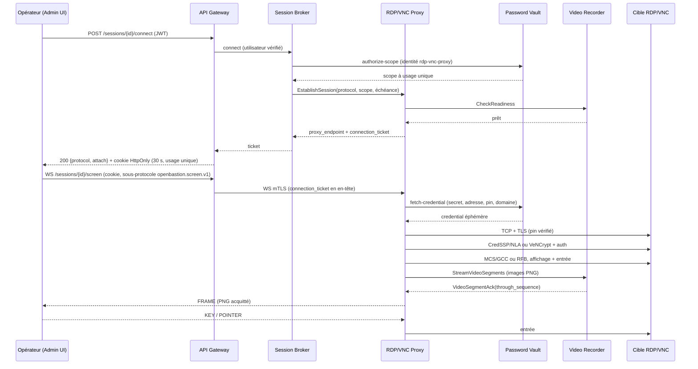

# ADR-0071 — Le proxy RDP/VNC termine la cible en Go pur et sert un flux écran acquitté

**Statut** `Accepté`, **mise en œuvre en cours** (validation contre une cible Windows réelle à réaliser) · 2 novembre 2026 · amende ADR-0069 (règles 1, 2 et 6) ; la contrainte TLS de production est précisée au §3 selon l'autorisation explicite de développement seulement

Le dépôt applique « concevoir avant de coder » : aucun code de proxy RDP/VNC n'est écrit tant que cet ADR n'est pas accepté.

## Reste à valider : une cible Windows réelle — 6 novembre 2026

**État au 8 novembre 2026** (passages CI #13 à #43, détaillés plus bas ; ADR-0086 pour la profondeur) :

| Point | État |
|---|---|
| Poignée de main, NLA, refus du §3 | **Établi** : CredSSP accepté, mauvais mot de passe refusé (`0xC000006D`), empreinte d'imposteur refusée avant tout octet CredSSP ; puis MCS, canaux, Client Info, licence, capacités et finalisation. |
| `request-mic` et séquences | **Établi** : Windows ne demande pas le MIC ; le client l'envoie non demandé, à la séquence 0, flux RC4 réinitialisé, `pubKeyAuth` à 1. |
| Fidélité des pixels, deltas RDP6 | **Établi à l'œil** : à 16 bpp (Interleaved RLE et non compressé) et à 32 bpp (RDP 6.0 planar, RLE et deltas, sur une seconde cible qui l'autorise par stratégie), écran, couleurs et texte fidèles (passage #48). Au passage #46, l'écran 32 bpp sortait blanc : Windows envoie un plan alpha de zéros, que le décodeur recopiait ; l'écran est désormais opaque. |
| Fragments Fast-Path | **Établi au passage #54** : dès que le client annonce `TS_MULTIFRAGMENTUPDATE_CAPABILITYSET` (256 Kio), Windows fragmente ses mises à jour (après la finalisation, 4 et 5 fragments à 16 bpp, 125 à 32 bpp) ; le client les réassemble (FIRST, NEXT…, LAST d'un même code, contigus, non compressés, 256 Kio et 64 morceaux au plus ; `pkg/rdp/fastpath_fragments.go`), et les trois cibles restent fidèles à l'œil (écran, saisie, reprise). Un fragment hors séquence, un code qui change, une taille dépassée ou une séquence qu'un TPKT interrompt ferment la session. Au passage #53, le codec passait, mais les isolements, qui lisent le flux eux-mêmes, refusaient le premier fragment : ils réassemblent désormais comme lui. |
| Réactivation | **Mise en œuvre, éprouvée contre FreeRDP ; jamais envoyée par Windows** (incrément 72). Mesuré à la PR #93 : le codec reprend la session déconnectée sans `Deactivate All`, aux trois cibles. Une cible qui exige le mot de passe à chaque connexion (`fPromptForPassword`) ne l'a pas exigé sous NLA : la session s'est ouverte avec les identifiants délégués. Aucun déclencheur reproductible n'est connu sur Windows. |
| Mises à jour non graphiques | **En partie** : pointeur (Fast-Path 5 et 9), Save Session Info, Set Error Info, toutes ignorées ou reconnues ; la liste reste fermée. |

**Reprise d'une session déjà ouverte : établie au passage #52.** Déconnectée, elle est rendue à la connexion suivante, même identifiant de session (3) et même écran (`pkg/rdp/mcs_windows_reconnect_test.go`). Active à la console (troisième cible de la matrice, qui garde la session que dockur ouvre) : la connexion la reprend (session 1), bureau à l'écran, saisie reçue. L'écran d'ouverture de session des passages #39 à #42 ne s'y reproduit pas : il tenait sans doute à une connexion arrivée pendant la préparation de la cible, non à la console ; un seul passage le mesure. Au passage #48, une saisie du test d'écran à 32 bpp a perdu « b » et Entrée : le client envoyait `KBDFLAGS_DOWN` à chaque appui, alors que ce drapeau dit que la touche était déjà enfoncée (une répétition) ; un appui n'en porte plus. Au passage #49, c'est le premier appui que le test perd, aux deux profondeurs : ce test envoyait chaque événement quelques microsecondes après le clic, quand l'isolement du clavier, une seconde après le sien, n'a perdu aucune touche en huit sessions. La cause probable est que Windows remet la touche à la fenêtre qui a le focus quand il la traite ; elle n'est pas prouvée. Le test tape désormais au rythme d'une personne (une seconde après le clic, 50 ms entre les événements). **Mesuré au passage #51** (`pkg/rdp/mcs_windows_keyafterclick_test.go`, trois essais par variante, clic sur le bureau puis dans le Bloc-notes, frappe aussitôt) : sans Synchronize Event, 5 essais complets sur 6 aux deux profondeurs ; avec un Synchronize Event à l'activation, 3 sur 6 ; avec un avant chaque clic, aucun complet. Le Synchronize Event n'évite pas la perte, et le client ne l'envoie pas. Des essais disparaissent en entier, Entrée comprise : les touches partent avant que la fenêtre ait le focus, ce que le client ne peut savoir. La saisie d'un opérateur, au rythme d'une personne, n'a perdu aucune touche. RDP reste non exposé.

VNC est livré. RDP est éprouvé contre FreeRDP 3.15 (incréments 70 et 71), jamais contre Windows : le critère de sortie de l'incrément 2 n'est pas tenu, et **RDP reste non exposé**. La machine Windows est en cours de mise en place par le propriétaire du projet. La validation devra établir :

- la poignée de main complète, Bureau à distance et NLA activés, et les refus d'ADR-0071 §3 sur cette cible ;
- si Windows demande `request-mic`, et comment il compte les séquences après : le passage à 1 n'est mesuré que sur FreeRDP ;
- la fidélité des pixels à fort contraste et la lisibilité du texte, masquées par un bogue de l'encodeur de FreeRDP ; et l'arithmétique des deltas RDP6, modulo 256 ici, saturée chez FreeRDP ;
- si une réactivation (`Deactivate All`) arrive en pratique chez Windows : le client la suit depuis l'incrément 72, éprouvé contre FreeRDP seulement (les fragments Fast-Path, eux, sont réassemblés depuis le passage #54) ;
- quelles mises à jour non graphiques Windows envoie, au regard de la liste fermée d'incrément 71.

**Comment, depuis le 7 novembre 2026** (demande du propriétaire du projet : « utilise `dockur/Windows` et configure un environnement Compose à lancer par la CI », sans lancement local) :

- **La cible** : Windows Server 2022, installé sans intervention dans une machine virtuelle KVM par `dockurr/windows` 6.06, épinglée par empreinte (ADR-0051) et suivie par Dependabot (`test/integration/testdata/rdp/windows/docker-compose.yml`). L'image télécharge l'ISO d'évaluation de Microsoft à chaque installation, soit 6 Go : aucun Windows n'est dans le dépôt ni dans une image. Seul le port RDP est publié, et seulement sur la boucle locale.
- **Le certificat n'est pas appris de la cible** : `prepare.sh` crée à chaque passage une autorité de test et le certificat RDP de `rdp-windows.test`, qu'`oem/rdp-setup.ps1` installe dans Windows à la fin de l'installation. Ce script garde NLA activé (`UserAuthentication=1`), TLS (`SecurityLayer=2`), et lance le Bloc-notes à chaque ouverture de session. Le test connaît donc l'empreinte et la racine avant que Windows démarre : ni apprentissage à la première connexion, ni `InsecureSkipVerify`. Il considère l'installation finie quand la cible présente ce certificat. Le mot de passe est tiré au hasard à chaque passage ; rien de tout cela n'est commité.
- **Le test** (`services/proxy/rdp-vnc-proxy/internal/engine/rdp_windows_interop_test.go`, `make test-rdp-windows`) rejoue ceux de FreeRDP contre Windows : CredSSP accepté, mauvais mot de passe refusé, empreinte d'imposteur refusée avant tout CredSSP ; puis l'écran, un clic et des touches dans le Bloc-notes, et l'écran qui change. Il dépose les images avant et après dans les artefacts du CI : la fidélité des pixels et la lisibilité du texte restent à juger par une personne. Il vaut aussi contre une autre machine Windows : il suffit des variables `RDP_WINDOWS_*`.
- **Le CI** (`.github/workflows/windows-rdp.yml`) : un runner `ubuntu-24.04` avec `/dev/kvm`, à la demande, chaque lundi, et sur une PR qui touche la cible, son test, `pkg/rdp` ou le codec RDP. **Ce n'est pas un contrôle requis** : une installation prend des dizaines de minutes. `oem/rdp-setup.ps1` copie aussi toutes les 30 s, en texte et en XML, les journaux RDP de Windows (RdpCoreTS, RemoteConnectionManager, LocalSessionManager, TermDD et Schannel du journal Système) dans le partage de dockur (`/shared`, `\\host.lan\Data` pour Windows) ; le CI les dépose dans l'artefact. Ce partage est anonyme, ce que Windows Server refuse par défaut : `AllowInsecureGuestAuth` n'est ouvert que sur cette machine de test.
- **Mesuré en CI au 8 novembre 2026** : le runner offre KVM et l'installation tient dans le disque et le temps donnés ; Windows présente le certificat épinglé ; Windows ne demande pas `request-mic`, mais coupe la connexion après un AUTHENTICATE NTLM portant un MIC sans mechListMIC SPNEGO : le client l'envoie donc non demandé, à la séquence 0, flux RC4 réinitialisé après lui ; `pubKeyAuth` à la séquence 1 est accepté et le mauvais mot de passe refusé (`0xC000006D`). `authInfo` est accepté : un `authInfo` altéré d'un octet fait fermer Windows sur-le-champ (alerte TLS), le vrai laisse la connexion ouverte, et le domaine de `TSPasswordCreds` (vide, `.` ou le nom NetBIOS) n'y change rien (`pkg/rdp/credssp_windows_isolation_test.go`). **Windows ferme ensuite la connexion 1 ms après le MCS Connect-Initial**, sans réponse ni alerte TLS, quelle que soit la variante essayée (`pkg/rdp/mcs_windows_isolation_test.go` : disposition du clavier, `CS_NET`, ordre des blocs, encodage des paramètres de domaine) ; la connexion est en TLS 1.2. Les journaux de Windows nomment la couche : à chaque Connect-Initial, `RDP_SEC` passe de `FStatePassthrough` à `FStateError` sur `FEventCheckAndCompleteReadsFailed` (`0x8007139F`, `ERROR_INVALID_STATE`), puis le socket est abandonné (1236, raison 4409) ; l'authentification réussie (1149) n'est jamais journalisée. Demander `SSL|HYBRID` n'y change rien ; avec `HYBRID_EX`, Windows envoie l'Early User Authorization Result `AUTHZ_SUCCESS`, puis ferme de même. Windows ne refuse donc pas le contenu du paquet, il ne s'attend pas à le lire. Un client de référence, FreeRDP 3 (`test/integration/testdata/rdp/windows/client/`, l'autorité de test installée et `/cert:deny`), ouvre une session complète sur la même machine : la cible est saine, la cause est dans ce client. FreeRDP fait CredSSP en NTLM direct, sans SPNEGO ; ce client le fait aussi dans l'isolement, Windows l'accepte, et ferme encore après le Connect-Initial. L'isolement envoie maintenant, après le CredSSP et le TLS de ce client, le Connect-Initial exact de FreeRDP, pris de son enregistrement en clair (qui contient le mot de passe et reste hors de l'artefact) : **Au passage #24, Windows répond (Connect-Response) au Connect-Initial de FreeRDP envoyé après le CredSSP et le TLS de ce client** : la cause est ce que dit le Connect-Initial de ce client. `pkg/rdp/mcs_windows_bisect_test.go` le bissecte. **Au passage #25, c'est le bloc `CS_CORE`** : le paquet de FreeRDP avec le `CS_CORE` de ce client est coupé, celui de ce client avec le `CS_CORE` de FreeRDP reçoit une Connect-Response que ce client accepte ; `CS_SECURITY`, `CS_CLUSTER` et l'absence de `CS_NET` n'y sont pour rien. Aucun champ de ce client, mis seul dans le `CS_CORE` de FreeRDP, ne le casse : c'est une combinaison, que la bisection cherche ensuite (ce `CS_CORE` avec un seul champ de FreeRDP, puis ceux de FreeRDP remplacés un à un, cumulativement). **Au passage #26, la paire est trouvée** : `supportedColorDepths` à 24 et 32 bpp seulement (`0x0009`) avec les `earlyCapabilityFlags` de ce client (`0x0003`). Les profondeurs de FreeRDP (`0x000F`) réparent seules ce `CS_CORE`, ses early capabilities aussi, et le cumul ne casse qu'au moment où les deux champs de ce client se rejoignent. **Correction** : le client annonce 15, 16, 24 et 32 bpp, comme FreeRDP et les clients Windows ; la session reste en 32 bpp (`WANT_32BPP`), et un Demand Active ou un bitmap d'une autre profondeur reste refusé, ce que les tests vérifient désormais pour 15 et 16 bpp. **Au passage #27, Windows répond au Connect-Initial de ce client** par une Connect-Response que ce client accepte. L'écran échoue ensuite 0,5 s plus loin, sur un `ErrMCSConnection` que toutes les étapes suivantes renvoient sans se nommer : le codec nomme désormais l'étape en échec (`RDP licensing: …`, sans changer le code de refus), et `pkg/rdp/mcs_windows_sequence_test.go` déroule la séquence étape par étape contre Windows, puis montre les paquets que Windows envoie après la licence. **Au passage #28, l'étape nommée est l'échange de capacités ; au #29, le Demand Active de Windows y propose 16 bpp** (`preferredBitsPerPixel` `0x0010`), que ce client refuse, puisqu'il ne décode que 32 bpp. Cela explique aussi la paire du #26 : sans pipeline graphique annoncé, Windows plafonne la session ; avec 24 et 32 bpp seuls il n'avait aucune profondeur commune, et FreeRDP, qui annonce le pipeline graphique (`RNS_UD_CS_SUPPORT_DYNVC_GFX_PROTOCOL`), y échappe. La cible de test relève sa configuration de profondeur avant tout changement (dans l'export des journaux), puis autorise 32 bpp (réglage RDP-Tcp et stratégie « Limit maximum color depth ») ; choix de la cible de test, réversible. **Au passage #30, c'est confirmé** : la cible, laissée par défaut, a `RDP-Tcp\ColorDepth` à 3 (16 bpp) et `fInheritColorDepth` à 0 ; la stratégie à 32 bpp suffit (la méthode WMI `SetColorDepthPolicy` est refusée, « Invalid operation »), et l'échange de capacités passe. L'étape suivante, la finalisation, échoue aussitôt ; l'isolement montre maintenant les paquets que Windows envoie après le Confirm Active, TPKT ou Fast-Path. **Au passage #31**, Windows répond au Confirm Active par un Set Error Info `0x000010EA` (`ERRINFO_BADCAPABILITIES`) et ferme. MS-RDPBCGR 2.2.7.1.2 dit que `bitmapCompressionFlag` « MUST be set to TRUE », et ce client l'envoie à 0 ; `pkg/rdp/mcs_windows_confirm_test.go` bissecte le Confirm Active contre les jeux de capacités de FreeRDP, pris de son enregistrement (refus : Set Error Info dans les 3 s ; acceptation : silence). **Au passage #32, la bisection le confirme** : `bitmapCompressionFlag` à TRUE suffit seul (le jeu Bitmap de FreeRDP aussi, qui ne diffère que par lui), et Windows enchaîne alors sur son Synchronize ; aucun autre jeu de FreeRDP n'y change rien. Le client l'annonce donc à TRUE. **Le choix de la profondeur est tranché par le propriétaire le 8 novembre 2026 (« Option 1, décode le 15/16 bpp ») : [ADR-0086](0086-le-client-rdp-decode-15-et-16-bpp-pour-les-cibles-windows-par-defaut.md)** ; la cible de test revient à ses réglages par défaut (16 bpp). **Au passage #39, tout le workflow est vert pour la première fois** : contre Windows laissé par défaut, en 16 bpp, le codec ouvre l'écran (61 trames pour se stabiliser, 73 en tout), les captures sont fidèles (couleurs, texte net, aucune tuile décalée) et l'écran change après la saisie. **Mais il ne prouve pas ce qu'il doit** : les captures montrent l'écran d'ouverture de session de Windows (« operator », mot de passe vide), et la saisie du test est allée dans ce champ (« The password is incorrect »). La cible n'a pas ouvert la session avec les identifiants envoyés, quand FreeRDP l'obtient sur la même machine ; pour un bastion, c'est rédhibitoire, l'opérateur ne devant jamais connaître le mot de passe. FreeRDP n'envoie pas `INFO_AUTOLOGON` (il s'en remet aux identifiants délégués par CredSSP) et ajoute d'autres drapeaux au Client Info ; `pkg/rdp/mcs_windows_logon_test.go` isole lesquels comptent. Le test d'écran doit aussi apprendre à refuser un écran d'ouverture de session. **Au passage #40**, avec `INFO_AUTOLOGON`, quels que soient les autres drapeaux, Windows reste 40 s sur son écran d'ouverture de session et n'envoie aucune notification d'ouverture ; sans lui, comme FreeRDP, l'écran devient noir et Windows coupe au bout de 5 trames : ce que donnent une ouverture de session qui commence et une réactivation (Deactivate All, puis un nouveau Demand Active) à laquelle personne ne répond. L'isolement y répond maintenant, pour le vérifier. **Au passage #41, Windows ouvre la session** : bureau et Bloc-notes à l'écran, notification d'ouverture de session (Save Session Info LOGON) pour les trois jeux de drapeaux, ceux du client compris, et aucune réactivation. L'écran d'ouverture de session des passages #39 et #40 tient donc à l'état de la machine, pas au client ; il reste à le comprendre, et le test d'écran doit apprendre à refuser un tel écran. Le clic du test active le Bloc-notes, mais les touches n'y laissent aucun texte : le client envoie `keyboardLayout` 0 dans `CS_CORE`, FreeRDP 0x409 ; `pkg/rdp/mcs_windows_keyboard_test.go` compare les deux. **Au passage #42**, la machine retombe sur son écran d'ouverture de session, et les touches y arrivent avec les deux dispositions (« The password is incorrect ») : le clavier n'est pas en cause. Ce qui varie d'un passage à l'autre, c'est l'état de la cible : dockur ouvre la session de l'utilisateur à la console pour lancer le script OEM, et le test la trouve ou non. La cible est désormais rendue au cas courant d'un serveur, sans session interactive : une tâche SYSTEM, une fois le script fini, ferme toute session, coupe l'ouverture automatique de dockur, puis seulement installe le certificat épinglé, qui dit au test que la cible est prête. Et le test d'écran exige que Windows ait dit que la session s'est ouverte (`CredSSPClientSession.LogonNotified`, la notification Save Session Info) : un écran d'ouverture de session ne passe plus. La reprise d'une session déjà ouverte reste à valider. **Au passage #43, la chaîne entière est prouvée** contre Windows Server 2022 laissé par défaut, sans session ouverte au départ : Windows ouvre la session avec les identifiants délégués et le notifie, l'écran 16 bpp est fidèle, et le texte tapé (« ob », Entrée) apparaît dans le Bloc-notes (`keyboard-0x0000.png`), le clic l'ayant activé. gopher-rdp reste connecté 40 s : la pile TLS de Go n'est pas en cause. gordp (`github.com/casvisor/gordp`, Apache-2.0, lu comme référence, rien n'en est repris) envoie la même version `0x00080004` que ce client, et rejoint FreeRDP là où ce client diffère : `postBeta2ColorDepth` `0xCA01`, `clientDigProductId` vide, `encryptionMethods` 0, `connectionType` valide, un `clientBuild`. Un second client de référence, gopher-rdp (Go, `crypto/tls`, CredSSP v6 avec SPNEGO, le profil de ce client ; licence MIT, jamais importé), à un commit épinglé relu avant de l'être et construit en Go pur (`test/integration/testdata/rdp/windows/gopher-rdp.sh`), se connecte aussi à chaque passage, à la demande du propriétaire : s'il obtient une session, la pile TLS de Go n'est pas en cause. Il ne vérifie pas le certificat de la cible (son choix) : il ne reçoit que le mot de passe aléatoire de la machine de test, sur la boucle locale.
- **Non vérifié à l'écriture** : rien n'a tourné. Le propriétaire n'a pas l'espace disque pour tirer l'image en local, et le premier passage du CI dira si le runner offre KVM, si l'installation tient dans le disque et le temps donnés, et si `rdp-setup.ps1` fait ce qu'il doit sur Windows. Cette section reste « à réaliser » tant que les cinq points ci-dessus ne sont pas établis sur ses résultats.

La section suivante date du 4 novembre et décrit l'état d'alors.

## État actuel de la pile RDP — 4 novembre 2026

Le transport `pkg/rdp/transport.go` effectue X.224, demande exclusivement `PROTOCOL_HYBRID` et ne retourne qu'après validation TLS (chaîne, nom et pin SHA-256). `Transport.EstablishCredSSP` orchestre sur cette connexion le dialogue SPNEGO/NTLMv2 strict : NEGOTIATE, CHALLENGE, AUTHENTICATE avec MIC et AV_PAIR target-name/channel-binding issus du pair TLS, `pubKeyAuth` v5/v6 scellé et vérification de la réponse serveur, puis délégation unique de `TSCredentials` mot de passe via `authInfo` scellé. Après cette délégation, `CredSSPClientSession.ConnectMCS` émet le MCS Connect-Initial avec GCC Conference-Create-Request et valide le MCS Connect-Response/GCC Conference-Create-Response dans un profil strict HYBRID sans canal virtuel.

**Limites actuelles :** la connexion s'arrête après Client Info (incrément 20) ; la phase Licensing n'est pas encore gérée. Erect Domain, Attach User, Channel Join et l'échange de capacités sont implémentés ; les mises à jour bitmap, les ordres graphiques et l'entrée ne sont pas implémentés. Le profil reste NTLM mot de passe uniquement ; Kerberos, SPNEGO `request-mic`/`mechListMIC`, carte à puce et Remote Guard sont refusés. Les tests bout en bout utilisent un serveur TLS factice et ne prouvent pas encore l'interopérabilité Windows/RDS réelle. Le runtime et la route RDP restent désactivés.

## Avancement d’implémentation — 3 novembre 2026 (état initial)

Le premier socle RDP est présent mais **ne constitue pas encore un moteur RDP utilisable** : `pkg/rdp/transport.go` effectue X.224, demande exclusivement `PROTOCOL_HYBRID` et valide TLS (chaîne, nom et empreinte SHA-256) avant de retourner un transport sans aucun champ credential. `pkg/rdp/credssp.go` ajoute maintenant l’encodage/décodage borné du conteneur ASN.1 DER `TSRequest` (versions 2 à 6, jetons SPNEGO opaques, `authInfo`, `pubKeyAuth`, `errorCode`, `clientNonce`), avec rejet des longueurs BER indéfinies, des longueurs DER non canoniques, des champs dupliqués/hors ordre et des payloads hors bornes.

**Limite à cette date :** aucun dialogue CredSSP complet n’était encore exécuté sur le transport. Les codecs NTLMSSP produisent les trois messages de négociation et le MIC du profil strict ; les hashes directionnels v5/v6 sont maintenant scellés dans le TSRequest final avec le dernier jeton SPNEGO et le nonce, et la réponse `pubKeyAuth` du serveur est vérifiée. Le dernier jeton est encore fourni par l’appelant : la machine d’état et les échanges TLS restent à orchestrer. `authInfo` n’est pas encore construit ni chiffré. Aucun secret n’est transmis par le runtime. Les challenges avec `MsvAvTimestamp` sont maintenant traités conformément à MS-NLMP (FILETIME serveur repris dans le blob et `LMChallengeResponse = Z(24)`) ; target-name et channel-bindings sont dérivés du pair TLS épinglé et sérialisés dans AUTHENTICATE ; MCS/GCC et l’affichage restent à faire. RDP reste désactivé dans le Broker/runtime.

Preuves du codec : round-trip DER, vecteur d’encodage initial, rejets ciblés de DER mal formé et fuzzing ; voir `pkg/rdp/credssp_test.go`. Ces tests de format ne prouvent pas encore l’interopérabilité avec Windows.

## Avancement d’implémentation — 3 novembre 2026 (SPNEGO)

`pkg/rdp/spnego.go` ajoute le décodage strict des deux formes SPNEGO utilisées par CredSSP : `InitialContextToken` / `NegTokenInit` et `NegTokenResp`. Les OID proposés et sélectionnés sont limités à NTLM (`1.3.6.1.4.1.311.2.2.10`) ; Kerberos et tout mécanisme inconnu sont refusés, sans repli. Les champs sont ordonnés, uniques et bornés ; les OID doivent être canoniques DER. Les états `reject` et `request-mic` sont refusés car aucune vérification de MIC n’est encore implémentée. Les jetons NTLM et MIC restent opaques : leur présence ne prouve aucune authentification.

Cette tranche n’implémente pas NTLMv2, n’accepte aucun mot de passe et ne branche pas le parseur au runtime. RDP reste désactivé. Les tests de format ne prouvent ni les preuves cryptographiques NTLMv2, ni l’interopérabilité Windows.

## Avancement d’implémentation — 3 novembre 2026 (NTLMv2)

`pkg/rdp/ntlmv2.go` ajoute les primitives NTLMv2 Go pures : dérivation `NTOWFv2` (MD4 du mot de passe UTF-16LE puis HMAC-MD5 de `Uppercase(username) + domain`), construction du blob de challenge, `NTProofStr`, réponse LMv2 et `SessionBaseKey`. Le challenge client de 8 octets est généré avec `crypto/rand`. `NTLMv2Response.Purge` efface les buffers et clés retournés ; les buffers intermédiaires manipulables sont effacés après usage.

`ParseNTLMv2AVPairs` exige un EOL final, borne la liste à 16 Kio et 64 attributs, refuse les doublons et valide les longueurs et UTF-16 des attributs connus ; les attributs inconnus restent opaques et bornés. NTLMv1/LMv1 n'est pas implémenté. `MsvAvTimestamp` est accepté : le FILETIME fourni par le serveur remplace l'horodatage local dans le blob NTLMv2 et impose `LMChallengeResponse = Z(24)`. `MsvAvTargetName` et `MsvAvChannelBindings` sont acceptés comme AV_PAIR client uniquement lorsqu'ils sont dérivés du pair TLS épinglé et ajoutés après le calcul de NTProof ; s'ils sont déjà présents dans le TargetInfo serveur, ils sont refusés. `MsvAvFlags.MIC_PRESENT` (bit `0x2`) est posé dans AUTHENTICATE après le calcul de la preuve. Aucun secret n'est transmis et le runtime RDP reste désactivé.

Le calcul est vérifié par le vecteur cryptographique publié dans MS-NLMP §4.2.4 (NTProofStr, LMv2 et SessionBaseKey), plus des cas négatifs et un fuzzer AV_PAIR. `NTProofStr` est la preuve calculée par le client ; NTLMv2 n’expose pas de preuve serveur distincte à vérifier dans cette couche. Ce vecteur ne prouve pas l’interopérabilité CredSSP/Windows ni l’authentification d’une session.

## Contexte

ADR-0069 (accepté) fixe les garanties du proxy RDP : terminaison côté cible, NLA/CredSSP obligatoire, empreinte du certificat TLS de la cible vérifiée **avant** l'envoi du mot de passe Vault, enregistrement vidéo obligatoire, canaux secondaires fermés, révocation et expiration réelles. ADR-0070 (accepté) livre le Video Recorder et son contrat de segments acquittés.

Trois constats, vérifiés dans le dépôt, rendent une autre conception nécessaire.

1. **La feuille de route demande RDP *et* VNC** (`docs/roadmap.md`, v0.0.1). ADR-0069 laisse VNC hors de son périmètre et exige une décision propre ; aucune décision ne couvre aujourd'hui VNC.
2. **cgo contredit le mode de livraison actuel.** ADR-0033 déploie des images statiques ; moteur RDP natif par cgo nécessiterait un compilateur C, des en-têtes et bibliothèques natives à l'exécution, et introduirait une surface que `-race` ne couvre pas entièrement. Ce sont exactement les coûts que le dépôt évite ailleurs.
3. **Un serveur RDP côté opérateur ne sert aucun client disponible.** L'Admin UI est un navigateur (ADR-0036) et le Desktop Client (Tauri) est sur la feuille de route. Il faudrait de toute façon un client RDP WASM ou desktop, explicitement hors périmètre d'ADR-0069.

État réel du code au 2 novembre 2026 :

- `pkg/rdp` ne contient que deux primitives Go (empreinte SHA-256 d'un DER, vérification d'une chaîne PEM) et un test natif conditionnel derrière cgo ; **aucun moteur, aucun service**.
- `pkg/mtls` réserve l'identité `rdp-proxy` ; le Video Recorder l'autorise sur `StreamVideoSegments` et `CheckReadiness`, mais aucun service ne la présente.
- `application.ProxySelector.Select` ne connaît que `ssh` ; `pkg/proxycore.Codec` est un relais `io.ReadWriter` (pertinent pour SSH, pas pour un flux graphique).
- `POST /sessions/{id}/connect` renvoie `proxyEndpoint`, `ticket`, `expiresAt` ; le ticket est consommé une fois par le proxy.
- ADR-0070 borne une image à 16 777 216 pixels et 4 Mio, un segment à 250 ms ou 4 Mio, et exige l'acquittement avant tout envoi à l'opérateur.

Invariants touchés : ADR-0003 (le secret reste dans le proxy), ADR-0008 (enregistrer ou refuser), ADR-0009 (break-glass), ADR-0010 (identité mTLS), ADR-0018 (terminer, c'est couper), ADR-0039 (reconnaître la cible avant le secret), ADR-0042 (codes de refus), ADR-0050 (transport), ADR-0070 (segments acquittés).

## Décision

### 1. Un service, deux moteurs Go purs, aucun natif

`services/proxy/rdp-vnc-proxy` sert les comptes Vault de protocole `rdp` et `vnc`. Son identité mTLS est `rdp-vnc-proxy` : la constante réservée `mtls.RDPProxy = "rdp-proxy"` est renommée `RDPVNCProxy = "rdp-vnc-proxy"` et les listes d'appelants du Video Recorder suivent (aucun service déployé ne présente l'ancienne identité). L'image reste statique et distroless : **aucun cgo, aucune bibliothèque native, aucun sous-processus**.

Le moteur est choisi par le **protocole du compte**, transmis par le Broker, jamais par le client. Le proxy refuse un protocole qu'il ne sert pas (`409`).

### 2. Le côté cible est un client de protocole écrit dans le dépôt

- `pkg/rdp` : sous-ensemble **client** RDP (X.224 + négociation, TLS, CredSSP/NLA NTLMv2, MCS/GCC, capacités, Client Info, bitmap updates, ordres de base, entrée, trame ; le cache de glyphes est écarté par ADR-0089).
- `pkg/vnc` : client RFB 3.8 (négociation, VeNCrypt/X.509, auth, encodages, framebuffer, entrée).
- `pkg/tlspin` : les primitives d'épinglage TLS actuelles de `pkg/rdp` y sont déplacées et partagées par les deux moteurs.

Aucun code de client RDP/VNC tiers n'est importé, copié ni lié. Seules la bibliothèque standard et `golang.org/x/crypto` sont utilisées (MD4 pour NTLMv2). Aucun binding cgo ni test natif lié à un moteur externe n'est conservé dans cette architecture Go pure.

Le côté opérateur utilise le flux écran défini à la décision 4 ; aucun serveur RDP n'est exposé à l'opérateur.

### 3. RDP vers la cible : sous-ensemble strict, refus par défaut

La connexion cible est un client RDP qui n'accepte que ce sous-ensemble. Tout le reste est refusé, jamais dégradé.

| Couche | Accepté | Refusé (fermé) |
|---|---|---|
| Transport | TCP vers `host:port` du compte, X.224 + RDP Negotiation | port implicite, cible différente du credential |
| Sécurité négociée | `PROTOCOL_HYBRID` (TLS + CredSSP) | `PROTOCOL_RDP` (sécurité standard), `PROTOCOL_SSL` seul, `PROTOCOL_RDSTLS` |
| TLS | TLS ≥ 1.2, **pin SHA-256 de la feuille** | chaîne système, nom DNS/CN, confiance au premier usage |
| Authentification | CredSSP/NLA, NTLMv2, domaine optionnel (vide = compte local) | NTLMv1, LM, mot de passe du client, repli sans NLA |
| MCS/GCC | canal d'E/S et canal utilisateur, **zéro canal virtuel** | `cliprdr`, `rdpdr`, `rdpsnd`, `drdynvc`, `rdpecam`, tout canal virtuel |
| Capacités | 32 bpp, bitmap RAW + RLE (RDP6), ordres de base, cache bitmap borné (v2/v3) ; pas de cache de glyphes (ADR-0089) | RemoteFX, EGFX, NSCodec, cache hors écran, multi-moniteurs |
| Ordres | DstBlt, PatBlt, ScrBlt, MemBlt, Mem3Blt, LineTo, PolygonSC, PolygonCB, EllipseSC, EllipseCB, OpaqueRect, SaveBitmap, MultiDstBlt, MultiPatBlt, MultiScrBlt, MultiOpaqueRect | tout ordre non annoncé : la session est refusée |
| Entrée | `TS_INPUT_PDU` (scancodes, souris) | fastpath input et Unicode input dans le premier incrément |
| Affichage | un moniteur, redimensionnement borné | multi-moniteurs, bureau au-delà de 16 777 216 px |
| Fin | MCS Disconnect Provider Ultimatum, TLS `close_notify` | — |

Le certificat TLS de la cible est vérifié avant le premier octet CredSSP ; une empreinte absente, mal formée ou différente ferme la connexion et écrit `session.tls_certificate_mismatch` à l'audit. `pkg/tlspin.ServerConfig` en production exige un `RootCAs` explicitement configuré et un `ServerName` : la validation standard de chaîne et de nom reste active, et `VerifyConnection` ajoute le contrôle du pin de la feuille. Aucun recours implicite aux racines système. En conséquence, un certificat auto-signé n'est accepté en production que si sa confiance est explicitement configurée dans `RootCAs`.

**Dérogation limitée au développement.** L'utilisateur autorise `InsecureSkipVerify: true` uniquement en développement. `tlspin.DevelopmentServerConfig` est donc compilé seulement avec `-tags development`, impose le contrôle du pin dans `VerifyConnection` et n'est pas disponible dans les binaires de production. Aucun autre `tls.Config` n'est concerné ; le dialogue interne reste en TLS 1.3 mutuel. Cette contrainte remplace, pour l'implémentation, la proposition initiale d'utiliser le pin comme seule ancre en production.

### 4. Le côté opérateur n'est ni RDP ni VNC : un flux écran unique

Ce point **amende la règle 2 d'ADR-0069 pour le seul segment aval**. Le segment cible conserve toutes ses garanties : NLA, pin avant secret, enregistrement obligatoire, canaux secondaires fermés, révocation, expiration.

L'opérateur reçoit un **flux binaire en WebSocket**, servi par l'API Gateway sur l'origine unique de l'Admin UI. Le flux transporte :

- des images **PNG complètes**, exactement les octets que le Video Recorder a acquittés (ADR-0070), avec séquence et horodatage UTC ;
- les événements d'entrée normalisés (clavier, souris), validés et bornés côté proxy.

Aucun serveur RDP/VNC, aucun client WASM, aucun client externe. Le Desktop Client pourra réutiliser le même contrat. Ce choix évite une surface « peer serveur » RDP et rend l'affichage identique à l'enregistrement : ce que l'opérateur voit est, à l'octet près, ce qui est rejoué.

### 5. VNC vers la cible : VeNCrypt/X.509 seulement

- RFB **3.8** uniquement (`RFB 003.008`) ; 3.3 et 3.7 sont refusés.
- Sécurité : **VeNCrypt 0.2**, sous-types **X509Vnc (261)** et **X509Plain (262)**, TLS ≥ 1.2 et même pin SHA-256 de la feuille. `None` (1), `VNC Authentication` (2) sans TLS, `TLS` (18) seul, RA2/RA2ne/Tight/Ultra sont refusés.
- `X509Plain` (nom d'utilisateur + mot de passe dans TLS) est préféré ; `X509Vnc` n'est accepté que si le mot de passe Vault fait **au plus 8 octets** — un mot de passe plus long serait tronqué en silence par l'authentification VNC historique, ce qui affaiblit le secret : il est refusé.
- Format pixel : true colour 32 bpp uniquement (`SetPixelFormat` si le serveur annonce autre chose).
- Encodages demandés : Raw, CopyRect, DesktopSize, ExtendedDesktopSize, Cursor, LastRect. Tight, ZRLE, Zlib, Hextile, JPEG et H.264 sont refusés.
- `ServerCutText` et `Bell` sont ignorés ; aucun `ClientCutText` n'est envoyé (presse-papiers fermé).
- Un seul écran ; ExtendedDesktopSize à plusieurs moniteurs est refusé. Bornes : 16 777 216 px, framebuffer 64 Mio (16 777 216 × 4 octets), rectangle d'update dans les bornes.

### 6. Le flux écran : contrat binaire, versionné, borné

Une seule version (`openbastion.screen.v1`). Trame serveur → client :

| Octet | Champ | Valeur |
|---|---|---|
| 0 | version | `1` |
| 1 | type | `1` FRAME, `2` HELLO, `3` END |
| 2–3 | drapeaux | `0` |
| 4–11 | séquence | `uint64`, croissante, à partir de 1 |
| 12–19 | horodatage | `int64` Unix nanosecondes, UTC |
| 20–23 | largeur | `uint32` |
| 24–27 | hauteur | `uint32` |
| 28–31 | longueur PNG | `uint32`, ≤ 4 194 304 |
| 32… | PNG | octets acquittés par le recorder |

`HELLO` est le préambule de contrôle de séquence `0` ; les `FRAME` commencent à `1` et sont strictement croissants ; `END` utilise le prochain numéro après la dernière frame acquittée (ou `1` si aucune frame n'a été envoyée). `HELLO` porte en plus le protocole (`u8` : `1` RDP, `2` VNC), un octet réservé, l'échéance de session (`u64`, Unix), la longueur de l'identifiant (`u32`) et l'identifiant de session. `END` porte un code stable (`u16`, voir §12), la longueur du texte (`u16`) et un texte UTF-8 de 200 octets au plus, jamais une cause interne.

Entrée client → serveur, message fixe de 16 octets : version, type (`1` KEY, `2` POINTER, `3` RELEASE_ALL), drapeaux (`KEY` : appui/relâchement), `keysym` X11, scancode PS/2 set 1, coordonnées, boutons, molette. Tout message de plus de 64 octets, tout type inconnu, toute coordonnée hors trame, tout bouton hors masque, toute touche hors table **ferme la session** — l'entrée n'est jamais interprétée « au mieux ».

Le client envoie `RELEASE_ALL` quand il perd le focus (pas de touche collée). L'entrée n'est **jamais journalisée ni enregistrée** (ADR-0069, règle 6) ; seules les erreurs de validation sans contenu sont tracées.

Un débit d'entrée par session est proposé (`SCREEN_INPUT_RATE_PER_SECOND=200`, `SCREEN_INPUT_BURST=400`) ; les déplacements de souris au-delà sont coalescés, un flux de touches au-delà ferme la session.

### 7. Le rattachement est à usage unique et ne met aucun secret dans une URL

Le contrat exact qu'ADR-0069 laissait à définir :

1. `POST /sessions/{id}/connect` (route existante, budget ADR-0016) reste le seul point d'entrée. Pour `ssh`, la réponse ne change pas. Pour `rdp`/`vnc`, elle devient `{protocol, attach, expiresAt}` — `expiresAt` est celle de l'attache (au plus 30 secondes), l'échéance de la session est dans `HELLO` — et l'adresse interne du proxy n'est **pas** exposée au navigateur.
2. La Gateway garde en mémoire, pour 30 s au plus et une fois, le couple `{proxy_endpoint, connection_ticket}` du Broker, indexé par une valeur aléatoire de 256 bits liée à la session et à l'utilisateur vérifié. Cette valeur part dans un **cookie `HttpOnly`, `Secure`, `SameSite=Strict`**, de chemin `/sessions/{id}/screen` et de durée 30 s ; le corps de la réponse ne la porte jamais, donc elle n'est ni dans JavaScript, ni dans une URL, ni dans un journal applicatif.
3. Le navigateur ouvre `GET /sessions/{id}/screen` en WebSocket avec le sous-protocole `openbastion.screen.v1` ; le navigateur envoie le cookie. La Gateway le consomme atomiquement, ouvre un WebSocket mTLS vers le proxy et y présente le `connection_ticket` dans un en-tête `Authorization`.
4. Le proxy consomme ce ticket une fois (même registre que le proxy SSH, avec le protocole dans l'entrée), vérifie `LiveSessions` (session révoquée ⇒ refus) puis exécute le pipeline.
5. Un cookie rejoué, expiré ou inconnu est refusé ; un nouveau `connect` pour la même session invalide l'attache précédente ; une révocation jette les tickets non utilisés (ADR-0018).

Limite assumée : la table des attaches est en mémoire, donc la Gateway reste à une instance dans le MVP — comme ses budgets de débit (ADR-0014/0016). Une Gateway redémarrée demande un nouveau `connect` ; la session reste active jusqu'à son échéance.

### 8. Le Video Recorder et ADR-0070 ne changent pas

Le proxy est un nouveau client de `StreamVideoSegments` et `CheckReadiness`, sous l'identité `rdp-vnc-proxy` ; les listes d'appelants du Video Recorder sont mises à jour et ses tests avec elles. Les règles d'ADR-0070 sont reprises telles quelles : séquences à partir de 1, strictement croissantes, segment ≤ 250 ms ou 4 Mio, un seul segment en vol, acquittement après persistance durable, marqueur terminal, aucun tampon local, `session.recording_lost` sinon.

Le proxy clôt un segment à l'intervalle de capture (`SCREEN_FRAME_INTERVAL_MS=50`, borné à [16, 250]) ou à la borne de 4 Mio, et n'envoie à l'opérateur que les images **acquittées**. Une image PNG de plus de 4 Mio ou un dépassement de la borne de pixels ferme la session et écrit `session.recording_lost` — ADR-0070 ne permet ni troncature ni `best-effort`.

Aucune dérogation break-glass pour les écrans : ADR-0069 règle 5 l'interdit. Le proxy n'appelle que `Admit`, jamais `AdmitSession(breakGlass=true)` ; le Broker refuse de créer une session break-glass `rdp`/`vnc`.

### 9. Le Vault épingle le certificat TLS comme il épingle la clé d'hôte

- Migration `008_screen_targets.sql` : `tls_certificate_sha256 TEXT NOT NULL DEFAULT ''` et `target_domain TEXT NOT NULL DEFAULT ''` sur `privileged_accounts`.
- `FetchCredentialResponse` gagne, de façon additive, `string tls_certificate_sha256 = 6` et `string target_domain = 7` ; `proxycore.Credential` les porte et les purge avec le reste.
- `SetTLSPin` (RPC + `PUT /vault/accounts/{id}/tls-pin`) : empreinte SHA-256 hexadécimale de 64 caractères, refusée si vide, mal formée ou posée sur un compte `ssh`. Le changement est **audité avant d'être appliqué** (`vault.tls_pin_set`), comme l'épinglage SSH (ADR-0039) ; la réponse donne l'empreinte, jamais un secret.
- Un compte `rdp`/`vnc` sans empreinte n'ouvre aucune session : `authorize-scope` répond `409` avec le code stable `no_pinned_tls_certificate` (ADR-0042), et `connect` le traduit pour l'opérateur. Le Broker refuse aussi la **création** de la session sur un tel compte, comme ADR-0043 le fait pour la clé d'hôte : une session qui ne pourrait jamais se connecter n'est pas créée.
- `target_host` reste `host:port`, comme pour SSH ; aucun port par défaut implicite. Le pin fait foi, pas le nom DNS.

### 10. Le Broker route par protocole, la Gateway sert le rattachement

- `ProxySelector.Select` mappe `ssh → ssh-proxy`, `rdp|vnc → rdp-vnc-proxy`, tout le reste refusé.
- **Le protocole d'une session est celui du compte privilégié, pas celui du corps de la requête.** Aujourd'hui `POST /sessions` recopie la valeur fournie par le client sans la confronter au compte (`createSession`, `session_broker_service.go`) ; avec plusieurs familles de proxy, cet écart devient un routage choisi par le client. Le Broker refuse une valeur qui diffère du compte (`409`), ne route que sur la valeur du compte, et `AccountLookup` expose le protocole du compte pour le faire. Le proxy refuse de son côté tout protocole qu'il ne sert pas.
- Le Broker tient un pool par famille de proxy (`SSH_PROXY_URLS`, `RDP_VNC_PROXY_URLS`, 1 à 16 instances, ADR-0046) et appelle la famille de la session, y compris pour la révocation.
- `EstablishSessionRequest` gagne `string protocol = 8` (additif). Le proxy stocke le protocole avec le ticket ; le Broker ne l'envoie pas au moteur par le credential. La réponse interne du Broker à `connect` porte le protocole, pour que la Gateway sache quelle forme de `ConnectionTicket` rendre.
- La Gateway gagne la route WebSocket `/sessions/{id}/screen`, la table bornée des attaches et le relais WebSocket mTLS. Elle refuse une origine non déclarée (`SCREEN_ALLOWED_ORIGINS`, défaut : même origine), désactive la compression (`permessage-deflate`), borne la taille des messages, n'accepte que le binaire et borne les attaches (un par session et par utilisateur, dix upgrades par minute et par utilisateur, propositions).
- Le contrat `ConnectionTicket` d'OpenAPI gagne les champs `protocol` et `attach` ; `proxyEndpoint` et `ticket` restent pour SSH. Le cookie d'attache est posé par la Gateway, hors du corps.

### 11. Le pipeline partagé est réutilisé, pas dupliqué

`pkg/proxycore` gagne un chemin « écran » qui réutilise **exactement** le cycle de vie de `Listener.Serve` : `Live.Begin` (révocation possible), admission d'enregistrement, récupération du credential, échéance, révocation, audit, purge. Refactor minimal : la partie commune est extraite dans une fonction interne qui prend une closure de relais ; `Serve` (SSH) passe `codec.Relay`, `ServeScreen` passe le relais écran. Les tests SSH existants sont la garde de la non-régression.

Ports ajoutés (noms proposés, figés à l'implémentation) :

```go
type ScreenCodec interface {
    Open(ctx context.Context, cred *Credential) (ScreenSession, error)
}

type ScreenSession interface {
    Frames() <-chan Frame // fermée à la fin ; Err dit pourquoi
    Input(Event) error
    Err() error
    Close() error
}

type FrameRecorder interface {
    Record(ctx context.Context, sessionID string, f Frame) (throughSequence uint64, err error)
    Seal(ctx context.Context, sessionID string, throughSequence uint64) error
}

type ScreenSink interface {
    Send(ctx context.Context, msg ScreenMessage) error
}
```

Le relais écran (dans `proxycore`) : image → `Record` (bloque jusqu'à l'acquittement) → `Sink.Send` ; une seule image en attente d'affichage, remplacée par la plus récente si le client est lent (les images sont complètes ; l'enregistrement, lui, ne perd rien). Une erreur, un acquittement ambigu ou un dépassement ferme les deux côtés.

### 12. Refus : codes stables, aucune cause interne

Avant le WebSocket, `connect` répond `409`/`503` selon ADR-0042. Après le WebSocket, `END` porte l'un de ces codes : `session_ended`, `pin_missing`, `pin_mismatch`, `tls_required`, `nla_required`, `protocol_version_unsupported`, `codec_unsupported`, `recording_unavailable`, `recording_lost`, `ticket_invalid`, `input_invalid`, `session_expired`, `session_revoked`, `target_unreachable`. Le texte est court, stable, sans adresse, sans nom interne, sans cause de panne.

### 13. Dépendances : deux ajouts, soumis à la policy

- `golang.org/x/crypto` (MD4 uniquement) dans `pkg/rdp` — déjà épinglé à `v0.58.0` dans le graphe du dépôt ; aucune nouvelle version.
- `github.com/coder/websocket` (MIT, sans dépendance, contextuel) dans la Gateway et le proxy — pour le serveur *et* le client WebSocket, plutôt qu'une implémentation RFC 6455 écrite à la main.

`.agents/policies/dependencies-and-supply-chain.md` §2 exige un accord nommé avant tout ajout : **le go demandé pour cet ADR vaut accord pour ces deux dépendances**, à leurs versions épinglées et vérifiées. À défaut, la Gateway et le proxy restent sans WebSocket et aucun incrément ne se livre.

### 14. Ce qui est refusé par principe

RDP sans NLA, TLS seul ou sécurité standard ; VNC sans VeNCrypt/X.509 ; pin absent ou différent ; recorder indisponible ou en retard d'acquittement ; break-glass pour un écran ; presse-papiers, audio, lecteurs, imprimantes, cartes à puce, caméra, multi-moniteurs ; RemoteFX/EGFX ; client RDP/VNC externe ; image > 4 Mio ou > 16 777 216 px ; tout PDU, encodage ou ordre hors du sous-ensemble annoncé ; toute session non révocable (`proxycore.LiveSessions` absent).

## Architecture et contrats

### Vue d'ensemble



### Flux de décision du moteur

| Protocole du compte | Moteur | Négociation obligatoire | Secret envoyé après |
|---|---|---|---|
| `rdp` | `pkg/rdp` | `PROTOCOL_HYBRID` | TLS + pin, puis CredSSP |
| `vnc` | `pkg/vnc` | VeNCrypt X509Vnc/X509Plain | TLS + pin, puis auth VNC/Plain |
| `ssh` | inchangé (`services/proxy/ssh-proxy`) | clé d'hôte épinglée (ADR-0039) | vérification de la clé d'hôte |

### Données et contrats

| Élément | Changement |
|---|---|
| `privileged_accounts` | `tls_certificate_sha256`, `target_domain` (migration 008) |
| `proto/vault/v1` | `FetchCredentialResponse` champs 6 et 7 ; `SetTLSPin` ; `PrivilegedAccount.tls_certificate_fingerprint` |
| `proto/proxy/v1` | `EstablishSessionRequest.protocol = 8` |
| `docs/api/rest/openapi.yaml` | `ConnectionTicket` étendu (`protocol`, `attach`), en-tête `Set-Cookie` de l'attache ; `PUT /vault/accounts/{id}/tls-pin` ; codes de refus |
| Audit | `session.tls_certificate_mismatch` (proxy), `vault.tls_pin_set` (Vault), plus les événements existants |
| Identités mTLS | `rdp-vnc-proxy` (remplace la constante réservée `rdp-proxy`) |
| Ports | proxy 8090 (contrôle + WebSocket, mTLS) ; la Gateway reste 8080 ; le SSH proxy reste 8085/2222 |

### Configuration proposée

| Variable | Défaut | Rôle |
|---|---|---|
| `VIDEO_RECORDER_URL` | aucune | obligatoire sous `RECORDING_POLICY=required` (défaut) |
| `RECORDING_POLICY` | `required` | inchangé ; `best-effort` est refusé pour les écrans |
| `SCREEN_FRAME_INTERVAL_MS` | `50` | cadence des images, VNC et RDP : au plus une image par intervalle ; borné à [16, 250] |
| `SCREEN_MAX_PIXELS` | `16777216` | borne de trame (ADR-0070) |

| `SCREEN_FRAME_INTERVAL_MS` | `50` | clôture d'un segment ; borné à [16, 250] |
| (constante) `screenstream.MaxPixels` | `16777216` | borne de trame (ADR-0070) ; **pas une variable** : elle ne pourrait que monter au-delà de ce que le contrat écran et le Video Recorder acceptent |
| `SCREEN_INPUT_RATE_PER_SECOND` | `200` | débit d'entrée par session |
| `SCREEN_INPUT_BURST` | `400` | rafale d'entrée |
| `RDP_VNC_PROXY_URLS` | aucune | pool du Broker, 1 à 16 |
| (constante de la Gateway) | `30` | durée de vie du cookie d'attache ; **pas une variable** : §7 la borne à 30 s au plus, un réglage ne pourrait que l'allonger |
| `SCREEN_ALLOWED_ORIGINS` | vide (même origine) | origines WebSocket acceptées |
| `RDP_CONNECT_TIMEOUT_SECONDS` | `15` | poignée de main cible (CredSSP compris) |
| `VNC_CONNECT_TIMEOUT_SECONDS` | `10` | poignée de main cible |
| `RDP_ENABLED` | `false` | Broker et proxy (ADR-0088, qui remplace `RDP_ENGINE_ENABLED`) : ouvre `rdp` aux opérateurs ; seuls `true` et `false` sont lus, toute autre valeur est fatale |

Toute valeur absente, hors bornes ou inconnue est fatale au démarrage (`settings/security.yaml`, règle « défaut strict »).

## Plan d'implémentation

Le sous-ensemble RDP est le chemin long : il demande la pile MCS/GCC, CredSSP/NTLMv2, les capacités, les bitmap updates, les ordres de base et le cache de glyphes. Les incréments ci-dessous livrent d'abord un écran utilisable en VNC, puis RDP, sans jamais exposer un protocole avant que son chemin pin + auth + enregistrement soit prouvé.

### Incrément 0 — contrats et fondations (aucun protocole réel)

Contenu : champs proto, migration 008 + `SetTLSPin`, `pkg/tlspin`, `pkg/screenstream`, `ProxySelector` + pool du Broker, identité `rdp-vnc-proxy`, chemin `ServeScreen` de `proxycore` avec un moteur factice, relais WebSocket de la Gateway avec une source factice, page écran de l'Admin UI avec un flux factice, client gRPC du Video Recorder. Dans le bac à sable Base44, le relais Vite de `/sessions` doit passer `ws: true` sous `BASE44_PREVIEW_MODE=1` (le WebSocket est alors sur la même origine que l'UI) et `SCREEN_ALLOWED_ORIGINS` doit couvrir l'origine publique du bac à sable, construite depuis `BASE44_PUBLIC_HOST_SUFFIX`, jamais écrite en dur ; sans le drapeau, `vite build` et la Gateway de production ne changent pas.

Critères de sortie : un moteur factice traverse ticket → admission → enregistrement → acquittement → affichage → révocation/expiration ; les tests SSH existants passent sans modification ; aucun secret dans les journaux ; `go test ./...` et `make vet` verts.

### Incrément 1 — VNC de bout en bout

Contenu : `pkg/vnc` complet du sous-ensemble §5 ; adaptateur `internal/engine/vnc.go` ; serveur RFB factice pour les tests ; cible TigerVNC réelle en test optionnel ; page UI avec clavier/souris.

Critères de sortie : session VNC depuis l'UI, enregistrée dans le Video Recorder et rejouable ; imposteur TLS, absence de VeNCrypt, mauvais mot de passe, mot de passe > 8 octets en `X509Vnc`, encodage non demandé, rectangle hors bornes : tous refusés avec le code attendu ; révocation et expiration coupent la cible et le WebSocket ; tests d'attaque rouges avant la garde, mutations tuées.

### Incrément 2 — RDP : poignée de main et affichage (non exposé)

Contenu : X.224 + négociation, TLS pin, CredSSP/NTLMv2, MCS/GCC, Client Info, capacités, bitmap updates RAW/RLE, trame ; **aucune route opérateur** (le drapeau `RDP_ENGINE_ENABLED` reste faux et le Broker n'annonce pas `rdp`).

Critères de sortie : poignée de main contre serveur factice et cible Windows réelle ; refus de `PROTOCOL_RDP`, de TLS seul, de NTLMv1, d'un certificat imposteur (aucun octet CredSSP émis) ; affichage d'une mire statique ; limites de PDU et de bitmap prouvées ; fuzz des parseurs sans panique.

### Incrément 3 — RDP : ordres, glyphes, entrée, utilisable

Contenu : ordres de base (le cache de glyphes est écarté par ADR-0089), pointeur, entrée slow-path, redimensionnement, activation de la route opérateur et du protocole côté Broker.

Critères de sortie : session RDP interactive enregistrée et rejouable ; texte lisible (par bitmaps, ADR-0089) ; aucune capacité non annoncée acceptée ; clavier AZERTY et QWERTY vérifiés ; touche relâchée sur perte de focus ; `session.recording_lost` sur image > 4 Mio.

### Incrément 4 — durcissement et preuves

Contenu : fuzzers de chaque parseur (RDP, CredSSP, NTLM, RFB, VeNCrypt) pendant 30 s en CI, mutations sur chaque garantie, `-race`, `govulncheck`, matrice de cibles réelles (Windows Server 2019/2022, TigerVNC, RealVNC), test de charge et mesures de latence/mémoire, documentation (OpenAPI, `docs/api/grpc`, `data-architecture`, `known-limitations`, `.agents/`).

Critères de sortie : portes de fin du dépôt ; chaque garantie a son test d'attaque et sa contre-épreuve ; les chiffres écrits sont mesurés ; les limites restantes sont listées.

### Incrément 5 — performance et grands écrans (hors premier périmètre)

Mesurer l'encodage PNG, l'intervalle de capture, la latence d'acquittement et la mémoire ; décider ensuite, par un ADR si nécessaire, d'un découpage en tuiles ou d'une révision de la borne de 4 Mio d'ADR-0070. Aucun chiffre n'est promis avant mesure.

### Fichiers touchés (indicatif)

| Emplacement | Contenu |
|---|---|
| `pkg/tlspin/` | pin SHA-256 et vérification PEM, déplacés de `pkg/rdp` |
| `pkg/rdp/` | client RDP en couches (x224, credssp, ntlm, mcs, gcc, capability, orders, bitmap, input, session) |
| `pkg/vnc/` | client RFB/VeNCrypt (handshake, security, encodages, framebuffer, input) |
| `pkg/screenstream/` | codec binaire des trames et des événements d'entrée, bornes partagées |
| `pkg/proxycore/screen.go` | ports `ScreenCodec`/`ScreenSession`/`FrameRecorder`/`ScreenSink`, `ServeScreen`, refactor du cycle de vie commun |
| `services/proxy/rdp-vnc-proxy/` | `cmd/`, `internal/engine/{rdp,vnc}`, `internal/infrastructure/{vault,audit,video_recorder,tickets}`, `internal/interfaces/{http,ws,callers}` |
| `services/access/api-gateway/internal/interfaces/screen.go` | route WS, table des attaches et cookie `HttpOnly`, relais mTLS |
| `services/access/session-broker/` | `ProxySelector`, pool par famille, protocole du compte, réponse de `connect` |
| `services/vault/password-vault/` | migration `008_screen_targets.sql`, `SetTLSPin`, champs de compte, client `FetchCredential` |
| `proto/vault/v1/vault.proto`, `proto/proxy/v1/proxy_control.proto` | champs et RPC additifs |
| `web/admin-ui/src/screens/` | canvas, décodage PNG, table clavier, pointeur, états (connexion, fin, reconnexion) |
| `pkg/mtls/identity.go`, `deploy/docker-compose/pki.sh`, `deploy/base44/docker-compose.yml` | identité, certificats, service de développement |
| `docs/api/rest/openapi.yaml`, `docs/api/grpc/README.md`, `docs/architecture/data-architecture.md`, `docs/security/known-limitations.md`, `.agents/` | contrats, modèle, limites et instructions tenus à jour dans le même commit que le code |

## Tests et preuves attendues

| Attaque ou panne | Test | Ce qu'il prouve |
|---|---|---|
| Certificat imposteur | serveur TLS avec une autre feuille ; le serveur factice n'observe aucun octet applicatif | le pin précède CredSSP |
| Empreinte absente ou mal formée | compte sans pin, puis pin non hexadécimal | refus fail-closed, aucun TCP vers la cible |
| RDP sans NLA | serveur qui sélectionne `PROTOCOL_SSL` ou `PROTOCOL_RDP` | refus, aucun mot de passe |
| NTLMv1 seulement | serveur factice | refus |
| VNC sans VeNCrypt | serveur RFB `None`/`VNC auth` | refus, aucun mot de passe |
| Mot de passe VNC > 8 octets en `X509Vnc` | compte correspondant | refus, pas de troncature silencieuse |
| Recorder arrêté | cible factice qui compte les connexions | zéro connexion cible, `session.recording_unavailable` |
| Acquittement perdu ou ambigu | recorder factice qui ne répond pas | session fermée, aucune image non acquittée affichée, `session.recording_lost` |
| Révocation pendant une trame | `TerminateSession` concurrent | cible fermée, WebSocket `END(session_revoked)` |
| Cookie d'attache rejoué | second upgrade avec le même cookie | refus, aucun second flux |
| PDU hostile | fuzz + PDU de taille maximale + 1 | pas de panique, pas d'allocation non bornée, session fermée |
| Entrée hors bornes / flood | coordonnées, boutons, type inconnu, rafale | session fermée ou événement coalescé, jamais d'effet hors trame |
| Presse-papiers | tentative `ClientCutText`, canal `cliprdr` | aucun canal ouvert, aucun texte transmis |
| Divergence affichage/enregistrement | recorder et client factices comparent les octets | l'image affichée est exactement l'image acquittée |

Chaque garantie est mesurée **rouge avant** sa garde (même branche, commit précédent) puis verte, et une mutation qui retire la garde doit tuer le test. Les cibles réelles sont optionnelles (`OPENBASTION_RDP_TARGET`, `OPENBASTION_VNC_TARGET`) et ne remplacent pas les serveurs factices : elles prouvent l'interopérabilité, pas les refus.

## Conséquences

- (+) Le proxy RDP/VNC reste dans le mode de livraison du dépôt : Go pur, image statique distroless, pas de compilateur C, pas d'ABI native, tests sous `-race` qui couvrent tout le code exécuté.
- (+) RDP et VNC partagent un seul côté opérateur, un seul pipeline de compte rendu et un seul enregistrement ; l'image affichée est l'image acquittée, octet pour octet.
- (+) Le pin TLS précède le secret pour les deux protocoles, sans dépendre de la chaîne système ni du DNS.
- (+) Le contrat de rattachement est défini : ticket à usage unique, jamais dans une URL, jamais dans un journal, révocable avec la session.
- (+) La révocation, l'expiration, la purge du credential, les codes de refus et l'audit réutilisent le pipeline déjà éprouvé par SSH ; le refactor de `proxycore` est gardé par les tests SSH existants.
- (−) **Le sous-ensemble RDP est un vrai travail de protocole** : MCS/GCC, CredSSP/NTLMv2, capacités, bitmap updates, ordres de base, cache de glyphes. C'est le chemin long ; aucun calendrier n'est promis.
- (−) Aucune mesure de latence, de débit, de mémoire ni de compatibilité avec un parc Windows réel n'est revendiquée avant l'incrément 4. L'encodage PNG à chaque trame et l'acquittement du recorder ajoutent de la latence au rendu.
- (−) Aucun client RDP/VNC externe ne peut se connecter : l'Admin UI (et plus tard le Desktop Client) sont les seuls clients. Le Desktop Client n'existe pas encore.
- (−) VNC est limité à RFB 3.8 + VeNCrypt/X.509 ; un serveur VNC qui n'offre que l'authentification historique ou 3.3/3.7 est refusé. L'authentification VNC historique tronque à 8 octets : un mot de passe plus long est refusé plutôt que tronqué.
- (−) ADR-0070 borne une image à 4 Mio : un bureau très chargé en 4K peut dépasser la borne et fermer la session. Aucun découpage en tuiles n'est décidé ici.
- (−) Un seul moniteur, pas de redimensionnement dynamique au-delà de la borne, pas de presse-papiers, audio, lecteurs, imprimantes, cartes à puce ni caméra.
- (−) Les raccourcis réservés au système (Ctrl+Alt+Del, Alt+Tab, touche Windows) ne sont pas interceptables par un navigateur : un bouton « Ctrl+Alt+Del » est proposé pour RDP, VNC n'a pas d'équivalent, et l'opérateur doit connaître cette limite. L'écran distant reste inutilisable au lecteur d'écran ; SSH demeure l'alternative non graphique.
- (−) La table des attaches est en mémoire : la Gateway reste à une instance dans le MVP ; un redémarrage demande un nouveau `connect`.
- (−) La dérogation `InsecureSkipVerify` + `VerifyConnection` est une exception nommée à la policy cryptographique ; elle est bornée à un constructeur, mais elle existe.
- (−) Deux dépendances nouvelles (`golang.org/x/crypto` dans `pkg/rdp`, `github.com/coder/websocket`) doivent être acceptées et épinglées ; la policy les soumet à un go nommé.
- (−) Les sessions RDP d'un serveur qui n'accepte pas TLS ≥ 1.2, ou qui n'offre que des suites TLS faibles, sont refusées. Les serveurs Windows très anciens peuvent ne pas être joignables.
- (−) `pkg/rdp` et `pkg/vnc` deviennent des implémentations de protocole à maintenir ; leur surface est fuzzée, mais une erreur de décodage reste possible. Les tests contre de vraies cibles sont la seule preuve d'interopérabilité.

## Alternatives envisagées

- **moteur RDP natif par cgo** : écarté afin de conserver une livraison Go pure, des images statiques distroless et une surface de code couverte par les tests Go ; son intégration imposerait une chaîne C, des bibliothèques natives et un suivi d'ABI.
- **Moteur RDP natif en sous-processus avec Xvfb et capture d'écran** : écarté. Elle évite cgo mais introduit X11, une capture par balayage d'écran, l'injection d'entrée par XTEST, des tests non déterministes et une image lourde ; la latence et la fidélité de l'affichage ne sont pas contrôlables au niveau du pixel.
- **Apache Guacamole / `guacd`** : écartée. Son contrat ne documente pas l'épinglage SHA-256 de la feuille **avant** CredSSP (l'invariant d'ADR-0039) ; il ajoute une JVM et `libguac`, et fait traverser le mot de passe Vault à un démon dont le contrat n'est pas le nôtre.
- **Un client RDP Go tiers (par exemple `grdp`) comme dépendance** : écartée. Couverture, maintenance, licence et empreinte à vérifier ; il n'offre ni le pin avant secret, ni les points d'enregistrement, ni le sous-ensemble fermé ; le corriger reviendrait à le réécrire.
- **Terminer RDP côté opérateur (règle 2 d'ADR-0069 au pied de la lettre)** : écartée. Elle exige une seconde pile RDP complète (serveur X.224/MCS/capacités/ordres, TLS serveur, NLA serveur) et aucun navigateur ne parle RDP sans client WASM, lui-même hors périmètre.
- **Flux VNC vers le navigateur avec noVNC** : écartée. Elle ajoute une dépendance JavaScript, un serveur RFB à écrire, et les octets affichés ne sont plus ceux acquittés par le recorder ; le contrat binaire PNG est plus petit et plus vérifiable.
- **Relais TCP transparent** : écartée. Il ne permet ni l'injection du credential Vault, ni le pin avant secret, ni la capture des images décodées.
- **RDP seul d'abord, VNC ensuite** : écartée comme ordre de livraison. VNC est le moteur le plus court et prouve toute la chaîne (rattachement, pin, enregistrement, affichage, entrée, révocation) avant d'attaquer la pile RDP. L'incrément 1 est VNC ; RDP suit.
- **Continuer sans enregistrement ou tamponner localement** : écartée. Une panne donnerait une session sans trace garantie ou transformerait le proxy en stockage secondaire (ADR-0008, ADR-0070).

## Ce que cette proposition ne décide pas

- Le découpage en tuiles ou une révision de la borne de 4 Mio d'ADR-0070 : incrément 5, avec mesures.
- La rétention des enregistrements : hors périmètre d'ADR-0070, inchangé.
- Le Desktop Client (Tauri) et son intégration OS : il réutilisera le flux écran, mais sa conception est un autre ADR.
- L'implémentation effective des moteurs RDP/VNC : elle reste conditionnée à l'acceptation de cet ADR et aux incréments décrits ci-dessus.
- L'arrêt après VNC : l'incrément 1 est utilisable seul. Si la pile RDP n'aboutit pas, le protocole `rdp` n'est jamais annoncé, VNC reste livré et aucun contrat public n'est cassé.


## ADR-0071 — incrément 9 : codecs NTLMSSP et MIC du profil strict

`pkg/rdp/ntlmssp.go` ajoute le profil NTLMSSP client borné : `MarshalNTLMSSPNegotiate` n'annonce que Unicode, NTLM, AlwaysSign, Extended Session Security et TargetInfo ; les trois structures gardent leur champ Version fixe à zéro (le flag VERSION n'est pas négocié). `ParseNTLMSSPChallenge` vérifie la signature/type, le sous-ensemble exact de flags, les security buffers, les offsets, l'alignement UTF-16LE, l'absence de chevauchement et la liste AV_PAIR. Les options OEM, NTLMv1/LM, SIGN/SEAL, KEY_EXCH, datagram et les bits inconnus sont refusés.

`NTLMv2ServerTargetInfoForProof` retourne une copie octet pour octet du TargetInfo serveur pour le calcul de NTProof. Le client ne modifie jamais ces octets avant le calcul de la preuve. Le bit `MsvAvFlags.MIC_PRESENT` (0x2) est posé dans le TargetInfo du blob AUTHENTICATE après le calcul de NTProof, conformément à MS-NLMP §3.1.5.1.2 ; les autres bits restent refusés. `MarshalNTLMSSPAuthenticate` vérifie que le proof et le blob correspondent à la réponse NTLMv2 et au TargetInfo du challenge, sérialise `AUTHENTICATE_MESSAGE` avec la réponse LMv2, ou `Z(24)` lorsque le challenge contient `MsvAvTimestamp`, et sans `EncryptedRandomSessionKey` (KEY_EXCH non négocié), puis calcule le MIC HMAC-MD5 sur les trois messages exacts avec le champ MIC initialement nul. Le message retourné doit être effacé par l'appelant après transmission.

Tests : profil NEGOTIATE exact, challenge valide, Version non négociée, downgrade et buffers malformés, alignement des offsets Unicode même après un AV_PAIR opaque de longueur impaire, preuve NTLMv2 incohérente, MIC recalculé indépendamment, réponse LMv2 liée au client challenge et absence de clé de session chiffrée, MIC_PRESENT posé dans AUTHENTICATE après NTProof, avec préservation byte-for-byte du TargetInfo serveur, et fuzzer du parseur de challenge. La structure suit MS-NLMP §§2.2.1.1–2.2.1.3 et §3.1.5.2.1 ([NEGOTIATE_MESSAGE](https://learn.microsoft.com/en-us/openspecs/windows_protocols/ms-nlmp/b34032e5-3aae-4bc6-84c3-c6d80eadf7f2), [CHALLENGE_MESSAGE](https://learn.microsoft.com/en-us/openspecs/windows_protocols/ms-nlmp/801a4681-8809-4be9-ab0d-61dcfe762786), [AUTHENTICATE_MESSAGE](https://learn.microsoft.com/en-us/openspecs/windows_protocols/ms-nlmp/033d32cc-88f9-4483-9bf2-b273055038ce)).

**Limites** : `MsvAvTargetName` et `MsvAvChannelBindings` restent refusés jusqu'à leur liaison TLS ; `MsvAvTimestamp` est supporté avec `Z(24)`. Le MIC ne remplace pas la liaison `pubKeyAuth` de CredSSP à la clé publique TLS. Le dialogue SPNEGO/CredSSP n'est pas encore exécuté, `authInfo` n'est pas chiffré, aucun credential n'est transmis et le runtime RDP reste désactivé. Pas de validation Windows réelle.


## ADR-0071 — incrément 10 : timestamp serveur NTLMv2

`ComputeNTLMv2Response` reconnaît `MsvAvTimestamp` dans le TargetInfo et utilise ses huit octets FILETIME comme timestamp du blob NTLMv2, même si l'appelant fournit une autre valeur locale. Conformément à MS-NLMP, la présence de ce timestamp fait produire `LMChallengeResponse = Z(24)` (24 octets nuls), plutôt qu'un proof LMv2. Le sérialiseur AUTHENTICATE accepte cette forme uniquement lorsque l'AV timestamp est présent et refuse un LM response non nul dans ce cas. Les challenges sans timestamp conservent le LMv2 habituel, lié au client challenge.

Tests : timestamp serveur distinct de l'horloge injectée, timestamp recopié à l'offset exact du blob, `Z(24)` dans la structure de réponse et dans le security buffer AUTHENTICATE, refus d'une LM response non nulle en présence du timestamp. Les AV `MsvAvTargetName` et `MsvAvChannelBindings` restent fail-closed : leur valeur doit être construite à partir du pair TLS effectivement épinglé, pas reflétée aveuglément. Le dialogue CredSSP, `pubKeyAuth`, le chiffrement `authInfo`, MCS/GCC et le moteur RDP restent absents.


**Correction de protocole dans l'incrément 10 :** le client ne doit pas ajouter `MsvAvFlags.MIC_PRESENT` au TargetInfo serveur avant le calcul de NTProof. La preuve est calculée sur les AV_PAIR exacts du CHALLENGE ; `NTLMv2ServerTargetInfoForProof` retourne une copie byte-for-byte pour ce calcul ; `MsvAvFlags.MIC_PRESENT` est ajouté ensuite dans le blob AUTHENTICATE. Distinction importante : MS-NLMP §3.1.5.1.2 demande ensuite d'ajouter les AV_PAIR client `MsvAvChannelBindings` et `MsvAvTargetName` au blob AUTHENTICATE, après le calcul de NTProof. L'incrément 11 implémente précisément cette étape sans réécrire les AV_PAIR serveur.


## ADR-0071 — incrément 11 : TargetName et channel binding TLS NTLMv2

`Transport.NTLMv2Bindings` ne travaille qu'après le handshake TLS de `DialHybrid`, qui a déjà vérifié chaîne, nom DNS et pin SHA-256 de la feuille. Il revalide le pin SHA-256 stocké pour le pair TLS avant de dériver le SPN RDP `TERMSRV/<nom TLS vérifié>` en UTF-16LE sans terminateur et le channel binding `tls-server-end-point` depuis le certificat réellement présenté sur cette connexion. Les noms DNS sont validés strictement et les IP sont canonisées. Le hash du certificat suit RFC 5929 §4.1 (algorithme de signature du certificat, SHA-256 en remplacement de MD5/SHA-1 ; les algorithmes sans hash unique sont refusés), puis la structure de channel binding NTLM/GSS est sérialisée et condensée en MD5 conformément à MS-NLMP.

`NTLMv2TargetInfoWithClientBindings` pose ou ajoute `MsvAvFlags.MIC_PRESENT`, puis ajoute les AV_PAIR client `MsvAvChannelBindings` et `MsvAvTargetName` au TargetInfo transporté dans le blob AUTHENTICATE. **Corrigé par l'incrément 70, ce point était faux** : `NTProofStr` et `SessionBaseKey` couvrent le blob envoyé. Texte d'origine : `NTProofStr` et `SessionBaseKey` restent calculés sur le TargetInfo exact du CHALLENGE serveur ; les deux AV_PAIR client sont ajoutés après le calcul de la preuve, comme le décrit MS-NLMP §3.1.5.1.2. `MarshalNTLMSSPAuthenticateWithBindings` vérifie l'égalité exacte des AV_PAIR ajoutés avec les liaisons attendues, puis calcule le MIC sur le message AUTHENTICATE final. L'ancienne API sans bindings reste disponible pour les tests de primitives, mais le chemin avec bindings est celui à employer pour une future orchestration CredSSP.

Tests : SPN RDP canonique et refus des noms mal formés ; dérivation CBT à partir du certificat TLS présenté ; refus d'un handshake incomplet, d'un certificat absent et d'algorithmes de signature ambigus ; différence de CBT entre deux certificats ; préservation du TargetInfo serveur utilisé pour NTProof ; AV_PAIR client présents dans AUTHENTICATE ; rejet par le validateur d'une substitution du SPN ou du CBT.

**Limites restantes** : ces primitives ne constituent pas encore un dialogue CredSSP ; aucun secret n'est transmis. `pubKeyAuth`, la protection de `authInfo`, SPNEGO orchestré, MCS/GCC et le moteur RDP complet restent à faire. RDP reste désactivé et aucune interopérabilité Windows réelle n'est revendiquée.

Références normatives : [RFC 5929 §4.1 (`tls-server-end-point`)](https://www.rfc-editor.org/rfc/rfc5929#section-4.1), [RFC 4121 §4.1.1.2 (hash des channel bindings)](https://www.rfc-editor.org/rfc/rfc4121#section-4.1.1.2), [MS-NLMP AV_PAIR](https://learn.microsoft.com/en-us/openspecs/windows_protocols/ms-nlmp/83f5e789-660d-4781-8491-5f8c6641f75e) et [MS-NLMP — réception du CHALLENGE](https://learn.microsoft.com/en-us/openspecs/windows_protocols/ms-nlmp/c0250a97-2940-40c7-82fb-20d208c71e96).


## ADR-0071 — incrément 12 : CredSSP v5/v6, dérivation des hashes pubKeyAuth

`Transport.NewCredSSPPublicKeyBinding` ouvre la prochaine étape de la liaison de clé publique CredSSP : il exige le handshake TLS terminé et revalide le pin SHA-256 du certificat feuille avant de lire `SubjectPublicKeyInfo`. Il extrait uniquement le contenu du champ ASN.1 `SubjectPublicKey` (BIT STRING), et non le certificat complet ni le `SubjectPublicKeyInfo` complet. Un nonce neuf de 32 octets est généré par `crypto/rand`.

`CredSSPPublicKeyBinding` calcule séparément les hashes SHA-256 client→serveur et serveur→client selon MS-CSSP §3.1.5, dans l'ordre exact `magic || NUL || clientNonce || SubjectPublicKey`. `VerifyServerToClientHash` compare en temps constant le hash serveur attendu avec le plaintext que le futur mécanisme GSS_Wrap devra d'abord déchiffrer. Les versions 5 et 6 sont les seules visées par cette primitive ; aucune rétrogradation vers les anciens mécanismes d'écho de clé n'est ajoutée.

Cette tranche s'arrête volontairement avant la protection de confidentialité : les hashes calculés **ne sont pas** des valeurs `pubKeyAuth` transmissibles. L'encapsulation NTLMSSP GSS_Wrap (signature, RC4/sealing et compteurs de séquence), le dialogue SPNEGO, l'échange TLS/TSRequest, la vérification effective du retour serveur et `authInfo` restent hors périmètre. Aucun secret n'est transmis et RDP reste désactivé.

Tests : extraction des bits SubjectPublicKey à partir du SPKI de certificat, calcul indépendant des deux hashes, présence du NUL terminal des chaînes magic, distinction des directions, sensibilité au nonce, rejet d'un pin absent ou différent, d'un handshake incomplet, d'un nonce de taille incorrecte, d'un SPKI mal formé et d'un hash serveur modifié ou tronqué.

Références : [MS-CSSP §2.2.1 — TSRequest et clientNonce](https://learn.microsoft.com/en-us/openspecs/windows_protocols/ms-cssp/6aac4dea-08ef-47a6-8747-22ea7f6d8685), [MS-CSSP §3.1.5 — séquencement et binding hash](https://learn.microsoft.com/en-us/openspecs/windows_protocols/ms-cssp/385a7489-d46b-464c-b224-f7340e308a5c), [FreeRDP `nla.c` — calcul de référence](https://pub.freerdp.com/api/nla_8c_source.html).

## 2026-11-04 — ADR-0071, incrément 13 : protection de confidentialité NTLMSSP GSS_Wrap

`pkg/rdp/ntlmssp_seal.go` ajoute le contexte de sécurité NTLMSSP client nécessaire à la confidentialité CredSSP. Le profil NEGOTIATE demande désormais `SIGN`, `SEAL`, `128` et `EXTENDED_SESSION_SECURITY` en plus d'Unicode, NTLM, AlwaysSign et TargetInfo ; le CHALLENGE doit confirmer tous ces bits. `KEY_EXCH`, OEM, LM-key, NTLMv1, les mécanismes datagramme et les bits inconnus restent refusés.

Le contexte exige une réponse produite par `ComputeNTLMv2Response` et vérifie qu'elle correspond au même server challenge et au même TargetInfo que le CHALLENGE analysé ; une réponse réutilisée avec un autre serveur ou une autre cible est refusée. Il utilise la `SessionBaseKey` NTLMv2 comme exported session key puisque `KEY_EXCH` n'est pas négocié. Les quatre clés directionnelles de signature et de chiffrement sont dérivées par MD5 des constantes de protocole terminées par NUL. Chaque direction possède son propre flux RC4 et son compteur 32 bits, initialisé à zéro. `WrapClientToServer` produit la signature NTLMSSP de 16 octets suivie du texte chiffré, ordre attendu par `pubKeyAuth`/`authInfo` ; `UnwrapServerToClient` déchiffre puis vérifie en temps constant la signature HMAC-MD5 sur `SeqNum || plaintext`. Un message mal formé, altéré, rejoué ou hors séquence empoisonne la direction concernée : l'état RC4 ne peut pas être repris en sécurité. `Close` invalide le contexte et efface les tableaux de clés accessibles.

Le vecteur GSS_WrapEx publié dans MS-NLMP §4.2.4.4 vérifie le chiffrement et le checksum avec les clés directionnelles de référence ; le test utilise la variante de signature sans `KEY_EXCH` (checksum HMAC non chiffré). Les tests supplémentaires couvrent les échanges dans les deux sens, les compteurs indépendants, les clés directionnelles et leurs terminateurs NUL, la falsification, le rejeu, le désordre, le downgrade des flags, le contexte non initialisé et la fermeture.

**Limites** : les primitives GSS_Wrap sont maintenant disponibles, mais aucun dialogue SPNEGO/CredSSP ne les orchestre encore. Les hashes v5/v6 de l'incrément 12 ne sont pas encore placés dans `TSRequest.pubKeyAuth`, le retour serveur n'est pas encore déchiffré/vérifié dans le flux TSRequest, `authInfo` n'est pas construit ni chiffré, et MCS/GCC, l'affichage et l'entrée restent absents. RC4 et HMAC-MD5 sont imposés par NTLMSSP et ne protègent pas le transport à eux seuls : TLS 1.3 épinglé reste obligatoire. Le runtime RDP reste désactivé et aucun credential n'est transmis.

Références : [MS-NLMP §3.4.3 — Message Confidentiality](https://learn.microsoft.com/en-us/openspecs/windows_protocols/ms-nlmp/115f9c7d-bc30-4262-ae96-254555c14ea6), [MS-NLMP §3.4.4.2 — Extended Session Security](https://learn.microsoft.com/en-us/openspecs/windows_protocols/ms-nlmp/a92716d5-d164-4960-9e15-300f4eef44a8), [MS-NLMP §3.4.5.2 — SIGNKEY](https://learn.microsoft.com/en-us/openspecs/windows_protocols/ms-nlmp/524cdccb-563e-4793-92b0-7bc321fce096), [MS-NLMP §3.4.5.3 — SEALKEY](https://learn.microsoft.com/en-us/openspecs/windows_protocols/ms-nlmp/bf39181d-e95d-40d7-a740-ab4ec3dc363d), [MS-NLMP §4.2.4.4 — GSS_WrapEx vector](https://learn.microsoft.com/en-us/openspecs/windows_protocols/ms-nlmp/9cdb7bb2-17e6-409c-99cc-04590db064d4).


Validation de l'incrément 13 : make build vet test, go test ./pkg/rdp/... -count=1, go test -race ./pkg/rdp/... -count=1, make proto-lint et GOTOOLCHAIN=go1.27.3 make vuln sont verts. make test-integration est vert (247.583 s) ; les scénarios PostgreSQL restent ignorés faute de TEST_DATABASE_URL. Les tests Compose ne sont pas lancés localement : ils restent exécutés par GitHub Actions. Les tests de mutation ont confirmé que la suppression de la vérification HMAC ou de l'incrément de séquence fait échouer les tests correspondants.


## 2026-11-04 — ADR-0071, incrément 14 : TSRequest pubKeyAuth v5/v6 et vérification serveur

`pkg/rdp/credssp_exchange.go` raccorde les trois primitives livrées précédemment sans encore créer de boucle réseau CredSSP. `NewCredSSPClientBindingRequest` scelle le hash client→serveur avec le contexte NTLMSSP GSS_Wrap, puis construit un `TSRequest` v5/v6 contenant ensemble le dernier jeton SPNEGO fourni par l'appelant, `pubKeyAuth` et le `clientNonce` de 32 octets. L'appel consomme le prochain numéro de séquence sortant ; le message doit être transmis une seule fois. Si l'envoi est incertain, le contexte doit être abandonné, pas réutilisé.

`VerifyCredSSPServerBindingResponse` accepte uniquement un TSRequest serveur de même version contenant exactement `version` et `pubKeyAuth` : aucun `negoTokens`, `authInfo`, `errorCode` ou `clientNonce` n'est permis dans cette réponse. Le payload est déballé avec le flux serveur→client, sa signature et sa séquence sont vérifiées par GSS_Wrap, puis le plaintext est comparé en temps constant au hash Server-To-Client dérivé du même certificat TLS épinglé et du nonce client. Toute erreur de structure, version, signature ou hash ferme le contexte ; l'appelant ne peut donc pas poursuivre vers `authInfo`.

Tests : round-trip client/serveur sur les deux directions de protection ; présence conjointe du dernier jeton, de `pubKeyAuth` et du nonce dans la requête ; absence du hash en clair sur le fil ; réponse serveur limitée aux deux champs prescrits ; refus de versions incohérentes, de champs supplémentaires, de hash serveur incorrect, de signature modifiée et de rejeu ; fermeture du contexte après toute réponse invalide.

**Limites restantes** : cette tranche ne lit ni n'écrit sur le transport TLS et ne pilote pas elle-même les états SPNEGO/NTLM ; le dernier jeton SPNEGO est fourni par l'appelant. Le dialogue complet et sa machine d'état restent à implémenter, de même que la construction et le scellement `authInfo` après vérification réussie du serveur. MCS/GCC, affichage et entrée restent absents. Aucun credential n'est transmis et le runtime RDP reste désactivé.

Références : [MS-CSSP §2.2.1 — TSRequest](https://learn.microsoft.com/en-us/openspecs/windows_protocols/ms-cssp/6aac4dea-08ef-47a6-8747-22ea7f6d8685) et [MS-CSSP §3.1.5 — Processing Events and Sequencing Rules](https://learn.microsoft.com/en-us/openspecs/windows_protocols/ms-cssp/385a7489-d46b-464c-b224-f7340e308a5c).


Validation de l'incrément 14 : `make build vet test`, `go test -race ./pkg/rdp/... -count=1`, `make proto-lint`, `GOTOOLCHAIN=go1.27.3 make vuln`, `make test-integration` et `git diff --check` sont verts. L'intégration multi-processus passe en 222,858 s ; les tests PostgreSQL sont ignorés faute de `TEST_DATABASE_URL`. Les tests Compose restent réservés à GitHub Actions. `govulncheck` ne trouve aucune vulnérabilité atteignable ; des avis subsistent dans quelques modules requis mais non appelés, et `npm audit` trouve zéro vulnérabilité dans les deux workspaces UI.


## 2026-11-04 — ADR-0071, incrément 15 : machine d'état CredSSP/SPNEGO sur TLS

`pkg/rdp/credssp_client.go` ajoute `Transport.EstablishCredSSP`, qui orchestre le dialogue client CredSSP sur le `tls.Conn` retourné par `DialHybrid`. Le premier TSRequest transporte un `NegTokenInit` SPNEGO proposant exclusivement NTLM et le NTLMSSP NEGOTIATE. Le serveur doit répondre par un TSRequest de même famille contenant un `NegTokenResp` `accept-incomplete`, sélectionnant explicitement l'OID NTLM et portant un CHALLENGE NTLMSSP valide. Le client produit ensuite la réponse NTLMv2 et le MIC avec les primitives existantes, en ajoutant au blob AUTHENTICATE le SPN `TERMSRV/<nom TLS vérifié>` et le channel binding dérivé du certificat présenté sur cette même connexion TLS.

Le dernier `NegTokenResp` client contenant AUTHENTICATE est joint dans le même TSRequest que `pubKeyAuth` scellé et `clientNonce`, conformément à l'ordre CredSSP. La réponse serveur doit être strictement limitée à `version` et `pubKeyAuth` ; GSS_Wrap vérifie sa signature/séquence et le hash directionnel est comparé en temps constant. La version retenue est le minimum entre la version locale et celle annoncée par le serveur, dans le sous-ensemble v5/v6. La session conserve le contexte NTLMSSP pour l'étape ultérieure et l'expose avec un `Close` explicite.

`MarshalSPNEGONTLMInit` et `MarshalSPNEGONTLMResponse` ajoutent les deux formes DER SPNEGO émises par le client. `readTSRequest` lit un seul TSRequest avec longueur DER canonique et une borne de 64 Kio ; les lectures/écritures sont soumises à un délai et à l'annulation du contexte. Toute erreur après le début du dialogue ferme le transport et abandonne le contexte, sans reprise d'un compteur GSS_Wrap incertain. Les réponses serveur avec `errorCode`, une version inférieure à 5, un mauvais ordre de champs, un mécanisme autre que NTLM, un état SPNEGO inattendu ou un `mechListMIC` non pris en charge sont refusées.

Le test de bout en bout utilise un serveur TLS factice avec certificat épinglé. Il vérifie l'aller-retour TSRequest, le choix de mécanisme, le proof NTLMv2, le MIC du transcript, les AV_PAIR `MsvAvTargetName`/`MsvAvChannelBindings` et `MIC_PRESENT`, le déchiffrement de `pubKeyAuth` client, puis la réponse serveur scellée. Il vérifie également la négociation v6→v5, les bornes de lecture DER, l'absence du mot de passe en clair dans le TSRequest final et l'absence d'émission lorsque le contexte est déjà annulé.

**Limites restantes** : cette étape ne construit ni ne transmet `TSCredentials`/`authInfo` ; le mot de passe fourni à l'API sert uniquement à calculer la preuve NTLMv2 et n'est jamais sérialisé. Le support est volontairement NTLM uniquement ; Kerberos, les échanges SPNEGO `request-mic`/`mechListMIC`, les versions CredSSP hors v5/v6 et les mécanismes de carte à puce/Remote Guard sont refusés. Aucune interopérabilité Windows réelle n'est revendiquée à ce stade. MCS/GCC, capacités, affichage et entrée restent absents ; le runtime RDP et sa route restent désactivés.

Références normatives : [MS-CSSP §2.2.1 — TSRequest](https://learn.microsoft.com/en-us/openspecs/windows_protocols/ms-cssp/6aac4dea-08ef-47a6-8747-22ea7f6d8685), [MS-CSSP §3.1.5 — séquencement CredSSP](https://learn.microsoft.com/en-us/openspecs/windows_protocols/ms-cssp/385a7489-d46b-464c-b224-f7340e308a5c), [RFC 4178 — SPNEGO](https://www.rfc-editor.org/rfc/rfc4178), [MS-NLMP — réception du CHALLENGE](https://learn.microsoft.com/en-us/openspecs/windows_protocols/ms-nlmp/8bbf686d-06d1-4511-9502-b0c071f9d6d7).


## 2026-11-04 — ADR-0071, incrément 16 : TSCredentials et protection authInfo

- Après validation stricte de la réponse `pubKeyAuth` serveur, `EstablishCredSSP` construit exclusivement `TSCredentials` de type 1 (`TSPasswordCreds`) ; les champs `domainName`, `userName` et `password` sont encodés en UTF-16LE dans leurs OCTET STRING DER explicites. Un username ou un mot de passe vide, les identités contenant NUL, l’UTF-8 invalide et les valeurs hors bornes sont refusés ; un domaine vide reste représentable.
- Le DER `TSCredentials` est scellé par le même contexte NTLMSSP GSS_Wrap, dans le sens client→serveur : `authInfo` transporte la signature NTLMSSP suivie du ciphertext. Le TSRequest final contient uniquement `version` et `authInfo` ; `negoTokens`, `pubKeyAuth`, `errorCode` et `clientNonce` sont absents.
- L'ordre est imposé : NEGOTIATE/CHALLENGE/AUTHENTICATE, `pubKeyAuth` client, validation `pubKeyAuth` serveur, puis un unique `authInfo`. Le compteur sortant GSS_Wrap est donc continu entre le binding et les credentials. Aucun retry n'est tenté après un envoi incertain ; l'erreur ferme le transport et détruit le contexte.
- Les buffers UTF-16LE et DER temporaires sont effacés au mieux après usage ; le contexte NTLMSSP est fermé immédiatement après l'émission de `authInfo`. Le buffer `Password` appartient à l'appelant et reste emprunté en lecture seule : l'appelant demeure responsable de sa purge.
- Le test TLS factice vérifie le décodage côté serveur, l'exactitude du domaine/utilisateur/mot de passe, le type 1, l'ordre de séquence GSS_Wrap, la forme stricte du TSRequest et l'absence du mot de passe UTF-8/UTF-16LE en clair dans le message `authInfo`. Tests unitaires couvrent Unicode hors BMP, domaine vide, UTF-8 invalide, champs surdimensionnés et altération de la signature qui empoisonne la séquence ; le test TLS rejette aussi un hash `pubKeyAuth` serveur incorrect et prouve qu’aucun `authInfo` ne part avant la validation du binding. Les 76 tests RDP de premier niveau passent, avec trois mutations de sécurité tuées sur trois.
- Limites : seuls les credentials mot de passe sont pris en charge ; carte à puce et Remote Guard restent refusés. La délégation n'a pas encore été validée contre Windows/RDS réel. Kerberos et SPNEGO MIC restent absents ; MCS/GCC, capacités, affichage et entrée RDP ne sont pas implémentés. Le runtime et la route RDP restent désactivés.

Références de protocole : [MS-CSSP §2.2.1.2 — TSCredentials](https://learn.microsoft.com/en-us/openspecs/windows_protocols/ms-cssp/94a1ab00-5500-42fd-8d3d-7a84e6c2cf03), [MS-CSSP §2.2.1.2.1 — TSPasswordCreds](https://learn.microsoft.com/en-us/openspecs/windows_protocols/ms-cssp/17773cc4-21e9-4a75-a0dd-72706b174fe5), [MS-CSSP §3.1.5 — Processing Events and Sequencing Rules](https://learn.microsoft.com/en-us/openspecs/windows_protocols/ms-cssp/385a7489-d46b-464c-b224-f7340e308a5c).


## 2026-11-04 — ADR-0071, incrément 17 : Basic Settings Exchange MCS/GCC

- `pkg/rdp/mcs_gcc.go` construit le MCS Connect-Initial BER ([APPLICATION 101]) encapsulé dans TPKT/X.224 Data et son GCC Conference-Create-Request T.124. L'OID T.124 0.0.20.124.0.1, la conférence et la clé H.221 client `Duca` sont encodés en PER ; les longueurs BER/PER sont canoniques et les données sont bornées à 1 Kio.
- Le profil `CS_CORE` fixe le bureau demandé (résolution bornée à 16 777 216 pixels), le nom client UTF-16LE borné, 32 bpp et `serverSelectedProtocol=PROTOCOL_HYBRID`. `CS_SECURITY` annonce une capacité 128 bits valide (dans `encryptionMethods`, ou dans `extEncryptionMethods` pour le profil de locale française). Ces capacités ne sont pas utilisées : le protocole HYBRID reste obligatoire et le `SC_SECURITY` serveur doit confirmer `encryptionMethod=0`/`encryptionLevel=0`. Aucun `CS_NET` n'est envoyé, car aucun canal virtuel n'est demandé.
- `CredSSPClientSession.ConnectMCS` n'est appelable qu'après une délégation CredSSP réussie et sur le TLS encore ouvert. L'échange est à usage unique, limité par délai et annulation ; toute erreur de transport ou réponse non conforme ferme la connexion sans tentative de reprise.
- `ParseMCSConnectResponse` vérifie TPKT/X.224, le résultat MCS, la structure BER des DomainParameters (dont les valeurs sont ignorées conformément au protocole), le GCC Conference-Create-Response et sa clé H.221 serveur `McDn` (les métadonnées GCC non utilisées sont ignorées). Il valide ensuite les blocs `SC_CORE`, `SC_SECURITY` et `SC_NET`, accepte l'absence du champ optionnel `earlyCapabilityFlags`, et exige le protocole HYBRID demandé, un serveur RDP du profil pris en charge, le chiffrement RDP standard désactivé, le canal global 1003 et zéro canal virtuel ; doublons, champs inconnus, longueurs incohérentes et valeurs de sécurité hors profil sont refusés.
- Le faux serveur TLS couvre l'émission de Connect-Initial et la réception de Connect-Response après la session CredSSP, le refus d'émettre avant délégation des credentials, la transition à usage unique, la fermeture terminale après une réponse invalide et l'annulation du contexte pendant la lecture de la réponse. Le contexte est revalidé après acquisition du verrou de session et avant toute écriture ; une annulation pendant la lecture est vérifiée par le faux serveur TLS. Les tests négatifs couvrent notamment protocole substitué, chiffrement RDP non nul, canal virtuel, mauvais canal global, version serveur inconnue, résultat MCS rejeté et clé H.221 incorrecte ; un fuzzer couvre le parseur de réponse.
- **Limites restantes :** la phase Channel Connection n'est pas encore faite : Erect Domain Request, Attach User Request/Confirm, Channel Join Request/Confirm et les identifiants utilisateur/canaux restent à implémenter. Aucun Client Info, capacités, affichage ou entrée. Aucun test Windows/RDS réel ; runtime et route RDP toujours désactivés.

Références normatives : [MS-RDPBCGR §3.3.5.3.3 — traitement du MCS Connect Initial/GCC Conference Create Request](https://learn.microsoft.com/en-us/openspecs/windows_protocols/ms-rdpbcgr/7617f746-95c9-4a6e-808d-e2f642471e86), [MS-RDPBCGR §3.2.5.3.4 — traitement du MCS Connect Response/GCC Conference Create Response](https://learn.microsoft.com/en-us/openspecs/windows_protocols/ms-rdpbcgr/d4fa5ef0-87c2-4256-b958-d50718a58d0b), [Client Core Data](https://learn.microsoft.com/en-us/openspecs/windows_protocols/ms-rdpbcgr/00f1da4a-ee9c-421a-852f-c19f92343d73), [Client Security Data](https://learn.microsoft.com/en-us/openspecs/windows_protocols/ms-rdpbcgr/6b58e11e-a32b-4903-b736-339f3cfe46ec), [Client Network Data](https://learn.microsoft.com/en-us/openspecs/windows_protocols/ms-rdpbcgr/49f99e00-caf1-4786-b43c-d425de29a03f), [Server Core Data](https://learn.microsoft.com/en-us/openspecs/windows_protocols/ms-rdpbcgr/379a020e-9925-4b4f-98f3-7d634e10b411), [Server Network Data](https://learn.microsoft.com/en-us/openspecs/windows_protocols/ms-rdpbcgr/89fa11de-5275-4106-9cf1-e5aa7709436c).

Validation finale de l'incrément 17 :
- `make build vet test` : PASS sur tous les modules avec Go 1.27.1.
- `go test ./pkg/rdp/... -count=1` : PASS ; 85 tests de premier niveau mesurés avec `go test -v ./pkg/rdp/... -count=1 | grep -c '^--- PASS'`.
- `go test -race ./pkg/rdp/... -count=1` : PASS.
- Fuzz `FuzzParseMCSConnectResponse` : PASS, 80 683 exécutions en 5 s, 4 entrées intéressantes nouvelles.
- `make proto-lint` : PASS (`buf lint` et génération).
- `GOTOOLCHAIN=go1.27.3 make vuln` : PASS ; aucune vulnérabilité atteignable. Des avis subsistent dans des modules requis mais non appelés ; `npm audit` : zéro vulnérabilité dans `web/admin-ui` et `web/openbastion-icons`.
- `DOCKER_BUILDKIT=0 make test-integration` : PASS (222,618 s). Le premier essai avec BuildKit a échoué sur deux extractions de couche Debian (`content digest ... not found`) ; les deux tests LDAP ciblés ont passé, puis la suite complète a passé avec le builder Docker classique. Les tests PostgreSQL sont ignorés faute de `TEST_DATABASE_URL`. Aucun test Compose n'a été lancé localement ; ils restent réservés à GitHub Actions.
- Quatre mutations de sécurité tuées sur quatre : acceptation du mauvais protocole HYBRID, du chiffrement RDP standard, d'un canal virtuel et d'une clé H.221 incorrecte font échouer leurs tests d'attaque.
- Rouge mesuré sur `origin/main` (`8c8accf`) dans un worktree détaché : les nouveaux tests échouent à compiler en l'absence de l'API MCS/GCC de cet incrément.
- `gofmt` ne retourne aucun fichier ; `git diff --check` : PASS.
- Espace disque après les validations : 3,6 Go disponibles (89 % utilisés). Aucun nettoyage destructif n'a été effectué.


## 2026-11-04 — ADR-0071, incrément 18 : MCS Channel Connection

- `pkg/rdp/mcs_channel.go` implémente les trois échanges de la phase Channel Connection après un `ConnectMCS` réussi : Erect Domain Request (`04 01 00 01 00`, `subHeight=0` et `subInterval=0`), Attach User Request (`28`) puis Attach User Confirm (`2e`). Le résultat doit être `rt-successful` et l'identifiant utilisateur doit être présent ; le User ID PER est décodé avec son décalage de base 1001.
- Le client rejoint ensuite séquentiellement le canal utilisateur attribué, puis le canal global I/O 1003 issu de `SC_NET`. Chaque Channel Join Request (`38`) encode l'initiateur avec le décalage User ID 1001 et l'identifiant de canal en valeur directe. Le client attend le Confirm correspondant (`3e`) avant d'envoyer la requête suivante et valide le résultat, l'initiateur, le canal demandé et le canal confirmé. Un identifiant incohérent, une confirmation refusée, un canal substitué ou un PDU mal formé ferme le transport.
- Aucun canal statique ou message channel n'est demandé ni rejoint. Le profil conserve donc exactement deux canaux, utilisateur et I/O ; l'API `CredSSPClientSession.ConnectMCSChannels` expose leurs identifiants et mémorise l'identifiant utilisateur pour les étapes ultérieures.
- L'opération est à usage unique, protégée par le verrou de session et bornée par délai/annulation. Une annulation pendant l'attente de la confirmation Attach User ferme le TLS ; aucune requête Channel Join ne peut partir après l'annulation. Une erreur après le début de l'échange ferme le transport et ne permet aucune reprise sur un état MCS incertain.
- Les tests incluent les octets de référence des quatre requêtes, les parseurs Attach User/Channel Join, les refus et substitutions de champs, un faux serveur TLS couvrant la séquence complète, le rejet d'Attach User et Channel Join, l'annulation, la transition à usage unique et les deux fuzzers de confirmations.
- **Limites restantes :** capacités, Client Info, licensing, affichage et entrée ne sont pas implémentés. Aucun test d'interopérabilité Windows/RDS réel ; le runtime et la route RDP restent désactivés. Le support reste limité à CredSSP NTLM v5/v6 avec mot de passe, sans Kerberos, carte à puce ni Remote Guard.

Référence normative : [Microsoft MS-RDPBCGR §1.3.1.1 — Connection Sequence](https://learn.microsoft.com/en-us/openspecs/windows_protocols/ms-rdpbcgr/023f1e69-cfe8-4ee6-9ee0-7e759fb4e4ee), qui décrit l’ordre strict de la phase Channel Connection et renvoie aux formats des sections §2.2.1.5 à §2.2.1.9.

Validation finale de l'incrément 18 :
- `make build vet test proto-lint` : PASS (42,4 s), compilation, `go vet`, tests de tous les modules et `buf lint`.
- `go test ./pkg/rdp/... -count=1` : PASS ; 98 tests de premier niveau mesurés avec `go test -v ./pkg/rdp/... -count=1 | grep -c '^--- PASS'`.
- `go test -race ./pkg/rdp/... -count=1` : PASS.
- Fuzz `FuzzParseMCSAttachUserConfirm` : PASS, 39 466 exécutions en 3 s, 5 entrées intéressantes nouvelles ; `FuzzParseMCSChannelJoinConfirm` : PASS, 39 427 exécutions en 3 s, 5 entrées intéressantes nouvelles.
- `GOTOOLCHAIN=go1.27.3 make vuln` : PASS ; aucune vulnérabilité atteignable dans les packages analysés, quelques avis restent dans des modules requis mais non appelés ; `npm audit` : zéro vulnérabilité dans `web/admin-ui` et `web/openbastion-icons`.
- `DOCKER_BUILDKIT=0 make test-integration` : PASS (225,956 s). Les tests d'intégration à processus réels ont passé ; les scénarios PostgreSQL sont ignorés faute de `TEST_DATABASE_URL`. Aucun test Compose n'a été lancé localement : ils restent réservés à GitHub Actions.
- Trois mutations de sécurité tuées sur trois : ignorer le résultat du Channel Join Confirm, accepter un canal confirmé substitué et ne pas fermer le transport sur réponse invalide font échouer les tests.
- Rouge mesuré sur le commit précédent `4fb3546` dans un worktree détaché : les nouveaux tests échouent à compiler en l'absence des API Channel Connection.
- `gofmt` ne retourne aucun fichier ; `git diff --check` : PASS.
- Aucun test d'interopérabilité Windows/RDS réel n'a été exécuté ; le runtime et la route RDP restent désactivés.

## 2026-11-04 — ADR-0071, incrément 19 : RDP Mandatory Capability Exchange

- `pkg/rdp/mcs_capabilities.go` décode le MCS Send Data Indication (`SDin`) reçu sur le canal I/O 1003, puis le `Demand Active PDU` encapsulé. Le profil exige le canal serveur 1002, l'initiateur serveur attendu, la segmentation complète, un `Share Control Header` de type `DEMANDACTIVEPDU`, la source serveur 1002, un Share ID non nul et des longueurs TPKT/Share Control cohérentes. Aucun en-tête de sécurité RDP standard n'est accepté : la connexion reste protégée par TLS sous HYBRID et `SC_SECURITY` a imposé le chiffrement RDP standard désactivé.
- Le parseur borne le nombre de Capability Sets à 32, chaque bloc à 2 Kio et l'ensemble au TPKT. Il refuse les types dupliqués, les longueurs tronquées/sur-déclarées et exige General, Bitmap, Order, Pointer et Input. Il vérifie le protocole `0x0200`, les champs General imposés à zéro, les indicateurs booléens, le profil 32 bpp, les dimensions non nulles sous 16 777 216 pixels, la compression bitmap et les rectangles multiples obligatoires, les flags d'ordres et d'entrée connus ainsi que la présence des scancodes. Les champs que MS-RDPBCGR impose d'ignorer (padding, profondeurs bitmap legacy, cache pointer) ne sont pas interprétés. Les types de capacités non consommés restent opaques et bornés ; ils ne sont ni activés ni retransmis.
- `CredSSPClientSession.ExchangeCapabilities` est une transition à usage unique, disponible seulement après CredSSP, Basic Settings Exchange et Channel Connection. Elle conserve une copie défensive du Share ID, des dimensions, de la profondeur annoncée et des types reçus. Elle est protégée par le verrou de session, soumise au contexte et à la deadline ; toute réponse invalide, annulation, erreur de lecture ou écriture incertaine ferme le TLS et rend la session terminale.
- Le `Confirm Active PDU` est construit avec le Share ID serveur, l'origine 1002, le canal utilisateur réellement attribué et le canal I/O 1003. Il annonce les cinq Capability Sets du profil minimal : General sans compression générale, Bitmap 32 bpp avec les indicateurs de compression et rectangles multiples exigés par le protocole, Order niveau 1 avec négociation activée mais tableau des 32 ordres primaires à zéro, Pointer avec le flag Color Pointer obligatoire et caches à zéro, Input avec les seuls scancodes (clavier aligné sur CS_CORE). Aucun ordre primaire, cache pointer, fast-path, Unicode ou événement souris étendu n'est annoncé. Le décodeur bitmap compressé et les consommateurs pointer/input restent à implémenter avant toute activation du runtime ; la route RDP reste désactivée.
- Le faux serveur TLS couvre désormais la séquence Connect-Initial/Response, Erect Domain, Attach User, les deux Channel Joins, Demand Active et Confirm Active. Les tests négatifs couvrent les substitutions MCS/canal/source, les longueurs, les doublons, les capacités obligatoires absentes, les dimensions hors limites et les valeurs booléennes invalides ; un fuzzer couvre le parseur Demand Active.
- **Limites restantes :** le serveur envoie Demand Active après la phase Licensing (MS-RDPBCGR §1.3.1.1), qui n'est pas encore implémentée. L'échange de capacités est donc testé derrière un faux serveur qui fournit directement Demand Active ; il ne constitue pas encore une séquence RDP interopérable avec Windows/RDS. Client Info, licensing, décodage bitmap/ordres, entrée et validation Windows/RDS réelle restent à faire. Le runtime et la route RDP restent désactivés.

Références normatives : [MS-RDPBCGR §1.3.1.1 — Connection Sequence](https://learn.microsoft.com/en-us/openspecs/windows_protocols/ms-rdpbcgr/023f1e69-cfe8-4ee6-9ee0-7e759fb4e4ee), [§2.2.1.13.1 — Server Demand Active PDU](https://learn.microsoft.com/en-us/openspecs/windows_protocols/ms-rdpbcgr/a07abad1-38bb-4a1a-96c9-253e3d5440df), [§2.2.1.13.1.1.1 — Capability Set](https://learn.microsoft.com/en-us/openspecs/windows_protocols/ms-rdpbcgr/d705c3b6-a392-4b32-9610-391f6af62323), [§2.2.1.13.2.1 — Confirm Active PDU Data](https://learn.microsoft.com/en-us/openspecs/windows_protocols/ms-rdpbcgr/4e9722c3-ad83-43f5-af5a-529f73d88b48), [§2.2.7.1.1 — General Capability Set](https://learn.microsoft.com/en-us/openspecs/windows_protocols/ms-rdpbcgr/41dc6845-07dc-4af6-bc14-d8281acd4877), [§2.2.7.1.2 — Bitmap Capability Set](https://learn.microsoft.com/en-us/openspecs/windows_protocols/ms-rdpbcgr/76670547-e35c-4b95-a242-5729a21b83f6), [§2.2.7.1.3 — Order Capability Set](https://learn.microsoft.com/en-us/openspecs/windows_protocols/ms-rdpbcgr/9f409c29-480c-4751-9665-510b8ffff294), [§2.2.7.1.5 — Pointer Capability Set](https://learn.microsoft.com/en-us/openspecs/windows_protocols/ms-rdpbcgr/925e2c05-c13f-44b1-aa20-23082051fef9) et [§2.2.7.1.6 — Input Capability Set](https://learn.microsoft.com/en-us/openspecs/windows_protocols/ms-rdpbcgr/b3bc76ae-9ee5-454f-b197-ede845ca69cc).

Validation finale de l'incrément 19 :
- `make build vet test proto-lint` : PASS sur tous les modules Go, `go vet`, tests unitaires et `buf lint`.
- `go test ./pkg/rdp/... -count=1` : PASS ; 105 tests de premier niveau mesurés avec `go test -v ./pkg/rdp/... -count=1 | grep -c '^--- PASS'`.
- `go test -race ./pkg/rdp/... -count=1` : PASS.
- `FuzzParseRDPDemandActive` : PASS, 80 789 exécutions en 6 s, 2 entrées intéressantes nouvelles (7 au total).
- Six mutations de sécurité tuées sur six : doublon de capability, fermeture terminale omise, plafond de pixels supprimé, exigence de compression bitmap supprimée, exigence de rectangles multiples supprimée et exigence SCANCODES supprimée.
- Rouge mesuré sur le commit de base `456a1aff` dans un worktree détaché : les nouveaux tests échouent à compiler en l'absence des nouvelles API Demand Active/Confirm Active.
- `GOTOOLCHAIN=go1.27.3 make vuln` : aucun problème atteignable détecté dans les packages analysés ; quelques avis restent dans des modules requis mais non appelés. `npm audit` : zéro vulnérabilité dans `web/admin-ui` et `web/openbastion-icons`.
- `DOCKER_BUILDKIT=0 make test-integration` : PASS (217,088 s). Les scénarios PostgreSQL ont été ignorés faute de `TEST_DATABASE_URL`. Aucun test Compose n'a été lancé localement : ils restent réservés à GitHub Actions.
- `gofmt` ne retourne aucun fichier ; `git diff --check` : PASS. Aucun test d'interopérabilité Windows/RDS réel ; le runtime et la route RDP restent désactivés.


## 2026-11-04 — ADR-0071, incrément 20 : Secure Settings Exchange / Client Info

Le package pkg/rdp/mcs_client_info.go encode le CLIENT_INFO_PDU après CredSSP et Channel Connection. Le PDU est transporté dans un MCS Send Data Request sur le canal global I/O 1003, avec le User Channel ID attribué dans le champ initiator, et un Basic Security Header portant SEC_INFO_PKT et flagsHi=0. Le transport HYBRID/TLS protège le PDU ; aucune sécurité RDP standard n'est activée.

Le TS_INFO_PACKET est volontairement minimal : INFO_UNICODE, INFO_AUTOLOGON et INFO_FORCE_ENCRYPTED_CS_PDU ; CodePage 0 (le keyboardLayout annoncé dans CS_CORE vaut zéro, le serveur ignore donc le Language ID) ; domaine, nom d'utilisateur et mot de passe encodés en UTF-16LE et terminés par NUL ; AlternateShell et WorkingDir vides ; extraInfo est omis car optionnel pour ce profil. Les longueurs cb* excluent le terminateur et sont bornées à 510 octets de contenu (512 octets avec NUL). Le mot de passe est présent dans TS_INFO_PACKET car il est requis pour l'ouverture automatique de session RDP classique. Il est donc transmis deux fois par le protocole : dans authInfo CredSSP scellé, puis dans le champ Password du Client Info. Les deux transmissions sont protégées (CredSSP/GSS_Wrap et TLS HYBRID) ; cette duplication ne donne aucun accès aux administrateurs et aucun secret n'est écrit dans les journaux ou l'audit.

RDPClientInfo.Password est une tranche empruntée en lecture seule : elle n'est jamais conservée dans CredSSPClientSession. Le convertisseur encode directement les octets UTF-8 en UTF-16LE sans créer de copie string du secret ; les buffers temporaires (runes, unités UTF-16, champ encodé, TS_INFO_PACKET et PDU complet) sont effacés après usage. L'appelant reste propriétaire de sa tranche et doit l'effacer après la transition. Les caractères NUL sont refusés dans le secret car ils terminent le champ ; les caractères de contrôle non NUL restent admis dans les mots de passe. Les identités rejettent UTF-8 invalide, NUL et caractères de contrôle.

CredSSPClientSession.SendClientInfo est une transition à usage unique, accessible uniquement après délégation CredSSP, MCS Connect et Channel Connection, avant toute capacité. Une entrée locale invalide ne modifie pas l'état de session ; une erreur de transport, une annulation ou une écriture incertaine ferme le TLS et rend la session terminale. ExchangeCapabilities exige désormais Client Info et licensingComplete=true. Aucun handler de Licensing ne peut encore positionner cet état en production ; après Client Info, la session reste donc bloquée sans consommer de PDU serveur. Les tests de capacités positionnent explicitement cet état de façon synthétique pour isoler le codec post-Licensing. Le MCS Send Data Request utilise uniquement le canal global I/O 1003 ; le champ initiator est le User Channel ID attribué.

Le faux serveur TLS exerce la séquence MCS Connect-Initial/Response, Erect Domain, Attach User, Channel Join utilisateur et I/O, puis Client Info. Un test distinct de codec post-Licensing simule explicitement licensingComplete dans l'état de session pour exercer Demand Active/Confirm Active ; il n'envoie ni ne valide aucun PDU Licensing. Le serveur valide indépendamment le canal, l'initiator, le Basic Security Header, les flags, les longueurs UTF-16LE, les terminateurs et le champ Password. Les tests négatifs couvrent identité/secret absents, UTF-8 invalide, NUL incorporé, caractères de contrôle d'identité, dépassement de longueur, canal incorrect, prérequis manquants et double émission. Un fuzzer exerce l'encodeur sur des identités et secrets arbitraires.

**Ce que cet incrément ne fait PAS :** il ne traite pas les PDUs de Licensing. Après Client Info, aucun PDU de Licensing n'est encore décodé et aucun état de licence ne peut être marqué terminé en production. ExchangeCapabilities refuse donc de lire Demand Active tant que licensingComplete reste false ; aucune phase n'est sautée et aucun PDU serveur n'est consommé prématurément. Le test de codec post-Licensing active cet état uniquement dans son fixture TLS synthétique ; il ne constitue pas un test d'interopérabilité du protocole Licensing. La phase Licensing, l'échange CAL complet, l'interopérabilité Windows/RDS réelle, la finalisation (Synchronize/Control/Font List), l'affichage et l'entrée restent à implémenter. Le runtime et la route RDP restent désactivés.

Références normatives : [MS-RDPBCGR §1.3.1.1 — Connection Sequence](https://learn.microsoft.com/en-us/openspecs/windows_protocols/ms-rdpbcgr/023f1e69-cfe8-4ee6-9ee0-7e759fb4e4ee), [§2.2.1.11.1 — Client Info PDU Data](https://learn.microsoft.com/en-us/openspecs/windows_protocols/ms-rdpbcgr/53e829df-29eb-44d4-8c70-e09f5a519be6), [§2.2.1.11.1.1 — TS_INFO_PACKET](https://learn.microsoft.com/en-us/openspecs/windows_protocols/ms-rdpbcgr/732394f5-e2b5-4ac5-8a0a-35345386b0d1), [§3.3.5.3.11 — Processing Client Info PDU](https://learn.microsoft.com/en-us/openspecs/windows_protocols/ms-rdpbcgr/ef9db6a5-36f4-4613-84b3-97501679d210), [§3.2.5.3.11 — Sending Client Info PDU](https://learn.microsoft.com/en-us/openspecs/windows_protocols/ms-rdpbcgr/86313d86-377e-4bab-97cb-c541dd9370ea) et [MS-RDPELE §1.3.3 — Licensing PDU Flows](https://learn.microsoft.com/en-us/openspecs/windows_protocols/ms-rdpele/32851b14-da8a-4a72-9fd4-41209bddd6e8).

Validation finale de l'incrément 20 :
- make build vet test proto-lint : PASS sur tous les modules Go, go vet, tests unitaires et buf lint.
- go test ./pkg/rdp/... -count=1 : PASS ; 112 tests de premier niveau mesurés avec go test -v ./pkg/rdp/... -count=1 | grep -c '^--- PASS'.
- go test -race ./pkg/rdp/... -count=1 : PASS.
- Fuzz FuzzMarshalRDPClientInfo : PASS, 38 738 exécutions en 6 s, 31 entrées intéressantes nouvelles (34 au total).
- 16 mutations de sécurité tuées sur 16 : flags Unicode/auto-logon/TLS, SEC_INFO_PKT, longueurs cbDomain/cbPassword, contenu Password, canal MCS, initiator, prérequis avant capacités, double émission, identité/secret obligatoires, borne UTF-16, NUL, contrôles et UTF-8.
- Rouge mesuré sur le commit de base 97a5934 dans un worktree détaché : les nouveaux tests échouent à compiler faute des nouvelles API Client Info.
- GOTOOLCHAIN=go1.27.3 make vuln : aucune vulnérabilité atteignable détectée dans les packages analysés ; quelques avis subsistent dans des modules requis mais non appelés. npm audit : zéro vulnérabilité dans web/admin-ui et web/openbastion-icons.
- DOCKER_BUILDKIT=0 make test-integration : PASS (291,076 s). Les tests PostgreSQL ont été ignorés faute de TEST_DATABASE_URL. Aucun test Compose local ; ils restent réservés à GitHub Actions.
- gofmt, validation YAML par Ruby/Psych et git diff --check : PASS.
- Aucun test d'interopérabilité Windows/RDS réel ; Licensing, finalisation, affichage, entrée, runtime et route RDP restent à faire/désactivés.


## 2026-11-04 — ADR-0071, incrément 21 : RDP Licensing (profil Personal Terminal Server)

Le package pkg/rdp/mcs_licensing.go implémente une transition Licensing à usage unique après Client Info. Le client attend un MCS Send Data Indication sur le canal global I/O 1003, valide l'initiateur serveur 1002, le TPKT, le PER length, le Basic Security Header SEC_LICENSE_PKT, le préambule LICENSE_REQUEST et la longueur de chaque champ. Le parseur vérifie ProductInfo (chaînes UTF-16LE terminées), KeyExchangeList (RSA obligatoire), le BLOB certificat et la liste de scopes bornée ; les données non consommées ou les longueurs incohérentes sont refusées.

Le profil implémenté est volontairement celui d'un Personal Terminal Server sans CAL locale : le client crée un CLIENT_NEW_LICENSE_REQUEST avec KEY_EXCHANGE_ALG_RSA, le PlatformId WinNT, un ClientRandom cryptographiquement aléatoire, un premaster de 48 octets chiffré RSA PKCS#1 v1.5, puis les BLOB ClientUserName et ClientMachineName. Le nom machine est le ClientName déjà annoncé dans CS_CORE ; le nom d'utilisateur est celui envoyé dans Client Info. Pour ce champ Licensing ANSI, seuls les caractères ASCII imprimables sont acceptés. Le client n'accepte ensuite que ERROR_ALERT avec STATUS_VALID_CLIENT, ST_NO_TRANSITION et un BLOB BB_ERROR_BLOB vide. Ce triplet exact marque Licensing terminé et débloque alors ExchangeCapabilities.

Le certificat RSA de Licensing est extrait d'une chaîne X.509 version 2 fournie dans le SERVER_LICENSE_REQUEST. Cette donnée étant transportée à l'intérieur du TLS déjà authentifié/épinglé, elle est liée à l'identité du serveur pour cette session. Si le BLOB certificat est vide, le client peut utiliser la clé RSA du certificat TLS, conformément au protocole ; une clé RSA de moins de 1024 bits est refusée. Les certificats propriétaires legacy (version 1) et les clés non-RSA sont refusés. Les secrets temporaires ClientRandom, premaster, ciphertext et buffers de PDU sont effacés après usage.

CredSSPClientSession.CompleteLicensing protège la transition par le verrou de session, contexte et deadline. L'opération ne peut être tentée qu'une fois, après Client Info. Une réponse invalide, un PDU inattendu (dont Platform Challenge, New License ou Upgrade License), un statut autre que le succès exact, une annulation ou une erreur de transport ferme TLS et rend la session terminale. Aucun CAL n'est lu, conservé, émis, mis à niveau ou renouvelé ; le runtime et la route RDP restent désactivés.

Les tests exercent le flux complet sur un faux serveur TLS : Client Info, Server License Request avec certificat X.509 RSA, Client New License Request, déchiffrement RSA du premaster côté serveur, STATUS_VALID_CLIENT, puis Demand Active/Confirm Active. Ils vérifient également les en-têtes MCS, l'identité Licensing, les champs RSA, les longueurs, le certificat, les états et les refus des messages malformés. Deux fuzzers couvrent les parseurs Server License Request et Licensing Error Alert.

Limites restantes : pas de magasin CAL ni de flux New License/Upgrade License/Platform Challenge ; pas de certificat propriétaire legacy ; noms d'utilisateur Licensing non ASCII refusés ; pas d'interopérabilité Windows/RDS réelle. La fin de connexion RDP (Synchronize/Control/Font List), le décodage graphique, l'entrée et l'activation du runtime/route restent à faire.

Références normatives : MS-RDPELE §1.3.3 (https://learn.microsoft.com/en-us/openspecs/windows_protocols/ms-rdpele/32851b14-da8a-4a72-9fd4-41209bddd6e8), §2.2.2.1 (https://learn.microsoft.com/en-us/openspecs/windows_protocols/ms-rdpele/e17772e9-9642-4bb6-a2bc-82875dd6da7c), §2.2.2.2 (https://learn.microsoft.com/en-us/openspecs/windows_protocols/ms-rdpele/c57e4890-9049-421e-9fe8-9a6f9519675a), §2.2.2.8 (https://learn.microsoft.com/en-us/openspecs/windows_protocols/ms-rdpbcgr/f18b6c9f-f3d8-4a0e-8398-f9b153233dca), MS-RDPBCGR §2.2.1.4.3.1.1 (https://learn.microsoft.com/en-us/openspecs/windows_protocols/ms-rdpbcgr/a37d449a-73ac-4f00-9b9d-56cefc954634) et §2.2.1.4.3.1.1.1 (https://learn.microsoft.com/en-us/openspecs/windows_protocols/ms-rdpbcgr/fe93545c-772a-4ade-9d02-ad1e0d81b6af).

Validation de l'incrément 21 :
- make build vet test proto-lint : PASS sur tous les modules Go, go vet, tests et buf lint.
- go test ./pkg/rdp/... -count=1 : PASS ; 121 tests de premier niveau.
- go test -race ./pkg/rdp/... -count=1 : PASS.
- FuzzParseRDPServerLicenseRequest : 48 962 exécutions en 3 s, 4 entrées intéressantes nouvelles (14 au total).
- FuzzParseRDPServerLicenseSuccess : 38 792 exécutions en 3 s, aucune entrée intéressante nouvelle (11 au total).
- GOTOOLCHAIN=go1.27.3 make vuln : aucune vulnérabilité atteignable ; des avis existent dans des modules requis mais non appelés. npm audit : zéro vulnérabilité dans Admin UI et openbastion-icons.
- Aucun test d'interopérabilité Windows/RDS réel ; le runtime et la route RDP restent désactivés.


## 2026-11-04 — ADR-0071, incrément 22 : RDP Connection Finalization

`pkg/rdp/mcs_finalization.go` implémente la finalisation client/serveur de la connexion RDP après Licensing et Confirm Active. `CredSSPClientSession.FinalizeConnection` est une transition à usage unique, verrouillée et soumise au contexte/deadline. Elle exige les états CredSSP, MCS, Client Info, Licensing et Capabilities tous terminés, un TLS actif et un Share ID non nul.

Le client envoie dans l’ordre Synchronize, Control/Cooperate, Control/Request Control et Font List vide. Les quatre PDU sont construits avec Share ID serveur, source utilisateur attribuée, canal I/O 1003, longueurs cohérentes et sans sécurité RDP standard (le transport reste TLS HYBRID). Le profil annonce zéro police : `numberFonts=0`, `totalNumFonts=0`, `FIRST|LAST`, `entrySize=50`. Les PDU sont envoyés en lot dans l’ordre, autorisé par MS-RDPBCGR §1.3.1.1.

Le client valide ensuite les quatre réponses serveur ordonnées : Synchronize serveur avec targetUser=0, Control/Cooperate, Control/Granted Control (grantId=User Channel ID, controlId=1002), puis Font Map vide (`numberEntries=0`, `totalNumEntries=0`, `FIRST|LAST`, `entrySize=4`). Le parseur vérifie TPKT/X.224, MCS Send Data Indication, initiateur 1002, canal 1003, segmentation, Share Control/Data headers, Share ID, source, stream ID, PDU type, longueurs et contenu. Toute erreur ou ambiguïté ferme TLS et rend la session terminale ; `connectionFinalized` n’est posé qu’après validation du Font Map et restauration de la deadline.

Tests : encodage strict des quatre PDU client ; réponses serveur valides et cas négatifs (TPKT, initiateur, canal, segmentation, Share Control, source, Share ID, type, compression, longueur, action Control) ; faux serveur TLS vérifiant le lot client et fournissant les quatre réponses ; prérequis et transition unique ; fuzz du parseur de réponse.

**Limites :** le faux serveur TLS valide le protocole mais ne constitue pas une interopérabilité Windows/RDS réelle. Le moteur d’affichage (bitmap compressé/ordres), le pointeur, le clavier/la souris, le runtime RDP et la route restent désactivés. Les limites Licensing (CAL, Platform Challenge, certificats propriétaires legacy, identités non ASCII) restent ouvertes.


## 2026-11-04 — Incrément 23 : Bitmap Update RAW 32 bpp

Le parseur `parseRDPBitmapUpdate` accepte uniquement un MCS Send Data Indication complet sur le canal I/O 1003, initié par le serveur 1002, encapsulant un Share Data PDU `PDUTYPE_DATAPDU` / `PDUTYPE2_UPDATE` et un `TS_UPDATE_BITMAP`. Le TPKT, l’en-tête X.224, le PER length, l’initiateur, le canal, le Share ID, la source, le stream, les flags et les longueurs sont validés strictement. Le nombre de rectangles est borné à 64 et le total à 16 777 216 pixels ; les coordonnées sont inclusives et doivent correspondre exactement aux dimensions et rester dans le bureau négocié.

Le sous-ensemble livré prend en charge uniquement `TS_BITMAP_DATA` non compressé, 32 bpp, flags nuls. Les scanlines bottom-up/BGRX sont converties en RGBA top-down, avec alpha opaque. Toute compression, tout format de pixel différent, flag inconnu, longueur incohérente, rectangle vide/hors bureau ou donnée résiduelle entraîne un refus. En conséquence, le Confirm Active annonce `bitmapCompressionFlag=0` côté client : le client ne prétend pas accepter des bitmaps compressés qu’il ne décode pas. Cette capacité côté client est distincte de la capacité de compression annoncée par le serveur dans Demand Active.

Le parseur est une brique pure, testée et fuzzée ; il est raccordé à un framebuffer RGBA/PNG par `RDPFramebuffer` (incrément 26), mais pas encore à une implémentation `proxycore.ScreenCodec` ni au cycle de vie de session. Le parseur traite un TPKT unique plafonné à 4096 octets ; le réassemblage MCS multi-segments et les grands rectangles restent à implémenter avant un rendu de bureau complet. Aucun rendu écran, ordre graphique, bitmap compressé, pointeur, clavier/souris, runtime ou route RDP n’est activé. Une validation Windows/RDS réelle reste requise.

Références : [MS-RDPBCGR §2.2.9.1.1.3.1.2 — Bitmap Update](https://learn.microsoft.com/en-us/openspecs/windows_protocols/ms-rdpbcgr/cf8fed19-573e-4bc3-bd87-66d45d2a8af0), [§2.2.9.1.1.3.1.2.2 — Bitmap Data](https://learn.microsoft.com/en-us/openspecs/windows_protocols/ms-rdpbcgr/84a3d4d2-5523-4e49-9a48-33952c559485), [§2.2.7.1.2 — Bitmap Capability Set](https://learn.microsoft.com/en-us/openspecs/windows_protocols/ms-rdpbcgr/76670547-e35c-4b95-a242-5729a21b83f6).

Validation de l’incrément 23 : `make build vet test proto-lint`, `go test -race ./pkg/rdp/... -count=1`, fuzz `FuzzParseRDPBitmapUpdate` (79 488 exécutions en 5 s), tests d’intégration processus réels (213,421 s), `govulncheck` sans vulnérabilité atteignable, `npm audit` sans vulnérabilité et `git diff --check` : PASS. Les scénarios PostgreSQL sont ignorés sans `TEST_DATABASE_URL`. Aucun test Compose local ni interopérabilité Windows/RDS réelle.


## 2026-11-04 — Incrément 24 : MCS Bitmap Receive Path borné

`readTPKTPacket` factorise la lecture d'un TPKT complet avec une limite choisie par le protocole appelant. Les phases de négociation et de contrôle conservent leur plafond historique de 4 Kio ; le chemin bitmap utilise un plafond dédié de 16 383 octets, sans augmenter globalement la taille acceptée par les autres parseurs. Cette limite est volontairement conservatrice pour rester sous la borne MS-RDPBCGR des MCS Send Data Request/Indication (16 383 octets).

`CredSSPClientSession.ReadBitmapUpdate(ctx, timeout)` raccorde maintenant la lecture au transport TLS vérifié et épinglé. L'appel n'est possible qu'après la finalisation de connexion et la validation des capacités ; il lit exactement un TPKT, le décode avec le parseur RAW 32 bpp de l'incrément 23, restaure la deadline après succès et ferme le transport sur erreur, troncature, dépassement, annulation ou PDU inattendu. La lecture reste sérialisée par le verrou de session. Les pixels retournés sont indépendants du buffer réseau, qui est effacé après décodage.

Le profil n'accepte toujours qu'un MCS Send Data Indication complet (`dataPriority/segmentation = 0x70`) dans un TPKT. Le réassemblage de plusieurs fragments MCS n'est **pas** implémenté et aucun fragment partiel n'est accepté. La limite de 16 383 octets s'applique au TPKT entier, donc elle est plus restrictive que la borne du seul MCS PDU. Les mises à jour qui dépassent cette limite, les bitmaps compressés, les autres profondeurs, les ordres graphiques, pointeur et entrée restent refusés/non pris en charge. `ReadBitmapUpdate` ne traduit pas encore les rectangles vers `proxycore.ScreenCodec` ; aucun runtime ni route RDP n'est activé.

Tests : décodage d'un rectangle de 63×63 pixels dont le TPKT dépasse 4 Kio ; refus au-delà de la limite ; lecture du même grand TPKT sur un faux serveur TLS avec prérequis de session finalisée ; conservation des contrôles négatifs et du fuzzer du parseur. La limite et le chemin de lecture sont bornés avant allocation, et la lecture réseau est soumise au contexte et à une deadline.

Référence normative : [MS-RDPBCGR §2.2 — Message Syntax](https://learn.microsoft.com/en-us/openspecs/windows_protocols/ms-rdpbcgr/b61e1c76-5d7c-4285-b61a-b69f85e4a0e2), qui limite les MCS Send Data Request/Indication à 16 383 octets afin d'éviter le PER extended size determinant.


## 2026-11-04 — Incrément 25 : réassemblage MCS multi-segments

`CredSSPClientSession.ReadBitmapUpdate` prend désormais en charge le découpage MCS `Send Data Indication` : un message complet (`begin|end`), ou une séquence `begin`, zéro ou plusieurs fragments intermédiaires, puis `end`. Le parseur valide chaque enveloppe TPKT/X.224/MCS, l’initiateur serveur 1002, le canal I/O 1003, la priorité HIGH, les bits réservés et le PER length. L’ordre des fragments est strict ; les séquences ambiguës ou incomplètes sont terminales. Ce lecteur mono-flux ne met pas en file des PDUs MCS intercalés et ne prend pas en charge l’extension T.125 `totalDataSize` V3 : ces formes sont refusées par la validation stricte du Share Data PDU.

Chaque fragment reste limité à 16 383 octets TPKT. L’assemblage est borné à cinq fragments et 65 535 octets, limite du champ Share Data `totalLength`. La lecture de toute la séquence utilise une deadline unique et l’annulation du contexte ; toute erreur, troncature, séquence invalide ou dépassement ferme TLS et efface le buffer temporaire. Le parseur Share Data/Bitmap existant est appelé seulement après réception de `end`, de sorte qu’aucune donnée partielle n’est exposée au consommateur.

Le test TLS de bout en bout reconstitue un rectangle RAW 32 bpp de 120×120 pixels découpé en cinq fragments et vérifie les pixels décodés. Un second test confirme qu’un `begin` répété est refusé et que le transport devient terminal.

**Limites :** pas de bitmap compressé, d’ordres graphiques, de pointeur, de clavier/souris ni d’adaptateur `proxycore.ScreenCodec`. Runtime et route RDP désactivés ; interopérabilité Windows/RDS réelle non vérifiée.

Références : [MS-RDPBCGR §2.2 — Message Syntax](https://learn.microsoft.com/en-us/openspecs/windows_protocols/ms-rdpbcgr/b61e1c76-5d7c-4285-b61a-b69f85e4a0e2) et [spécification MS-RDPBCGR](https://winprotocoldoc.z19.web.core.windows.net/MS-RDPBCGR/%5BMS-RDPBCGR%5D-220903.pdf).


## 2026-11-04 — Incrément 26 : framebuffer RDP vers le contrat ScreenStream

`pkg/rdp/framebuffer.go` introduit `RDPFramebuffer`, un adaptateur de rendu pur entre les rectangles RGBA produits par `ReadBitmapUpdate` et le contrat v1 `screenstream.Message` consommé par `proxycore.ScreenCodec`/`ServeScreen`. Le framebuffer conserve l'image complète du bureau, initialisée en noir opaque ; chaque mise à jour RDP partielle modifie uniquement ses rectangles, puis produit une trame PNG complète, car le contrat ScreenStream v1 transporte des images PNG intégrales et non des deltas.

La création valide les dimensions et borne le bureau à `screenstream.MaxPixels` (16 777 216) et 64 Mio RGBA au maximum. `Apply` valide tous les rectangles (dimensions, coordonnées et longueur RGBA) avant toute mutation. Les anciennes zones modifiées sont sauvegardées temporairement pour restaurer le framebuffer si l'encodage PNG échoue ou dépasse `screenstream.MaxPNGBytes` (4 Mio). Les séquences sont strictement croissantes et ne sont consommées qu'après validation du message par `screenstream.Encode`. Les horodatages sont normalisés en UTC. Les dimensions du framebuffer restent fixes pour toute sa durée de vie.

Les tests décodent réellement les PNG générés, prouvent qu'une mise à jour partielle conserve les pixels précédents, valident le contrat ScreenStream, et vérifient qu'un rectangle invalide ne modifie ni l'image ni le numéro de séquence. La brique reste indépendante du réseau et du cycle de vie des sessions : elle ne constitue pas encore une implémentation `proxycore.ScreenCodec`, ne gère pas les événements clavier/souris et ne connecte pas automatiquement `ReadBitmapUpdate` à `ServeScreen`.

**Limites :** RAW 32 bpp uniquement ; bitmaps compressés, ordres graphiques, pointeur et entrée toujours absents. Une trame PNG complète supérieure à 4 Mio est refusée sans exposer de trame partielle. Le runtime et la route RDP restent désactivés ; aucune interopérabilité Windows/RDS réelle n'est revendiquée.


## 2026-11-04 — Incrément 27 : adaptateur RDP ScreenCodec et cycle de vie des frames

`services/proxy/rdp-vnc-proxy/internal/engine.RDPCodec` implémente désormais le contrat `proxycore.ScreenCodec` sans introduire de dépendance inverse dans `pkg/proxycore`. Avant tout secret, `Open` exige les racines X.509 explicites, l’adresse cible, l’utilisateur, le nom TLS et l’empreinte SHA-256 fournis par les métadonnées Vault. Le client ouvre ensuite X.224 avec sélection exclusive HYBRID et pin TLS, effectue CredSSP NTLMv2 v6 avec `pubKeyAuth` vérifié et délégation `authInfo`, puis exécute dans l’ordre MCS/GCC, Channel Connection, Client Info, Licensing, Demand Active/Confirm Active et Connection Finalization. Le secret reste emprunté depuis `proxycore.Credential`, n’est pas conservé par le codec et reste soumis à la purge du cycle de vie proxycore.

Après négociation, la taille réelle du bureau annoncée par le serveur initialise `RDPFramebuffer`. Une boucle de lecture appelle `CredSSPClientSession.ReadBitmapUpdate`, applique les rectangles RAW 32 bpp au framebuffer et émet des messages `screenstream.Message` complets via `ScreenSession.Frames()`. L’annulation du contexte interrompt la lecture TLS ; `Close` ferme le transport et attend la fin de la boucle. Les erreurs de pinning, de sélection HYBRID et de protocole sont traduites en `ScreenFailure` à codes stables. Les tests utilisent une session RDP factice pour vérifier l’émission de trames, la géométrie négociée, la fermeture à l’annulation, le refus des métadonnées absentes et le mapping du pin TLS.

**Limites et décision de sécurité :** `ScreenSession.Input` refuse explicitement les événements (`screenstream.ErrUnsupported`) : le codec n’est donc pas encore interactif. L’encodage RDP Input PDU, la sérialisation indépendante des écritures face à la lecture TLS, les bitmaps compressés et les ordres graphiques restent à implémenter. Le `RDPCodec` n’est volontairement pas sélectionné par le runtime ; aucun ticket ou chemin réseau RDP n’est activé par cet incrément. L’interopérabilité Windows/RDS réelle et le flux E2E avec un enregistreur sont encore à valider. Le champ Vault `TargetDomain` sert ici de nom TLS cible ; le profil CredSSP/Client Info n’envoie pas de domaine AD distinct tant que le modèle Vault ne fournit pas un champ dédié non ambigu.
Validation de l’incrément 27 :
- `go test ./services/proxy/rdp-vnc-proxy/... -count=1` : PASS.
- `go test -race ./services/proxy/rdp-vnc-proxy/internal/engine ./pkg/rdp/... -count=1` : PASS.
- `make build vet test proto-lint` : PASS sur les modules Go, `go vet`, tests et Buf lint.
- `DOCKER_BUILDKIT=0 make test-integration` : PASS (249,495 s). Les tests PostgreSQL nécessitant `TEST_DATABASE_URL` sont ignorés faute de variable ; aucun test Compose local n’a été lancé.
- `GOTOOLCHAIN=go1.27.3 make vuln` : aucune vulnérabilité atteignable ; quelques avis subsistent dans des modules requis mais non appelés.
- `npm audit --audit-level=low` dans `web/admin-ui` et `web/openbastion-icons` : zéro vulnérabilité.
- `git diff --check` : PASS. `scripts/check-architecture-deps.sh` absent du dépôt.
- Aucun test d’interopérabilité Windows/RDS réelle ni test E2E RDP avec Video Recorder. Runtime et route RDP désactivés.


## 2026-11-04 — Incrément 28 : RDP Input PDU et multiplexage TLS lecture/écriture

`pkg/rdp/mcs_input.go` construit des `TS_INPUT_PDU` slow-path dans un Share Data PDU (`PDUTYPE2_INPUT`, message type scancode `0x0004` et souris `0x8001`), encapsulé dans un MCS Send Data Request sur le canal I/O 1003 avec l’User Channel ID et le Share ID négociés. Le nombre d’événements par PDU est limité à 128 et le paquet reste soumis à la borne TPKT existante. Les scan codes Set-1 utilisent `KBDFLAGS_DOWN`/`KBDFLAGS_RELEASE` et le bit `KBDFLAGS_EXTENDED` pour les codes préfixés E0. Les événements souris prennent en charge le déplacement, les trois boutons primaires et la molette par incréments de 120 ; les flags et combinaisons invalides sont rejetés. Le masque ScreenStream/RFB (bit 0 gauche, bit 1 milieu, bit 2 droit) est remappé vers les flags RDP (BUTTON1 gauche, BUTTON3 milieu, BUTTON2 droit), sans inversion de la disposition physique. Les bits 3/4 du masque partagé sont aussi traduits en impulsions wheel-up/wheel-down lors de leur front montant, en complément du champ `Wheel` dédié.

`CredSSPClientSession.SendInput` est disponible uniquement après Connection Finalization. Le verrou de lecture (`readMu`) et celui d’écriture (`writeMu`) sont indépendants : le lecteur de bitmap ne conserve plus le verrou d’état pendant un read TLS bloquant. Les deadlines sont directionnelles (`SetReadDeadline` et `SetWriteDeadline`) et l’annulation interrompt seulement l’opération correspondante. TLS autorise un lecteur et un écrivain concurrents ; les écritures multiples restent sérialisées. Toute erreur d’écriture, deadline ambiguë ou annulation pendant l’envoi ferme la session. `Close` peut interrompre la lecture sans attendre la fin d’un verrou tenu pendant le réseau.

`RDPCodec.Input` traduit les événements ScreenStream vers ces primitives. Les keysyms seuls et les boutons souris étendus sont refusés plutôt que convertis de manière heuristique. Les touches maintenues et boutons actifs sont suivis par session ; `InputReleaseAll` et la fermeture émettent les relâchements correspondants avant la fermeture TLS, avec un timeout borné. Le contexte de vie du lecteur appartient explicitement à `ScreenSession.Close` et n’est pas annulé directement par le contexte d’admission parent : `relayScreen` appelle `Close` dans son defer, ce qui permet de transmettre les key-up/button-up même lorsque le parent vient d’être annulé, puis d’interrompre la lecture TLS. Si le contexte est déjà annulé à la fin de l’ouverture, le transport est fermé avant de retourner la session. L’état des touches/boutons n’est mis à jour qu’après l’envoi réussi du lot. Les entrées sont sérialisées dans l’adaptateur pour empêcher les courses entre l’opérateur et la fermeture.

Tests : construction et décodage structurel des PDU clavier/souris ; drapeaux key-down/key-up et E0 ; limites d’événements et entrées malformées ; faux serveur TLS vérifiant qu’un `SendInput` peut s’exécuter pendant qu’un `ReadBitmapUpdate` est bloqué ; tests engine de traduction scancode, touches étendues, bouton, molette, rejet keysym-only et relâchement des touches/boutons à la fermeture.

**Limites et décision de sécurité :** seules les entrées slow-path scan code et les trois boutons souris primaires sont supportés ; pas de keysyms/XKB vers scan codes, Unicode fast-path, souris étendue, joystick, synchronisation clavier/LED, ni événements de presse-papiers. Les bitmaps compressés et ordres graphiques restent absents. Aucun test Windows/RDS réel n’est revendiqué. Le codec n’est toujours pas sélectionné par le runtime et la route RDP reste désactivée jusqu’à validation d’interopérabilité et du flux E2E avec Video Recorder.

Validation de l’incrément 28 :
- `go test ./pkg/rdp/... ./services/proxy/rdp-vnc-proxy/... -count=1` : PASS.
- `go test -race ./pkg/rdp/... ./services/proxy/rdp-vnc-proxy/... -count=1` : PASS, y compris lecture bitmap bloquée + écriture concurrente et fermeture qui interrompt la lecture TLS.
- `make build vet test proto-lint` : PASS sur tous les modules Go, `go vet`, tests et Buf lint.
- `FuzzMarshalRDPInput` : PASS, 62 618 exécutions en 5 s.
- `DOCKER_BUILDKIT=0 make test-integration` : PASS (284,562 s). Les tests PostgreSQL nécessitant `TEST_DATABASE_URL` sont ignorés ; le test Compose est ignoré sans `COMPOSE_TEST`.
- `GOTOOLCHAIN=go1.27.3 make vuln` : aucune vulnérabilité atteignable ; quelques avis demeurent dans des modules requis mais non appelés.
- `npm audit --audit-level=low` dans `web/admin-ui` et `web/openbastion-icons` : zéro vulnérabilité.
- `git diff --check` : PASS. Aucun test Windows/RDS réel ni E2E RDP avec Video Recorder. Runtime et route RDP restent désactivés.


## 2026-11-05 — Incrément 29 : premier profil de décodage RDP 6.0 Bitmap

Le parseur `TS_BITMAP_DATA` accepte désormais `BITMAP_COMPRESSION` pour les rectangles 32 bpp et décode un sous-ensemble strict du `RDP6_BITMAP_STREAM`. Le chemin valide le `TS_CD_HEADER` (première ligne à zéro, taille du corps exacte, largeur de scan alignée sur quatre pixels, taille décompressée égale à `width × height × 4`) avant toute allocation du framebuffer de sortie. Le flux RDP6 accepte le format ARGB (`CLL=0`), sans chroma subsampling, sans RLE de plans et avec ou sans plan alpha. Les plans sont lus en ordre de lignes bottom-up et normalisés en pixels RGBA top-down ; l'alpha absent est opaque. Un octet de padding final est toléré conformément au format.

Les entrées RLE, AYCoCg, chroma subsampling, flags réservés, tailles de plan incohérentes, longueurs tronquées/sur-déclarées et données résiduelles sont refusées. Les limites existantes (64 rectangles, 16 777 216 pixels au total, TPKT/MCS et `bitmapLength` bornés) restent appliquées. Aucun fallback ne tente d'interpréter un flux non reconnu comme RAW : l'erreur rend la mise à jour invalide et le chemin réseau terminal selon le comportement existant.

Ce profil ne couvre **pas** encore le RDP 6.0 RLE par plan ; il s'agit d'une première tranche de compatibilité du conteneur RDP6, pas d'une prise en charge complète de la compression RDP. Le `bitmapCompressionFlag` reste volontairement à zéro dans le Confirm Active : le client ne négocie donc pas la réception compressée tant que RLE/AYCoCg/subsampling ne sont pas couverts. Le décodeur est prêt pour des tests contrôlés et l'évolution du profil, mais le serveur ne doit pas être incité à envoyer un encodage partiellement supporté. Le codec RDP n'est toujours pas sélectionné par le runtime, les ordres graphiques ne sont pas implémentés, et la route RDP reste désactivée. Aucun test d'interopérabilité Windows/RDS réel n'est revendiqué.

Tests : reconstruction ARGB avec/sans alpha, padding, intégration dans un Bitmap Update, refus des en-têtes/flags/formats non pris en charge et fuzz dédié du décodeur.

Références normatives : [MS-RDPBCGR §2.2.9.1.1.3.1.2.2 — Bitmap Data](https://learn.microsoft.com/en-us/openspecs/windows_protocols/ms-rdpbcgr/84a3d4d2-5523-4e49-9a48-33952c559485), [MS-RDPEGDI §2.2.2.5.1 — RDP 6.0 Bitmap Compressed Bitmap Stream](https://learn.microsoft.com/en-us/openspecs/windows_protocols/ms-rdpegdi/9b422f69-8e05-4c6d-b6fb-fa02ef75a8f2), [MS-RDPEGDI §3.1.9 — RDP 6.0 Bitmap Compression](https://learn.microsoft.com/en-us/openspecs/windows_protocols/ms-rdpegdi/0d2e1a03-e123-46b2-b2b8-ed730a794ae4).

Validation de l’incrément 29 :
- `go test ./pkg/rdp/... -count=1` : PASS.
- `go test -race ./pkg/rdp/... ./services/proxy/rdp-vnc-proxy/... -count=1` : PASS.
- `make build vet test proto-lint` : PASS sur tous les modules Go, `go vet`, tests et Buf lint.
- `FuzzDecodeRDP6BitmapWithHeader` : PASS, 61 383 exécutions en 5 s.
- `DOCKER_BUILDKIT=0 make test-integration` : PASS (267,706 s), processus réels ; les tests PostgreSQL nécessitant `TEST_DATABASE_URL` sont ignorés. Aucun test Compose local n’a été lancé.
- `GOTOOLCHAIN=go1.27.3 make vuln` : aucune vulnérabilité atteignable ; quelques avis subsistent dans des modules requis mais non appelés.
- `npm audit --audit-level=low` dans `web/admin-ui` et `web/openbastion-icons` : zéro vulnérabilité.
- `git diff --check` : PASS. Aucun test Windows/RDS réel ni E2E RDP avec Video Recorder. `bitmapCompressionFlag=0`, runtime et route RDP restent désactivés.


## 2026-11-05 — Incrément 30 : RDP 6.0 RLE des plans ARGB

Le décodeur RDP6 accepte désormais le bit RLE du FormatHeader pour le profil ARGB sans perte ni sous-échantillonnage. Chaque plan (alpha facultatif, rouge, vert, bleu) est décodé indépendamment, ligne par ligne, à partir de segments RAW/RUN. Le control byte est interprété avec le nombre RAW dans le nibble haut et la longueur RUN dans le nibble bas ; les longueurs étendues 16+n et 32+n sont prises en charge avec zéro valeur RAW. Les segments sans RAW utilisent la valeur de base zéro, comme prescrit.

Les lignes suivantes à la première sont reconstruites à partir des deltas zig-zag signés sur 8 bits par rapport à la ligne précédente, avec arithmétique modulo 256. Le décodeur borne chaque segment à la largeur de sa ligne, chaque plan à width×height, exige la consommation exacte de chaque plan et refuse les contrôles nuls, segments vides, données tronquées, dépassements de ligne et octets résiduels. Les plans sont ensuite recombinés dans l'ordre ARGB, inversés de bottom-up vers top-down et normalisés en RGBA. Le format non compressé conserve son octet de padding optionnel ; aucun padding RLE ambigu n'est accepté.

Le profil reste strictement CLL=0 / CS=0 : AYCoCg, réduction de perte, chroma subsampling et bits réservés restent refusés. Le flag bitmap compression du Confirm Active demeure à zéro : cet incrément ajoute une capacité de décodage isolée, sans annoncer encore au serveur que le client accepte tous les profils RDP6. Les ordres graphiques restent absents ; runtime et route RDP restent désactivés. Aucune interopérabilité Windows/RDS réelle n'est revendiquée.

Tests : vecteur publié MS-RDPEGDI §3.1.9.2.3 (6×3), RAW/RUN, run-only à base zéro, runs étendus, deltas multi-lignes, intégration de quatre plans ARGB avec alpha et de trois plans sans alpha, bottom-up, rejets de segments malformés et données résiduelles ; fuzz dédié du décodeur de plans et seed RLE du fuzzer du conteneur.

Références normatives : [MS-RDPEGDI §2.2.2.5.1.2 — RDP6_RLE_SEGMENT](https://learn.microsoft.com/en-us/openspecs/windows_protocols/ms-rdpegdi/f7e4c717-669e-4f31-8b34-e8f5ab2e107e), [§3.1.9.2 — Run-Length Encoding](https://learn.microsoft.com/en-us/openspecs/windows_protocols/ms-rdpegdi/c5f101a0-7e67-4f3c-a678-d9760ce8921c), [§3.1.9.2.3 — Decoding Run-Length Sequences](https://learn.microsoft.com/en-us/openspecs/windows_protocols/ms-rdpegdi/46a9972c-0cdd-4673-add4-87f89b837742).

Validation de l'incrément 30 :
- go test ./pkg/rdp/... -count=1 : PASS.
- go test -race ./pkg/rdp/... ./services/proxy/rdp-vnc-proxy/... -count=1 : PASS.
- make build vet test proto-lint : PASS sur les modules Go, go vet, tests unitaires et Buf lint.
- FuzzDecodeRDP6RLEPlane : PASS, 63 458 exécutions en 5 s ; le fuzzer du conteneur RDP6 inclut également un seed RLE.
- DOCKER_BUILDKIT=0 go test -v ./test/integration/... -count=1 -timeout=900s : PASS (224,177 s). Les scénarios PostgreSQL sont ignorés faute de TEST_DATABASE_URL. Aucun test Compose local n'a été lancé.
- GOTOOLCHAIN=go1.27.3 make vuln : aucune vulnérabilité atteignable ; quelques avis restent dans des modules requis mais non appelés. npm audit : zéro vulnérabilité dans web/admin-ui et web/openbastion-icons.
- git diff --check : PASS. Le script scripts/check-architecture-deps.sh est absent du dépôt.
- Aucun test d'interopérabilité Windows/RDS réel ni E2E RDP avec Video Recorder. bitmapCompressionFlag=0, runtime et route RDP restent désactivés.


## 2026-11-05 — Incrément 31 : réception Fast-Path Bitmap Update bornée

ReadBitmapUpdate sait maintenant reconnaître le framing Fast-Path directement sur le flux TLS, en plus du TPKT slow-path. Le lecteur lit le premier octet sans surconsommer, valide le format de longueur Fast-Path à un ou deux octets et applique un plafond de 16 383 octets au paquet complet. Le chemin TPKT conserve son plafond MCS existant et son réassemblage multi-fragments inchangé.

Le parseur accepte un seul TS_FP_UPDATE_BITMAP par PDU, non fragmenté et non compressé. Son corps bitmapUpdateData partage le même décodeur borné des rectangles que le slow-path : nombre de rectangles limité à 64, 32 bpp seulement, géométrie incluse dans le bureau négocié, longueurs exactes, RAW ou profil RDP6 ARGB RAW/RLE. Les formats d'événement Fast-Path autres que Bitmap, les fragments, les flags de sécurité RDP legacy, la compression Fast-Path et les mises à jour multiples dans un même paquet sont refusés.

Le lecteur ne positionne pas FASTPATH_OUTPUT_SUPPORTED dans la General Capability Set. Cette capacité n'est pas annoncée au serveur tant que les événements pointeur, ordres et autres mises à jour Fast-Path ne sont pas pris en charge. Le parseur et le chemin de lecture sont néanmoins couverts par des tests unitaires, un test TLS réel avec serveur factice et un fuzzer dédié.

Limites : pas de négociation Fast-Path, fragmentation Fast-Path, compression Fast-Path, agrégation de plusieurs événements, pointeur Fast-Path ni ordres Fast-Path. Aucun test d'interopérabilité Windows/RDS réel ; runtime et route RDP restent désactivés.

Références normatives : MS-RDPBCGR §2.2.9.1.2.1 — Fast-Path Update (https://learn.microsoft.com/en-us/openspecs/windows_protocols/ms-rdpbcgr/a1c4caa8-00ed-45bb-a06e-5177473766d3), §2.2.9.1.2.1.2 — Fast-Path Bitmap Update (https://learn.microsoft.com/en-us/openspecs/windows_protocols/ms-rdpbcgr/0ae3c114-1439-4465-8d3f-6585227eff7d), §3.2.5.9.3.1 — Processing Fast-Path Update Fragments (https://learn.microsoft.com/en-us/openspecs/windows_protocols/ms-rdpbcgr/8000f797-c2b6-42da-b469-29d4f90f375e).

Validation de l'incrément 31 :
- go test ./pkg/rdp/... -count=1 : PASS.
- go test -race ./pkg/rdp/... ./services/proxy/rdp-vnc-proxy/... -count=1 : PASS.
- make build vet test proto-lint : PASS sur tous les modules Go, go vet, tests unitaires et Buf lint.
- FuzzParseRDPFastPathBitmapUpdate : PASS, 56 576 exécutions en 5 s.
- DOCKER_BUILDKIT=0 go test -v ./test/integration/... -count=1 -timeout=900s : PASS (231,640 s), processus réels ; les tests PostgreSQL sont ignorés faute de TEST_DATABASE_URL. Aucun test Compose local n'a été lancé.
- GOTOOLCHAIN=go1.27.3 make vuln : aucune vulnérabilité atteignable ; certains avis subsistent dans des modules requis mais non appelés.
- npm audit --audit-level=low dans web/admin-ui et web/openbastion-icons : zéro vulnérabilité.
- git diff --check : PASS. Aucun test Windows/RDS réel ; runtime et route RDP restent désactivés.


## 2026-11-05 — Incrément 32 : décodage AYCoCg avec réduction de perte

Le décodeur RDP6 accepte désormais les profils AYCoCg (`CLL=1..7`) sans chroma subsampling (`CS=0`), en complément du profil ARGB (`CLL=0`). Les plans alpha, luma, Co et Cg sont lus dans leur ordre normatif ; l'alpha reste inchangé et l'absence de plan alpha produit une image opaque. Les plans peuvent être RAW ou RLE, en réutilisant le décodeur de plans borné existant.

Les composantes Co/Cg sont interprétées comme des échantillons signés, puis restaurées selon le niveau CLL. La transformation inverse AYCoCg vers RGB utilise les coefficients normatifs à demi-précision signée et borne chaque canal de sortie à `[0,255]`. Les dimensions, tailles de plan, limites d'allocation, consommation exacte et règles de padding existantes restent appliquées. Le profil avec subsampling (`CS=1`) et les bits réservés restent refusés.

Le `bitmapCompressionFlag` de Confirm Active reste à zéro : l'ajout de profils de décodage isolés ne constitue pas encore une négociation complète de toutes les capacités RDP6. Aucun test Windows/RDS réel n'est revendiqué ; le runtime et la route RDP restent désactivés.

Tests : conversion AYCoCg avec CLL, chroma signée positive/négative, clamp RGB, plan alpha absent, chemins RAW et RLE, rejet du subsampling et fuzz du conteneur RDP6.

Références normatives : [MS-RDPEGDI §2.2.2.5.1 — RDP6_BITMAP_STREAM](https://learn.microsoft.com/en-us/openspecs/windows_protocols/ms-rdpegdi/9b422f69-8e05-4c6d-b6fb-fa02ef75a8f2), [§3.1.9.1.2 — Color Space Conversion](https://learn.microsoft.com/en-us/openspecs/windows_protocols/ms-rdpegdi/ef530a0a-03d8-482f-989b-57a1036797b2), [§3.1.9.1.4 — Color Loss Reduction](https://learn.microsoft.com/en-us/openspecs/windows_protocols/ms-rdpegdi/b4462e64-2286-4e77-9c5e-2046fc490cc0).


Validation de l'incrément 32 :
- `go test ./pkg/rdp/... -count=1` : PASS.
- `go test -race ./pkg/rdp/... ./services/proxy/rdp-vnc-proxy/... -count=1` : PASS.
- `make build vet test proto-lint` : PASS sur tous les modules Go, `go vet`, tests unitaires et Buf lint.
- `FuzzDecodeRDP6BitmapWithHeader` : PASS, 65 038 exécutions en 5 s, avec seed AYCoCg.
- `GOTOOLCHAIN=go1.27.3 make vuln` : aucune vulnérabilité atteignable ; quelques avis subsistent dans des modules requis mais non appelés.
- `npm audit --audit-level=low` dans `web/admin-ui` et `web/openbastion-icons` : zéro vulnérabilité.
- `gofmt` et `git diff --check` : PASS. Aucun test Windows/RDS réel ; le `bitmapCompressionFlag` reste à zéro, runtime et route RDP restent désactivés.

## 2026-11-05 — Incrément 33 : RDP6 AYCoCg avec chroma subsampling

Le décodeur accepte désormais `CS=1` pour les profils AYCoCg (`CLL=1..7`). Les plans alpha et luma conservent la résolution bitmap ; les plans Co/Cg sont lus à `ceil(width/2) × ceil(height/2)`, en RAW ou RLE indépendant. La reconstruction réplique chaque échantillon chroma sur son bloc 2×2, en tronquant les blocs de bord pour les dimensions impaires. L'ordre bottom-up des plans est conservé jusqu'à la conversion RGBA top-down.

Le `TS_CD_HEADER.cbScanWidth` reste strictement vérifié et la largeur bitmap reste multiple de quatre, conformément à MS-RDPBCGR ; les hauteurs impaires sont prises en charge. `CS=1` avec `CLL=0` est refusé, comme tout bit réservé, plan tronqué, RLE hors dimensions, consommation inexacte ou octet résiduel ambigu. Les allocations restent bornées par les plafonds de pixels et `cbUncompressedSize`. Le `bitmapCompressionFlag` reste à zéro : le serveur n'est pas invité à émettre des profils compressés tant que les capacités RDP complètes et l'interopérabilité ne sont pas établies.

Tests : reconstruction RAW avec hauteur impaire et passage par Bitmap Update ; alpha pleine résolution ; RLE des plans Y/Co/Cg à leurs dimensions respectives ; rejet d'un plan chroma RLE tronqué et de `CS=1` en ARGB ; seeds RAW/RLE du fuzzer de conteneur.

Référence normative : [MS-RDPEGDI §3.1.9.1.3 — Chroma Subsampling and Super-Sampling](https://learn.microsoft.com/en-us/openspecs/windows_protocols/ms-rdpegdi/57507b94-41e6-41ff-a35e-c00211945ceb) et [§2.2.2.5.1 — RDP6_BITMAP_STREAM](https://learn.microsoft.com/en-us/openspecs/windows_protocols/ms-rdpegdi/9b422f69-8e05-4c6d-b6fb-fa02ef75a8f2).

Validation de l'incrément 33 :
- `make build vet test proto-lint` : PASS sur tous les modules Go, `go vet`, tests unitaires et Buf lint.
- `go test ./pkg/rdp/... -count=1` : PASS ; 167 résultats `--- PASS` mesurés.
- `go test -race ./pkg/rdp/... ./services/proxy/rdp-vnc-proxy/... -count=1` : PASS.
- `FuzzDecodeRDP6BitmapWithHeader` : PASS, 49 267 exécutions en 5 s.
- Contre-épreuves : 3 mutations tuées sur 3 (acceptation de CS avec CLL=0, index chroma horizontal sans facteur 2, décodage RLE des chromas à la résolution pleine) ; fichiers restaurés et `cmp` PASS.
- `.agents/settings/project.yaml` : parse YAML PASS ; `gofmt` et `git diff --check` : PASS.
- Aucun test Compose local, aucune interopérabilité Windows/RDS réelle ni E2E avec Video Recorder. Le `bitmapCompressionFlag` reste à zéro, le runtime et la route RDP restent désactivés.

## 2026-11-05 — Incrément 34 : premier ordre graphique RDP OpaqueRect

Le parseur slow-path `TS_UPDATE_ORDERS` prend en charge un profil primaire volontairement étroit : `TS_ENC_OPAQUERECT_ORDER` (0x0A). Il exige `TS_STANDARD`, un changement explicite vers OpaqueRect lorsque le type courant ne l'est pas, un unique octet `fieldFlags=0x7f` (les sept champs explicites), des coordonnées absolues signées 16 bits, une largeur et une hauteur strictement positives, et un rectangle entièrement inclus dans le bureau. Le triplet RGB est converti en pixels RGBA opaques et renvoyé sous forme de `RDPBitmapRectangle`, directement consommable par le framebuffer existant.

Le type d'ordre primaire courant est conservé entre les mises à jour TLS successives et n'est validé/commis qu'après le décodage complet de la mise à jour. Les comptes d'ordres sont bornés à 1 024 ; l'aire cumulée des rectangles ne dépasse pas `maxRDPDesktopArea`. Les PDU secondaires/alternatifs, autres types d'ordre, coordonnées delta, clipping bounds, champs omis, flux tronqués, comptes nuls/excessifs et octets résiduels sont refusés. Une mise à jour malformée ne retourne aucun rectangle et ne modifie pas l'état d'ordre. Le lecteur de session refuse également tout `TS_UPDATE_ORDERS` tant que le slot de capacité partagé n'a pas été négocié ; ce garde reste fermé dans le profil actuel.

**Ce que cela ne fait PAS :** aucun `PatBlt`, aucun autre ordre primaire, secondaire ou alternatif, aucun bounds/delta, aucun `TS_FP_UPDATE_ORDERS`, aucun état de champ omis. L'index de négociation `TS_NEG_PATBLT_INDEX` (0x01) représente à la fois PatBlt et OpaqueRect ; il reste donc entièrement à zéro dans Confirm Active. Ce parseur ne rend pas les ordres disponibles aux serveurs et ne justifie aucune activation du codec/runtime RDP. Les événements Fast-Path autres que Bitmap Update restent hors périmètre.

Tests : décodage de plusieurs OpaqueRect dans une mise à jour ; persistance du type entre deux PDU TLS ; rendu PNG via `RDPFramebuffer` ; rejet sur TLS des ordres non négociés ; rejets des drapeaux, ordres, champs, dimensions et données invalides ; fuzz du parseur ; état inchangé après erreur.

Références normatives : [MS-RDPBCGR §2.2.9.1.1.3.1 — Slow-Path Graphics Update](https://learn.microsoft.com/en-us/openspecs/windows_protocols/ms-rdpbcgr/bd3c4df4-87b9-43dd-88cb-ce5b24698e19), [MS-RDPEGDI §2.2.2.1 — Orders Update](https://learn.microsoft.com/mt-mt/openspecs/windows_protocols/ms-rdpegdi/ef7c27f5-0977-46fe-a50e-f9a51d6ab90b), [MS-RDPEGDI §2.2.2.2.1.1.2 — Primary Drawing Order](https://learn.microsoft.com/en-us/openspecs/windows_protocols/ms-rdpegdi/23f766d4-8343-4e6b-8281-071ddccc0272) et [MS-RDPEGDI — PatBlt et slot de négociation partagé](https://learn.microsoft.com/en-us/openspecs/windows_protocols/ms-rdpegdi/bd4bf5e7-b988-45f9-8201-3b22cc9aeeb8).

Validation de l'incrément 34 :
- `go test ./pkg/rdp/... ./services/proxy/rdp-vnc-proxy/... -count=1` : PASS.
- `go test -v ./pkg/rdp/... -count=1` : 174 résultats `--- PASS` mesurés.
- `go test -race ./pkg/rdp/... ./services/proxy/rdp-vnc-proxy/... -count=1` : PASS.
- `FuzzParseRDPOrdersUpdate` : PASS, 48 233 exécutions en 5 s.
- Contre-épreuves : 6 mutations compilantes tuées sur 6 (bornes bureau, drapeaux de contrôle, masque des champs, type initial, persistance du type entre PDU, garde de négociation) ; restauration et `cmp` PASS pour chaque fichier.
- `gofmt` et `git diff --check` : PASS. Aucun test Compose local ni interopérabilité Windows/RDS réelle ; le slot de négociation reste désactivé et le runtime/route RDP restent désactivés.


## 2026-11-05 — Incrément 35 : PatBlt slow-path, profil PATCOPY à brosse solide

Le parseur `TS_UPDATE_ORDERS` décode maintenant un second profil primaire : `TS_ENC_PATBLT_ORDER` (0x01), en plus d'OpaqueRect. Le profil accepté correspond à la forme documentée `fieldFlags=0x027f` : coordonnées absolues signées 16 bits, ROP `PATCOPY` (0xF0), champs `BackColor` et `ForeColor` présents, puis `BrushStyle=BS_SOLID` (0x00). Le rectangle rendu prend la couleur `ForeColor`, opaque. La forme reste volontairement stricte : aucun delta, clipping bounds, champ omis, brush en cache, brush hachée/pattern, `BrushHatch`, `BrushExtra` ou ROP dépendant de la destination/source.

Le type primaire initial implicite est PatBlt, conformément à MS-RDPEGDI ; le type courant demeure conservé entre les PDU. Les contrôles de dimensions, de bornes du bureau, de compte d'ordres, de surface cumulée, de consommation exacte et de commit transactionnel de l'état restent communs au chemin OpaqueRect. Les ordres secondaires, alternatifs et Fast-Path Orders restent refusés.

Le slot `TS_NEG_PATBLT_INDEX` demeure à zéro dans Confirm Active : implémenter ce profil restreint ne suffit pas à annoncer un support général de PatBlt/OpaqueRect à un serveur. Le runtime et la route RDP restent désactivés.

Tests : décodage du vecteur normatif PATCOPY/solid brush, pixels RGBA et rendu PNG via `RDPFramebuffer`, transition PatBlt vers OpaqueRect entre deux PDU TLS, rejet des ROP et brushes non supportés, des masques de champs invalides, coordonnées delta et rectangles invalides ; seed PatBlt ajouté au fuzzer des ordres.

Références normatives : [MS-RDPEGDI §2.2.2.2.1.1.2.3 — PatBlt](https://learn.microsoft.com/en-us/openspecs/windows_protocols/ms-rdpegdi/bd4bf5e7-b988-45f9-8201-3b22cc9aeeb8), [§2.2.2.2.1.1.1.1 — Coord Field](https://learn.microsoft.com/en-us/openspecs/windows_protocols/ms-rdpegdi/870b982c-9abe-40cb-99d0-2c3f0cc5fb74), [§2.2.2.2.1.1.2 — Primary Drawing Order](https://learn.microsoft.com/en-us/openspecs/windows_protocols/ms-rdpegdi/23f766d4-8343-4e6b-8281-071ddccc0272) et [MS-RDPBCGR — Order Capability Set](https://learn.microsoft.com/en-us/openspecs/windows_protocols/ms-rdpbcgr/9f409c29-480c-4751-9665-510b8ffff294).

Validation de l’incrément 35 :
- Test rouge avant implémentation : `TestParseRDPOrdersUpdateDecodesSolidPatBlt` échoue sur le commit précédent (`ErrMCSConnection`), puis passe après ajout du décodeur.
- `GOTOOLCHAIN=go1.27.3 GOWORK=$PWD/go.work make build vet test proto-lint` : PASS sur tous les modules Go, compilation, `go vet`, tests unitaires et Buf lint.
- `go test ./pkg/rdp/... ./services/proxy/rdp-vnc-proxy/... -count=1` : PASS.
- `go test -race ./pkg/rdp/... ./services/proxy/rdp-vnc-proxy/... -count=1` : PASS.
- `go test -v ./pkg/rdp/... -count=1` : 178 résultats `--- PASS` mesurés.
- `FuzzParseRDPOrdersUpdate` : PASS, 49 161 exécutions en 5 s.
- Contre-épreuves : 5 mutations compilantes tuées sur 5 (ROP, style de brosse, masque de champs, bornes du rectangle, garde de négociation) ; tous les fichiers restaurés octet pour octet.
- `gofmt` et `git diff --check` : PASS. Aucun test Compose local ni interopérabilité Windows/RDS réelle ; le slot de négociation reste désactivé et le runtime/route RDP restent désactivés.


## 2026-11-05 — Incrément 36 : DstBlt slow-path, BLACKNESS/WHITENESS

Le parseur `TS_UPDATE_ORDERS` décode maintenant le profil DstBlt (`orderType=0x00`) avec masque strict `0x1f` : quatre coordonnées absolues signées 16 bits et `bRop` explicite. Seuls les ROP constants `BLACKNESS` (`0x00`) et `WHITENESS` (`0xff`) sont rendus comme rectangles opaques noir/blanc. Ils ne dépendent ni des bits source, ni des bits brush, ni de l'état précédent du framebuffer. Les opérations dépendantes de la destination, notamment `DSTINVERT`, restent refusées car elles exigent un opérateur de framebuffer stateful.

Le type initial primaire reste PatBlt ; DstBlt exige donc un `TS_TYPE_CHANGE` explicite. L'état mémorise les familles d'ordres rencontrées et la session vérifie séparément `dstBltEnabled` (index 0) et `patBltOpaqueRectEnabled` (index partagé 1), en plus du garde-fou global `primaryOrdersEnabled`. Le test TLS couvre la transition DstBlt → PatBlt → OpaqueRect sur trois PDU. DstBlt et le slot partagé PatBlt/OpaqueRect restent non annoncés dans Confirm Active ; aucune capacité n'est activée prématurément.

Tests : BLACKNESS/WHITENESS, pixels RGBA et rendu PNG, ROP destination-dépendant refusé, masque incomplet, coordonnées invalides/delta, type change initial obligatoire, garde de négociation DstBlt propre à l'index 0 et transition de type sur TLS. Le seed DstBlt est intégré au fuzzer `FuzzParseRDPOrdersUpdate`.

Références normatives : [MS-RDPEGDI §2.2.2.2.1.1.2.1 — DstBlt](https://learn.microsoft.com/en-us/openspecs/windows_protocols/ms-rdpegdi/87ea30df-59d6-438e-a735-83f0225fbf91), [§2.2.2.2.1.1.2 — Primary Drawing Order](https://learn.microsoft.com/en-us/openspecs/windows_protocols/ms-rdpegdi/23f766d4-8343-4e6b-8281-071ddccc0272), [§2.2.2.2.1.1.1.7 — ROP3 Operation Index](https://learn.microsoft.com/en-us/openspecs/windows_protocols/ms-rdpegdi/a9a85075-e796-45eb-b84a-f399324a1109).

Validation de l’incrément 36 :
- Test rouge avant implémentation : le décodeur refuse initialement DstBlt ; BLACKNESS/WHITENESS passent après ajout du profil strict.
- `GOTOOLCHAIN=go1.27.3 GOWORK=$PWD/go.work make build vet test proto-lint` : PASS sur tous les modules Go, compilation, `go vet`, tests unitaires et Buf lint.
- `go test ./pkg/rdp/... ./services/proxy/rdp-vnc-proxy/... -count=1` : PASS.
- `go test -race ./pkg/rdp/... ./services/proxy/rdp-vnc-proxy/... -count=1` : PASS.
- `go test -v ./pkg/rdp/... -count=1` : 181 résultats `--- PASS` mesurés.
- `FuzzParseRDPOrdersUpdate` : PASS, 50 276 exécutions en 5 s.
- Contre-épreuves : 7 mutations compilantes tuées sur 7 (ROP, masque, bornes, négociation DstBlt, négociation PatBlt/OpaqueRect, garde globale, type initial) ; tous les fichiers restaurés octet pour octet.
- `gofmt` et `git diff --check` : PASS. Aucun test Compose local ni interopérabilité Windows/RDS réelle ; les capacités DstBlt et PatBlt/OpaqueRect restent non annoncées, runtime/route RDP désactivés.


## 2026-11-05 — Incrément 37 : DstBlt DSTINVERT stateful

Le profil DstBlt accepte maintenant le ROP `DSTINVERT` (`0x55`) en plus de BLACKNESS/WHITENESS. Contrairement aux remplissages constants, DSTINVERT ne transporte aucun buffer RGBA de remplacement : il est conservé comme une opération destination-only typée dans `RDPBitmapRectangle`. `RDPFramebuffer.Apply` valide l'opération, sauvegarde les pixels touchés pour rollback, inverse les trois canaux RGB du framebuffer existant et préserve l'alpha. Les contrôles de dimensions, de limites, de compte de rectangles et le rollback sur erreur PNG s'appliquent aussi à ce chemin.

Le parseur refuse toujours les ROP qui dépendent des bits source/pattern ainsi que les autres ROP destination-only non implémentés. Le contrôle de négociation DstBlt index 0 demeure obligatoire ; aucune capacité n'est annoncée et le runtime/route RDP restent désactivés.

Tests : vecteur DSTINVERT sans pixels de remplacement, peinture PATCOPY initiale suivie d'une inversion réelle vérifiée dans le PNG, alpha préservé, ROP source-dépendant et ROP non pris en charge refusés, seed DSTINVERT ajouté au fuzzer.

Références : [MS-RDPEGDI DstBlt](https://learn.microsoft.com/en-us/openspecs/windows_protocols/ms-rdpegdi/87ea30df-59d6-438e-a735-83f0225fbf91), [ROP3 Operation Index — DSTINVERT](https://learn.microsoft.com/en-us/openspecs/windows_protocols/ms-rdpegdi/a9a85075-e796-45eb-b84a-f399324a1109).

Validation de l’incrément 37 :
- Test rouge avant implémentation : le parseur rejette DSTINVERT et le framebuffer refuse l'opération sans pixels de remplacement ; les tests passent après ajout du chemin stateful.
- `GOTOOLCHAIN=go1.27.3 GOWORK=$PWD/go.work make build vet test proto-lint` : PASS sur tous les modules Go, compilation, `go vet`, tests unitaires et Buf lint.
- `go test ./pkg/rdp/... ./services/proxy/rdp-vnc-proxy/... -count=1` : PASS.
- `go test -race ./pkg/rdp/... ./services/proxy/rdp-vnc-proxy/... -count=1` : PASS.
- `go test -v ./pkg/rdp/... -count=1` : 186 résultats `--- PASS` mesurés.
- `FuzzParseRDPOrdersUpdate` : PASS, 48 183 exécutions en 5 s.
- Contre-épreuves : 7 mutations compilantes tuées sur 7 (mode DSTINVERT, canaux rouge/bleu, payload de remplacement, opération inconnue, rollback PNG, limite cumulative de pixels) ; tous les fichiers restaurés octet pour octet.
- `gofmt` et `git diff --check` : PASS. Aucun test Compose local ni interopérabilité Windows/RDS réelle ; aucune capacité graphique n'est annoncée, runtime/route RDP désactivés.


## 2026-11-05 — Incrément 38 : PatBlt PATINVERT à brosse solide

Le profil PatBlt accepte maintenant `PATINVERT` (`0x5a`) avec `BS_SOLID`, en plus de `PATCOPY`. Le parseur conserve `ForeColor` comme motif RGBA répété dans le rectangle et marque l'opération comme `rdpBitmapRectanglePatInvert`. `RDPFramebuffer.Apply` applique le XOR RGB entre les pixels existants et le motif ; le canal alpha est préservé. La validation exige un payload motif de taille exacte, et le chemin reste soumis aux limites de rectangle et de surface cumulée ainsi qu'au rollback atomique existant.

Les autres ROP PatBlt, les brushes non solides, les champs omis et les coordonnées delta restent refusés. Le slot de négociation partagé PatBlt/OpaqueRect demeure désactivé ; runtime et route RDP restent désactivés.

Tests : PATINVERT sur une zone préalablement peinte par PATCOPY, résultat PNG vérifié par XOR RGB et alpha, payload de motif absent refusé, autres ROP et brushes non pris en charge refusés ; seed PATINVERT ajouté au fuzzer.

Référence normative : [MS-RDPEGDI — ROP3 Operation Index, PATINVERT (0x5A)](https://learn.microsoft.com/en-us/openspecs/windows_protocols/ms-rdpegdi/a9a85075-e796-45eb-b84a-f399324a1109).

Validation de l'incrément 38 :
- Test rouge avant implémentation : PATINVERT est rejeté par le parseur ; le test framebuffer échoue avant le chemin XOR.
- `GOTOOLCHAIN=go1.27.3 GOWORK=$PWD/go.work make build vet test proto-lint` : PASS sur tous les modules Go, compilation, `go vet`, tests unitaires et Buf lint.
- `go test ./pkg/rdp/... ./services/proxy/rdp-vnc-proxy/... -count=1` : PASS.
- `go test -race ./pkg/rdp/... ./services/proxy/rdp-vnc-proxy/... -count=1` : PASS.
- `go test -v ./pkg/rdp/... -count=1` : 189 résultats `--- PASS` mesurés.
- `FuzzParseRDPOrdersUpdate` : PASS, 52 474 exécutions en 5 s.
- Contre-épreuves : 8 mutations compilantes tuées sur 8 (mode PATINVERT, XOR rouge/vert/bleu, alpha, longueur exacte du motif, BS_SOLID, ROP non supporté) ; tous les fichiers restaurés octet pour octet.
- `gofmt` et `git diff --check` : PASS. Aucun test Compose local ni interopérabilité Windows/RDS réelle ; le slot PatBlt/OpaqueRect reste non annoncé, runtime/route RDP désactivés.


## 2026-11-05 — ADR-0071, incrément 39 : PatBlt PATAND/PATOR

Le profil PatBlt à brosse `BS_SOLID` accepte deux ROP3 supplémentaires qui ne dépendent que de la destination et du motif : `PATAND` (`0xA0`, D AND P) et `PATOR` (`0xFA`, D OR P). Le parseur conserve `ForeColor` comme motif RGBA borné ; `RDPFramebuffer.Apply` applique AND ou OR par canal RGB sur la zone existante et préserve l'alpha. La validation du payload motif reste exacte et intervient avant toute mutation.

Les autres ROP restent refusés, en particulier les opérations qui dépendent d'un bitmap source, d'un brush non solide, ou d'un champ omis. Le slot de négociation partagé PatBlt/OpaqueRect reste désactivé ; runtime et route RDP restent désactivés.

Tests : décodage PATAND/PATOR, rendu PNG après une zone initialement peinte, résultats AND/OR RGB vérifiés, alpha opaque conservé, payload motif absent ou surlong refusé, ROP non supporté refusé ; seeds PATAND/PATOR ajoutés au fuzzer.

Référence normative : [MS-RDPEGDI — Ternary Raster Operation Index (ROP3)](https://learn.microsoft.com/en-us/openspecs/windows_protocols/ms-rdpegdi/a9a85075-e796-45eb-b84a-f399324a1109), notamment `0xA0` (DPa) et `0xFA` (DPo).

Validation de l'incrément 39 :
- Test rouge avant implémentation : les tests de décodage et de rendu PATAND/PATOR échouent sur le commit précédent (`ErrMCSConnection`), puis passent après ajout des deux ROP.
- `GOTOOLCHAIN=go1.27.3 GOWORK=$PWD/go.work make build vet test proto-lint` : PASS sur tous les modules Go, compilation, `go vet`, tests unitaires et Buf lint.
- `go test ./pkg/rdp/... ./services/proxy/rdp-vnc-proxy/... -count=1` : PASS.
- `go test -race ./pkg/rdp/... ./services/proxy/rdp-vnc-proxy/... -count=1` : PASS.
- `go test -v ./pkg/rdp/... -count=1` : 193 résultats `--- PASS` mesurés.
- `FuzzParseRDPOrdersUpdate` : PASS, 51 468 exécutions en 5 s.
- Contre-épreuves : 8 mutations compilantes tuées sur 8 (mapping PATAND/PATOR, opérateurs AND/OR, préservation alpha, longueur exacte du motif, BS_SOLID, refus des ROP non supportés) ; tous les fichiers restaurés octet pour octet.
- `gofmt` et `git diff --check` : PASS. Aucun test Compose local ni interopérabilité Windows/RDS réelle ; le slot PatBlt/OpaqueRect reste non annoncé, runtime/route RDP désactivés.


## 2026-11-05 — ADR-0071, incrément 40 : PatBlt NOTPATCOPY

Le profil PatBlt `BS_SOLID` accepte `NOTPATCOPY` (`0x0F`, ROP3 `Pn`) : le motif `ForeColor` est inversé bit à bit, puis peint comme un remplacement opaque. Cette opération ne dépend ni de la destination ni d'un bitmap source ; le parseur la ramène au chemin de remplacement existant après inversion des trois canaux RGB.

Les autres ROP et brushes restent refusés ; les champs doivent être explicites, les coordonnées absolues et le rectangle dans le bureau. Le slot de négociation PatBlt/OpaqueRect reste désactivé ; runtime et route RDP restent désactivés.

Tests : décodage NOTPATCOPY avec motif RGB inversé, rendu PNG après une zone préalablement peinte (preuve que le résultat remplace la destination), alpha opaque, seed de fuzzing.

Référence normative : [MS-RDPEGDI — Ternary Raster Operation Index (ROP3), 0x0F / Pn](https://learn.microsoft.com/en-us/openspecs/windows_protocols/ms-rdpegdi/a9a85075-e796-45eb-b84a-f399324a1109).

Validation de l'incrément 40 :
- Test rouge avant implémentation : les tests de décodage et de rendu NOTPATCOPY échouent sur le commit précédent (`ErrMCSConnection`), puis passent après ajout du ROP.
- `GOTOOLCHAIN=go1.27.3 GOWORK=$PWD/go.work make build vet test proto-lint` : PASS sur tous les modules Go, compilation, `go vet`, tests unitaires et Buf lint.
- `go test ./pkg/rdp/... ./services/proxy/rdp-vnc-proxy/... -count=1` : PASS.
- `go test -race ./pkg/rdp/... ./services/proxy/rdp-vnc-proxy/... -count=1` : PASS.
- `go test -v ./pkg/rdp/... -count=1` : 195 résultats `--- PASS` mesurés.
- `FuzzParseRDPOrdersUpdate` : PASS, 50 994 exécutions en 5 s.
- Contre-épreuves : 8 mutations compilantes tuées sur 8 (remplacement indépendant de la destination, inversion des trois canaux, index ROP, BS_SOLID, refus des ROP non supportés) ; tous les fichiers restaurés octet pour octet.
- `gofmt` et `git diff --check` : PASS. Aucun test Compose local ni interopérabilité Windows/RDS réelle ; le slot PatBlt/OpaqueRect reste non annoncé, runtime/route RDP désactivés.


## 2026-11-05 — ADR-0071, incrément 41 : ScrBlt SRCCOPY

Le parseur slow-path accepte `ScrBlt` (`orderType=0x02`) uniquement avec `SRCCOPY` (`0xCC`) et les sept champs explicites (`fieldFlags=0x7F`) : quatre coordonnées de destination, le ROP et les deux coordonnées source. Les coordonnées source et destination sont absolues, signées 16 bits et entièrement bornées au bureau. Les bounds, deltas, champs omis, ROP source/destination différents et données résiduelles restent refusés.

Le framebuffer copie depuis la surface primaire vers la destination. Il prend une photographie bornée de la région source avant l'écriture, ce qui rend les copies qui se chevauchent déterministes ; la sauvegarde destination existante permet toujours le rollback atomique si la génération de trame échoue. Le profil est soumis à l'index de négociation ScrBlt 2, indépendant de DstBlt 0 et du slot partagé PatBlt/OpaqueRect 1.

Tests : décodage et état de négociation, rejets ROP/champs/delta/coordonnées source et destination, copie verticale chevauchante vérifiant la sémantique source snapshot, chemin TLS accepté lorsque l'index est explicitement simulé, refus TLS lorsque ScrBlt n'est pas négocié.

Référence normative : [MS-RDPEGDI — ScrBlt (SCRBLT_ORDER)](https://learn.microsoft.com/en-us/openspecs/windows_protocols/ms-rdpegdi/a4e322b0-cd64-4dfc-8e1a-f24dc0edc99d) et [Primary Drawing Order — ordre et index de négociation](https://learn.microsoft.com/en-us/openspecs/windows_protocols/ms-rdpegdi/23f766d4-8343-4e6b-8281-071ddccc0272).

Validation de l'incrément 41 :
- Test rouge avant implémentation : le parseur rejette ScrBlt ; le test passe après ajout du profil SRCCOPY.
- `GOTOOLCHAIN=go1.27.3 GOWORK=$PWD/go.work make build vet test proto-lint` : PASS sur tous les modules Go, compilation, `go vet`, tests unitaires et Buf lint.
- `go test ./pkg/rdp/... ./services/proxy/rdp-vnc-proxy/... -count=1` : PASS.
- `go test -race ./pkg/rdp/... ./services/proxy/rdp-vnc-proxy/... -count=1` : PASS.
- `go test -v ./pkg/rdp/... -count=1` : 199 résultats `--- PASS` mesurés.
- `FuzzParseRDPOrdersUpdate` : PASS, 50 319 exécutions en 5 s.
- Contre-épreuves : 10 mutations compilantes tuées sur 10 (ROP SRCCOPY, limites source/destination, field mask, origine de copie, payload, état et garde de négociation) ; tous les fichiers restaurés octet pour octet.
- `gofmt` et `git diff --check` : PASS. Aucun test Compose local ni interopérabilité Windows/RDS réelle ; l'index ScrBlt 2 reste non annoncé, runtime/route RDP désactivés.

## 2026-11-05 — ADR-0071, incrément 42 : MultiDstBlt destination-only

Le parseur slow-path accepte `MultiDstBlt` (`orderType=0x0F`) avec le masque strict `fieldFlags=0x7F` : quatre coordonnées absolues signées 16 bits, un ROP destination-only, le nombre de rectangles delta et un `VARIABLE2_FIELD` borné. Le profil ne rend que les rectangles de `CodedDeltaList` (1 à 45), pas les quatre coordonnées d'ordre qui les précèdent. Dans chaque quadruple delta, `left` et `top` s'accumulent depuis le rectangle précédent ; `width` et `height` sont des dimensions, non des deltas, et un zero-bit les fait reprendre la dimension précédente. Les valeurs signées 7/15 bits sont décodées strictement.

Seuls `BLACKNESS` (`0x00`), `WHITENESS` (`0xFF`) et `DSTINVERT` (`0x55`) sont acceptés. Les rectangles sont validés individuellement contre le bureau et soumis aux limites communes de nombre, de surface cumulée et de framebuffer ; le rendu conserve l'atomicité de `RDPFramebuffer.Apply`. Le slot de négociation MultiDstBlt 15 est suivi indépendamment, mais reste non annoncé dans Confirm Active ; le runtime et la route RDP restent désactivés.

Tests : listes multi-rectangles, dimensions absolues et dimensions répétées, deltas signés 7/15 bits, BLACKNESS/WHITENESS/DSTINVERT, absence de rendu du rectangle de tête, bornes et rejets des ROP/champs/listes invalides, garde TLS lorsque l'index 15 n'est pas négocié, rendu PNG et fuzz du parseur.

Références normatives : [MS-RDPEGDI §2.2.2.2.1.1.2.2 — MultiDstBlt](https://learn.microsoft.com/en-us/openspecs/windows_protocols/ms-rdpegdi/aaae7840-3eb4-4038-9204-b95f87b44534) et [§2.2.2.2.1.1.1.5 — Delta-Encoded Rectangles](https://learn.microsoft.com/en-us/openspecs/windows_protocols/ms-rdpegdi/b89f2058-b180-4da0-9bd1-aa694c87768c).

Validation de l'incrément 42 :
- `PATH=/tmp/openbastion-tools:$PATH GOTOOLCHAIN=go1.27.3 GOWORK=$PWD/go.work make build vet test proto-lint` : PASS (génération Buf, build, vet de tous les modules, tests unitaires complets et `buf lint`).
- `go test -race ./pkg/rdp/... ./services/proxy/rdp-vnc-proxy/... -count=1` : PASS.
- `go test -v ./pkg/rdp/... -count=1` : 206 tests `--- PASS`.
- `FuzzParseRDPOrdersUpdate` : PASS, 76 670 exécutions en 5 s (4 workers).
- Contre-épreuves : 12 mutations compilantes tuées sur 12 (accumulation width/height, rectangle de tête, signes 7/15 bits, whitelist ROP, dimensions nulles, payload résiduel, zeroBits inutilisés, limite 45 rectangles, garde de négociation et field mask) ; sources restaurées octet pour octet.
- `gofmt` et `git diff --check` : PASS. Aucun test Compose local ni interopérabilité Windows/RDS réelle ; l'index MultiDstBlt 15 reste non annoncé, runtime/route RDP désactivés.


## 2026-11-05 — ADR-0071, incrément 43 : MultiOpaqueRect

Le parseur slow-path accepte `MultiOpaqueRect` (`orderType=0x12`) avec les neuf champs explicites (`fieldFlags=0x01ff`) : coordonnées absolues signées 16 bits, couleur RGB, nombre de rectangles delta et `CodedDeltaList` bornée dans un `VARIABLE2_FIELD`. Les rectangles de la liste sont décodés avec les mêmes règles delta strictes que MultiDstBlt : `left`/`top` relatifs au rectangle précédent, dimensions explicites ou répétées par zero-bit. La couleur opaque est appliquée à chaque rectangle ; les coordonnées de tête ne sont pas peintes.

L'ordre a son état de négociation indépendant, index 18 ; `ReadBitmapUpdate` refuse le flux si cette capacité n'est pas explicitement activée. Le profil impose 1 à 45 rectangles, une longueur de liste maximale de 395 octets, des bornes de bureau strictes, et refuse les coordonnées delta, les champs omis, les field flags incomplets, les données résiduelles et les rectangles invalides. Confirm Active n'annonce toujours aucun ordre graphique ; runtime et route RDP restent désactivés.

Tests : décodage multi-rectangles, couleur RGBA exacte, rendu PNG des deux zones, conservation du fond non peint, rejet des masques/longueurs/listes/bornes invalides, refus TLS lorsque l'index 18 n'est pas négocié, acceptation TLS avec négociation simulée et seed de fuzz.

Référence normative : [MS-RDPEGDI §2.2.2.2.1.1.2.6 — MultiOpaqueRect](https://learn.microsoft.com/en-us/openspecs/windows_protocols/ms-rdpegdi/74e46cd9-d649-4bbe-9f8a-f4200f23302e) et [MS-RDPEGDI — Primary Drawing Order](https://learn.microsoft.com/en-us/openspecs/windows_protocols/ms-rdpegdi/23f766d4-8343-4e6b-8281-071ddccc0272).

Validation de l’incrément 43 :
- `PATH=/tmp/openbastion-tools:$PATH GOTOOLCHAIN=go1.27.3 GOWORK=$PWD/go.work make build vet test proto-lint` : PASS (génération Buf, build, vet de tous les modules, tests unitaires complets et `buf lint`).
- `go test -race ./pkg/rdp/... ./services/proxy/rdp-vnc-proxy/... -count=1` : PASS.
- `go test -v ./pkg/rdp/... -count=1` : 210 tests `--- PASS`.
- `FuzzParseRDPOrdersUpdate` : PASS, 76 670 exécutions en 5 s (4 workers).
- Contre-épreuves : 7 mutations compilantes tuées sur 7 (mapping RGB, liste delta seule, masque neuf champs, état de l'ordre, garde index 18, limite 46 rectangles et coordonnées négatives) ; source restaurée octet pour octet.
- `gofmt` et `git diff --check` : PASS. Aucun test Compose local ni interopérabilité Windows/RDS réelle ; l'index MultiOpaqueRect 18 reste non annoncé, runtime/route RDP désactivés.


## 2026-11-05 — ADR-0071, incrément 44 : MultiPatBlt

Le parseur slow-path accepte `MultiPatBlt` (`orderType=0x10`) avec les quatorze champs explicites (`fieldFlags=0x3fff`) : coordonnées, ROP3, couleurs de fond et de premier plan, origine et description de brosse, compte et `CodedDeltaList`. Le profil volontairement restreint accepte uniquement `BS_SOLID`, origine `(0,0)`, `BrushHatch=0` et sept octets `BrushExtra` nuls. La couleur de premier plan pilote les cinq ROP déjà éprouvés sur PatBlt : PATCOPY, PATINVERT, PATAND, PATOR et NOTPATCOPY ; BackColor est conservé sur le fil mais n'est pas consommé par ce sous-ensemble. Seuls les rectangles delta sont appliqués, jamais les coordonnées de tête.

L'ordre suit son état de négociation indépendant, index 16 ; `ReadBitmapUpdate` refuse le flux si cette capacité n'est pas explicitement activée. Le profil impose 1 à 45 rectangles, une liste delta de 395 octets maximum, un masque complet, des dimensions/bornes strictes et rejette les brosses non solides, origines/hachures/extra non nuls, ROP non supportés, champs omis et octets résiduels. Confirm Active n'annonce toujours aucun ordre graphique ; runtime et route RDP restent désactivés.

Tests : décodage de plusieurs rectangles, rendu PNG PATINVERT sur deux régions avec framebuffer prérempli, cinq ROP partagés avec PatBlt, rejet du masque/ROP/brosse/origine/hachure/extra/liste invalide, refus TLS sans négociation index 16, acceptation TLS avec négociation simulée et seed de fuzz.

Référence normative : [MS-RDPEGDI §2.2.2.2.1.1.2.4 — MultiPatBlt](https://learn.microsoft.com/en-us/openspecs/windows_protocols/ms-rdpegdi/5f677576-a62e-48d9-a58d-711490882365) et [MS-RDPEGDI — Primary Drawing Order](https://learn.microsoft.com/en-us/openspecs/windows_protocols/ms-rdpegdi/23f766d4-8343-4e6b-8281-071ddccc0272).

Validation de l’incrément 44 :
- `PATH=/tmp/openbastion-tools:$PATH GOTOOLCHAIN=go1.27.3 GOWORK=$PWD/go.work make build vet test proto-lint` : PASS (génération Buf, build, vet de tous les modules, tests unitaires complets et `buf lint`).
- `go test -race ./pkg/rdp/... ./services/proxy/rdp-vnc-proxy/... -count=1` : PASS.
- `go test -v ./pkg/rdp/... -count=1` : 214 tests `--- PASS`.
- `FuzzParseRDPOrdersUpdate` : PASS, 94 425 exécutions en 5 s (4 workers).
- Contre-épreuves : 10 mutations compilantes tuées sur 10 (mapping ForeColor, whitelist ROP, field mask, origine/style/BrushExtra, rectangles delta, état, garde index 16 et limite 46 rectangles) ; source restaurée octet pour octet.
- `gofmt` et `git diff --check` : PASS. Aucun test Compose local ni interopérabilité Windows/RDS réelle ; l'index MultiPatBlt 16 reste non annoncé, runtime/route RDP désactivés.


## 2026-11-05 — ADR-0071, incrément 45 : MultiScrBlt

Le parseur slow-path accepte `MultiScrBlt` (`orderType=0x11`) avec les neuf champs explicites (`fieldFlags=0x01ff`) et le seul ROP `SRCCOPY` (`0xcc`). Il valide l'ancre destination, l'origine source, le compte et le `CodedDeltaList` borné. Chaque rectangle delta reçoit un offset source relatif à l'ancre destination de l'ordre : `source = nXSrc/nYSrc + (destination - nLeftRect/nTopRect)`. Les rectangles source et destination doivent être intégralement dans le bureau ; le framebuffer conserve la sémantique snapshot pour chaque copie.

L'ordre suit son état de négociation indépendant, index 17 ; `ReadBitmapUpdate` refuse le flux si cette capacité n'est pas explicitement activée. Le profil impose 1 à 45 rectangles, un masque complet, des coordonnées absolues sans clipping, une liste delta bornée, et rejette les ROP autres que SRCCOPY, les champs omis, les coordonnées delta, les rectangles invalides et les données résiduelles. Confirm Active n'annonce toujours aucun ordre graphique ; runtime et route RDP restent désactivés.

Tests : décodage de deux rectangles et calcul des deux origines source, rendu PNG depuis une trame de pixels déterministes, contrôle des bornes source/destination, rejet des masques/ROP/listes invalides, refus TLS sans négociation index 17, acceptation TLS avec négociation simulée et seed de fuzz.

Référence normative : [MS-RDPEGDI §2.2.2.2.1.1.2.8 — MultiScrBlt](https://learn.microsoft.com/en-us/openspecs/windows_protocols/ms-rdpegdi/31b79b49-15b7-4709-bbc2-d58ce0362292) et [Delta-Encoded Rectangles](https://learn.microsoft.com/en-us/openspecs/windows_protocols/ms-rdpegdi/b89f2058-b180-4da0-9bd1-aa694c87768c).

Validation de l’incrément 45 :
- `PATH=/tmp/openbastion-tools:$PATH GOTOOLCHAIN=go1.27.3 GOWORK=$PWD/go.work make build vet test proto-lint` : PASS (génération Buf, build, vet de tous les modules, tests unitaires complets et `buf lint`).
- `go test -race ./pkg/rdp/... ./services/proxy/rdp-vnc-proxy/... -count=1` : PASS.
- `go test -v ./pkg/rdp/... -count=1` : 217 tests `--- PASS`.
- `FuzzParseRDPOrdersUpdate` : PASS, 116 071 exécutions en 5 s (4 workers).
- Contre-épreuves : 9 mutations compilantes tuées sur 9 (field mask, SRCCOPY, calcul d'offset source, bornes source/destination, liste delta seule, état, garde index 17 et limite 46 rectangles) ; source restaurée octet pour octet.
- `gofmt` et `git diff --check` : PASS. Aucun test Compose local ni interopérabilité Windows/RDS réelle ; l'index MultiScrBlt 17 reste non annoncé, runtime/route RDP désactivés.


## 2026-11-05 — ADR-0071, incrément 46 : LineTo

Le parseur slow-path accepte `LineTo` (`orderType=0x09`) avec les dix champs explicites (`fieldFlags=0x03ff`) et un profil de tracé minimal : `BackMode=TRANSPARENT`, `R2_COPYPEN` (`0x0d`), `PenStyle=SOLID`, `PenWidth=1`, couleur de fond nulle et coordonnées absolues signées. Le segment est rasterisé par Bresenham, départ inclus et endpoint exclu (sémantique GDI), sans antialiasing ni clipping. Les points sont conservés comme une opération ordonnée dans le même flux d'updates framebuffer que les rectangles ; les pixels antérieurs sont sauvegardés afin de permettre le rollback si l'encodage PNG échoue.

L'ordre suit son état de négociation indépendant, index 8 ; `ReadBitmapUpdate` refuse le flux si cette capacité n'est pas explicitement activée. Le profil refuse les champs omis, les coordonnées delta, les endpoints hors bureau, les modes de fond opaques, les ROP2 non supportés, les styles de plume non solides, les épaisseurs autres que 1 et les lignes dépassant 32 768 points et les segments de longueur nulle. Confirm Active n'annonce toujours aucun ordre graphique ; runtime et route RDP restent désactivés.

Tests : rasterisation horizontale, verticale, diagonale et point unique, limites et coordonnées négatives, rendu PNG et pixels hors segment inchangés, rejet de chaque champ non supporté, refus TLS sans négociation index 8, acceptation TLS avec négociation simulée et seed de fuzz.

Référence normative : MS-RDPEGDI §2.2.2.2.1.1.2.11 (`LINETO_ORDER`), [Primary Drawing Order](https://learn.microsoft.com/en-us/openspecs/windows_protocols/ms-rdpegdi/23f766d4-8343-4e6b-8281-071ddccc0272) et [Win32 LineTo endpoint semantics](https://learn.microsoft.com/en-us/windows/win32/api/wingdi/nf-wingdi-lineto).

Validation de l’incrément 46 :
- `PATH=/tmp/openbastion-tools:$PATH GOTOOLCHAIN=go1.27.3 GOWORK=$PWD/go.work make build vet test proto-lint` : PASS (génération Buf, build, vet de tous les modules, tests unitaires complets et `buf lint`).
- `go test -race ./pkg/rdp/... ./services/proxy/rdp-vnc-proxy/... -count=1` : PASS.
- `go test -v ./pkg/rdp/... -count=1` : 221 tests principaux `--- PASS` (669 succès en comptant les sous-tests et seeds).
- `FuzzParseRDPOrdersUpdate` : PASS, 112 213 exécutions en 5 s (4 workers).
- Contre-épreuves : 11 mutations compilantes tuées sur 11 (masque, BackMode, ROP2, style/largeur de plume, BackColor, bornes, Bresenham, état, garde index 8 et rendu framebuffer) ; sources restaurées octet pour octet.
- `gofmt` et `git diff --check` : PASS. Aucun test Compose local ni interopérabilité Windows/RDS réelle ; l'index LineTo 8 reste non annoncé, runtime/route RDP désactivés.


## 2026-11-05 — ADR-0071, incrément 47 : Polyline

Le parseur slow-path accepte Polyline (orderType=0x16) avec les sept champs explicites (fieldFlags=0x7f) : point de départ absolu, R2_COPYPEN (0x0d), entrée de cache de brosse nulle, couleur de plume RGB, nombre de points et CodedDeltaList (VARIABLE1_FIELD). Le décodeur applique DELTA_PTS_FIELD : deux zero-bits par point, deltas X/Y signés empaquetés, première paire relative au point de départ, puis accumulation relative au point précédent. Le profil borne le champ CodedDeltaList à 148 octets au total (octet cbData inclus), soit 147 octets de données au maximum, et à 34 points ; cette limite locale reste sous le maximum normatif de 148 octets. Chaque segment est rasterisé en Bresenham GDI (départ inclus, endpoint exclu), et les opérations sont conservées dans l'ordre du flux framebuffer.

L'ordre suit son état de négociation indépendant, index 22 ; ReadBitmapUpdate refuse le flux si cette capacité n'est pas explicitement activée. Le profil refuse les champs omis, les coordonnées delta, les ROP2 autres que R2_COPYPEN, les entrées de cache de brosse non nulles, les points hors bureau, les zero-bits inutilisés non nuls, les longueurs résiduelles et les polylignes dégénérées sans segment. Confirm Active n'annonce toujours aucun ordre graphique ; runtime et route RDP restent désactivés.

Tests : décodage et accumulation de trois sommets, plusieurs segments et couleur RGB, rasterisation PNG avec pixels hors tracé inchangés, limites de 34 points/148 octets, zero-bits et deltas négatifs, rejet des champs/ROP/cache/liste invalides, refus TLS sans négociation index 22, acceptation TLS avec négociation simulée et seed de fuzz.

Référence normative : [MS-RDPEGDI §2.2.2.2.1.1.2.18 — Polyline](https://learn.microsoft.com/en-us/openspecs/windows_protocols/ms-rdpegdi/b60b4d9b-aac5-4b98-84d3-edc0c0779a5c), [Delta-Encoded Points](https://learn.microsoft.com/en-us/openspecs/windows_protocols/ms-rdpegdi/6c7b2a52-103c-4a7d-a2a9-997416d4a475) et [One-Byte Header Variable Field](https://learn.microsoft.com/en-us/openspecs/windows_protocols/ms-rdpegdi/008cb233-8ae9-4e05-ad03-83f284f20a61).

Validation de l'incrément 47 :
- Test rouge sur le commit précédent `a257183` : un test temporaire exigeant le décodage de Polyline échoue avec `ErrMCSConnection` ; le même profil est accepté par le nouveau parseur.
- `PATH=/tmp/openbastion-tools:$PATH GOTOOLCHAIN=go1.27.3 GOWORK=$PWD/go.work make build vet test proto-lint` : PASS sur tous les modules Go, compilation, `go vet`, tests unitaires complets et `buf lint`.
- `go test -race ./pkg/rdp/... ./services/proxy/rdp-vnc-proxy/... -count=1` : PASS.
- `go test -v ./pkg/rdp/... -count=1` : 226 tests principaux `--- PASS`.
- `FuzzParseRDPOrdersUpdate` : PASS, 60 208 exécutions en 5 s (4 workers).
- Contre-épreuves : 7 mutations compilantes tuées sur 7 (bits de zéro, plafond de points, whitelist ROP2, cache de brosse, masque de champs, garde de négociation et couleur de plume) ; le fichier source est restauré octet pour octet après chaque mutation.
- `gofmt` et `git diff --check` : PASS. Aucun test Compose local ni interopérabilité Windows/RDS réelle ; l'index Polyline 22 reste non annoncé, runtime/route RDP désactivés.


## ADR-0071, incrément 48 — PolygonSC

Le parseur slow-path accepte PolygonSC (`orderType=0x14`, négociation index 20) avec les sept champs explicites : point de départ absolu, `R2_COPYPEN` (`0x0d`), `FillMode=ALTERNATE` (`0x01`), couleur de brosse RGB, nombre de deltas et `CodedDeltaList`. Le profil local n’accepte que des coordonnées absolues signées 16 bits, borne les deltas à 34 points et le champ à 147 octets de données (148 avec `cbData`) ; les sommets restent dans le bureau, sans clipping. Le rasteriseur applique la règle pair/impair aux centres des pixels et produit des spans horizontaux bornés ; les opérations polygonales restent ordonnées avec les autres opérations du framebuffer. `cbData` délimite exactement `CodedDeltaList`, sans consommer les ordres suivants ; le même découpage corrige Polyline pour les PDU contenant plusieurs ordres primaires. Le rollback PNG restaure uniquement les spans effectivement peints. L'index 20 est vérifié indépendamment mais reste non annoncé ; runtime/route RDP désactivés.

Référence normative : [MS-RDPEGDI §2.2.2.2.1.1.2.16 — PolygonSC](https://learn.microsoft.com/en-us/openspecs/windows_protocols/ms-rdpegdi/22e1117f-d40d-41df-9709-59389ac1f8dc), [Delta-Encoded Points](https://learn.microsoft.com/en-us/openspecs/windows_protocols/ms-rdpegdi/6c7b2a52-103c-4a7d-a2a9-997416d4a475).

Validation de l'incrément 48 :
- Test rouge sur le commit précédent `8c9efa7` : `TestParseRDPOrdersUpdateDecodesPolygonSC` échoue avec `ErrMCSConnection` avant l'implémentation, puis passe après ajout du profil.
- `PATH=/tmp/openbastion-tools:$PATH GOTOOLCHAIN=go1.27.3 GOWORK=$PWD/go.work make build vet test proto-lint` : PASS sur tous les modules Go, compilation, `go vet`, tests unitaires complets et `buf lint`.
- `go test -race ./pkg/rdp/... ./services/proxy/rdp-vnc-proxy/... -count=1` : PASS.
- `go test -v ./pkg/rdp/... -count=1` : 237 tests principaux `--- PASS`.
- `FuzzParseRDPOrdersUpdate` : PASS, 209 241 exécutions en 5 s (4 workers).
- Contre-épreuves : 12 mutations compilantes tuées sur 12 (FillMode, ROP2, limite de points, masque, zero-bits, négociation indépendante, couleur, arrondi pixel-center et quatre contrôles `cbData`/slicing Polyline/PolygonSC) ; les sources sont restaurées octet pour octet après chaque mutation.
- `gofmt` et `git diff --check` : PASS. Aucun test Compose local ni interopérabilité Windows/RDS réelle ; index PolygonSC 20 non annoncé, runtime/route RDP désactivés.


## ADR-0071, incrément 49 — EllipseSC

Le parseur slow-path accepte EllipseSC (`orderType=0x19`, négociation index 25) avec les sept champs explicites : coordonnées absolues signées 16 bits, rectangle inclusif, `R2_COPYPEN` (`0x0d`), `FillMode=ALTERNATE` (`0x01`) et couleur RGB. Le profil local refuse `NOFILLL` et `WINDING`, les coordonnées négatives/inversées, les rectangles hors bureau et tout clipping. Le rasteriseur calcule les spans horizontaux avec une équation d’ellipse entière aux centres des pixels ; le framebuffer conserve l’ordre des opérations et restaure les spans si l’encodage PNG échoue. La parité pixel-à-pixel avec GDI reste à vérifier par interopérabilité Windows/RDS. L’index 25 est contrôlé indépendamment, sans annoncer la capacité ; runtime/route RDP désactivés.

Référence normative : [MS-RDPEGDI §2.2.2.2.1.1.2.19 — EllipseSC](https://learn.microsoft.com/en-us/openspecs/windows_protocols/ms-rdpegdi/5146fab3-c43f-44d7-b541-04666a80e33b), [Coord Field](https://learn.microsoft.com/en-us/openspecs/windows_protocols/ms-rdpegdi/870b982c-9abe-40cb-99d0-2c3f0cc5fb74) et [Fill Mode](https://learn.microsoft.com/en-us/openspecs/windows_protocols/ms-rdpegdi/06dc7074-71cd-41cf-9028-964877875dfc).

Validation de l'incrément 49 :
- Test rouge sur le commit précédent `f8a073c` : `TestParseRDPOrdersUpdateDecodesEllipseSC` échoue avec `ErrMCSConnection` avant l'implémentation, puis passe après ajout du profil.
- `PATH=/tmp/openbastion-tools:$PATH GOTOOLCHAIN=go1.27.3 GOWORK=$PWD/go.work make build vet test proto-lint` : PASS sur tous les modules Go, compilation, `go vet`, tests unitaires complets et `buf lint`.
- `go test -race ./pkg/rdp/... ./services/proxy/rdp-vnc-proxy/... -count=1` : PASS.
- `go test -v ./pkg/rdp/... -count=1` : 246 tests principaux `--- PASS`.
- `FuzzParseRDPOrdersUpdate` : PASS, 179 553 exécutions en 5 s (4 workers).
- Contre-épreuves : 12 mutations compilantes tuées sur 12 (ROP2, FillMode, masque, bornes inclusives, centre et racine entière, négociation indépendante, couleur, mapping d’ordre, état, consommation des champs et rollback PNG) ; les sources sont restaurées octet pour octet après chaque mutation.
- `gofmt` et `git diff --check` : PASS. Aucun test Compose local ni interopérabilité Windows/RDS réelle ; l’équivalence pixel-à-pixel avec GDI reste à vérifier. Index EllipseSC 25 non annoncé, runtime/route RDP désactivés.


## ADR-0071, incrément 50 — R2_NOT pour PolygonSC et EllipseSC

Les profils PolygonSC et EllipseSC acceptent désormais `R2_NOT` (`0x06`, fonction `Dn`) en plus de `R2_COPYPEN` (`0x0d`). `R2_NOT` inverse les trois canaux RGB de la destination ; le canal alpha interne reste opaque et la couleur fournie dans l’ordre reste requise mais n’est pas utilisée par cette opération. Les autres valeurs ROP2 restent refusées. Le même chemin de spans et le même rollback PNG sont conservés. Les index de négociation 20 et 25 restent indépendants et non annoncés ; runtime/route RDP désactivés.

Référence normative : [MS-RDPEGDI §2.2.2.2.1.1.1.6 — ROP2_OPERATION](https://learn.microsoft.com/en-us/openspecs/windows_protocols/ms-rdpegdi/34e554e4-2e7c-4f1f-a8a6-e7b319bf6fe1), qui définit `R2_NOT` (`0x06`) comme `Dn`.

Validation de l'incrément 50 :
- `PATH=/tmp/openbastion-tools:$PATH GOTOOLCHAIN=go1.27.3 GOWORK=$PWD/go.work make build vet test proto-lint` : PASS sur tous les modules Go, génération Buf, compilation, `go vet`, tests unitaires complets et `buf lint`.
- `go test -race ./pkg/rdp/... ./services/proxy/rdp-vnc-proxy/... -count=1` : PASS.
- `go test -v ./pkg/rdp/... -count=1` : 250 tests principaux `--- PASS`.
- `FuzzParseRDPOrdersUpdate` : PASS, 102 090 exécutions en 5 s (4 workers).
- Contre-épreuves : 2 mutations compilantes tuées sur 2 : suppression de l'inversion RGB (PolygonSC et EllipseSC) et rejet de `R2_NOT` dans les deux parseurs ; sources restaurées et comparées octet pour octet.
- `gofmt` et `git diff --check` : PASS. Aucun test Compose ni interopérabilité Windows/RDS réelle ; index 20/25 non annoncés et runtime/route RDP désactivés.


## ADR-0071, incrément 51 — R2_XORPEN pour PolygonSC et EllipseSC

Les profils PolygonSC et EllipseSC acceptent `R2_XORPEN` (`0x07`, fonction `DPx`) en plus de `R2_COPYPEN` (`0x0d`) et `R2_NOT` (`0x06`). Pour chaque pixel peint, le framebuffer calcule le XOR bit à bit entre les trois composantes RGB de destination et la couleur RGB de plume/brosse ; le canal alpha interne reste opaque. Les autres opérations ROP2 restent refusées. Le calcul est partagé entre les deux formes, sans modifier le rasteriseur, les spans ni le rollback PNG. Les index de négociation 20 et 25 restent indépendants et non annoncés ; runtime/route RDP désactivés.

Référence normative : [MS-RDPEGDI §2.2.2.2.1.1.1.6 — ROP2_OPERATION](https://learn.microsoft.com/en-us/openspecs/windows_protocols/ms-rdpegdi/34e554e4-2e7c-4f1f-a8a6-e7b319bf6fe1), qui définit `R2_XORPEN` (`0x07`) comme `DPx`.

Validation de l'incrément 51 :
- `PATH=/tmp/openbastion-tools:$PATH GOTOOLCHAIN=go1.27.3 GOWORK=$PWD/go.work make build vet test proto-lint` : PASS sur tous les modules Go, génération Buf, compilation, `go vet`, tests unitaires complets et `buf lint`.
- `go test -race ./pkg/rdp/... ./services/proxy/rdp-vnc-proxy/... -count=1` : PASS.
- `go test ./pkg/rdp -run '^$' -fuzz '^FuzzParseRDPOrdersUpdate$' -fuzztime=5s -parallel=4` : PASS, 69 393 exécutions.
- `go test -v ./pkg/rdp/... -count=1` : 252 tests principaux `--- PASS`.
- Contre-épreuves : 2 mutations compilantes tuées sur 2 (XOR remplacé par OR dans le framebuffer ; `R2_XORPEN` retiré des parseurs PolygonSC/EllipseSC), les deux formes échouent pour chaque mutation ; sources restaurées octet pour octet.
- `gofmt` et `git diff --check` : PASS. Aucun test Compose ni interopérabilité Windows/RDS réelle ; index 20/25 non annoncés et runtime/route RDP désactivés.


## ADR-0071, incrément 52 — R2_NOT pour LineTo

Le profil LineTo (`orderType=0x09`, négociation index 8) accepte `R2_NOT` (`0x06`, fonction `Dn`) en plus de `R2_COPYPEN` (`0x0d`). Le framebuffer réutilise le moteur ROP2 commun : les trois composantes RGB de destination sont inversées, l’alpha interne reste opaque et la couleur de plume demeure requise dans l’ordre mais n’est pas consommée par `R2_NOT`. Les autres ROP2 restent refusés ; les coordonnées absolues, la plume solide d’un pixel, le fond transparent, les bornes et la sémantique Bresenham GDI restent inchangés. L’index 8 reste non annoncé ; runtime et route RDP désactivés.

Référence normative : [MS-RDPEGDI §2.2.2.2.1.1.1.6 — ROP2_OPERATION](https://learn.microsoft.com/en-us/openspecs/windows_protocols/ms-rdpegdi/34e554e4-2e7c-4f1f-a8a6-e7b319bf6fe1), qui définit `R2_NOT` (`0x06`) comme `Dn`.

Validation de l'incrément 52 :
- Test rouge sur le profil précédent : le parseur refuse `R2_NOT` pour LineTo et le test de rendu ne compile pas avant l'ajout du champ ROP2 ; les tests ciblés passent après implémentation.
- `PATH=/tmp/openbastion-tools:$PATH GOTOOLCHAIN=go1.27.3 GOWORK=$PWD/go.work make build vet test proto-lint` : PASS sur tous les modules Go, génération Buf, compilation, `go vet`, tests unitaires complets et `buf lint`.
- `go test -race ./pkg/rdp/... ./services/proxy/rdp-vnc-proxy/... -count=1` : PASS.
- `go test ./pkg/rdp -run '^$' -fuzz '^FuzzParseRDPOrdersUpdate$' -fuzztime=5s -parallel=4` : PASS, 87 432 exécutions.
- `go test -v ./pkg/rdp/... -count=1` : 254 tests principaux `--- PASS`.
- Contre-épreuves : 2 mutations compilantes tuées sur 2 (désactivation de l'inversion RGB et rejet de `R2_NOT` dans le parseur LineTo) ; fichiers restaurés octet pour octet.
- `gofmt` et `git diff --check` : PASS. Aucun test Compose ni interopérabilité Windows/RDS réelle ; index LineTo 8 non annoncé, runtime/route RDP désactivés.


## ADR-0071, incrément 53 — R2_NOT pour Polyline

Le profil Polyline (`orderType=0x16`, négociation index 22) accepte `R2_NOT` (`0x06`, fonction `Dn`) en plus de `R2_COPYPEN` (`0x0d`). Le ROP2 est conservé sur chaque segment produit par le décodage de `DELTA_PTS_FIELD`, puis transmis au moteur ROP2 commun du framebuffer. Chaque pixel des segments inverse les trois composantes RGB de destination ; l’alpha interne reste opaque et la couleur de plume demeure requise sur le fil mais n’est pas consommée par `R2_NOT`. Les autres ROP2, les coordonnées hors bureau, les points/deltas hors limites, les champs omis et les données résiduelles restent refusés. L’index 22 reste non annoncé ; runtime et route RDP désactivés.

Référence normative : [MS-RDPEGDI §2.2.2.2.1.1.1.6 — ROP2_OPERATION](https://learn.microsoft.com/en-us/openspecs/windows_protocols/ms-rdpegdi/34e554e4-2e7c-4f1f-a8a6-e7b319bf6fe1), qui définit `R2_NOT` (`0x06`) comme `Dn`.

Validation de l'incrément 53 :
- Test rouge sur le profil précédent : le parseur refuse `R2_NOT` sur Polyline ; les tests de décodage et de rendu de deux segments passent après implémentation.
- `PATH=/tmp/openbastion-tools:$PATH GOTOOLCHAIN=go1.27.3 GOWORK=$PWD/go.work make build vet test proto-lint` : PASS sur tous les modules Go, génération Buf, compilation, `go vet`, tests unitaires complets et `buf lint`.
- `go test -race ./pkg/rdp/... ./services/proxy/rdp-vnc-proxy/... -count=1` : PASS.
- `go test ./pkg/rdp -run '^$' -fuzz '^FuzzParseRDPOrdersUpdate$' -fuzztime=5s -parallel=4` : PASS, 74 501 exécutions.
- `go test -v ./pkg/rdp/... -count=1` : 256 tests principaux `--- PASS`.
- Contre-épreuves : 2 mutations compilantes tuées sur 2 (désactivation de l’inversion RGB dans le renderer partagé et rejet de `R2_NOT` dans le parseur Polyline) ; fichiers restaurés octet pour octet.
- `gofmt` et `git diff --check` : PASS. Aucun test Compose ni interopérabilité Windows/RDS réelle ; index Polyline 22 non annoncé, runtime/route RDP désactivés.


## ADR-0071, incrément 54 — R2_XORPEN pour LineTo

Le profil LineTo (`orderType=0x09`, négociation index 8) accepte `R2_XORPEN` (`0x07`, fonction `DPx`) en plus de `R2_COPYPEN` (`0x0d`) et `R2_NOT` (`0x06`). Le framebuffer réutilise `applyRDPROP2` : pour chaque pixel du segment Bresenham, les trois composantes RGB de destination sont combinées par XOR avec la couleur de plume ; l’alpha interne reste opaque. La couleur reste requise dans l’ordre, les autres ROP2 restent refusés, et les bornes, le fond transparent, la plume solide d’un pixel ainsi que l’endpoint exclu restent inchangés. L’index 8 reste non annoncé ; runtime et route RDP désactivés.

Référence normative : [MS-RDPEGDI §2.2.2.2.1.1.1.6 — ROP2_OPERATION](https://learn.microsoft.com/en-us/openspecs/windows_protocols/ms-rdpegdi/34e554e4-2e7c-4f1f-a8a6-e7b319bf6fe1), qui définit `R2_XORPEN` (`0x07`) comme `DPx`.

Validation de l'incrément 54 :
- Test rouge sur le profil précédent : le parseur refuse `R2_XORPEN` pour LineTo ; les tests de décodage et de rendu passent après implémentation.
- `PATH=/tmp/openbastion-tools:$PATH GOTOOLCHAIN=go1.27.3 GOWORK=$PWD/go.work make build vet test proto-lint` : PASS sur tous les modules Go, génération Buf, compilation, `go vet`, tests unitaires complets et `buf lint`.
- `go test -race ./pkg/rdp/... ./services/proxy/rdp-vnc-proxy/... -count=1` : PASS.
- `go test ./pkg/rdp -run '^$' -fuzz '^FuzzParseRDPOrdersUpdate$' -fuzztime=5s -parallel=4` : PASS, 112 969 exécutions.
- `go test -v ./pkg/rdp/... -count=1` : 258 tests principaux `--- PASS`.
- Contre-épreuves : 2 mutations compilantes tuées sur 2 (XOR remplacé par OR dans le renderer commun et rejet de `R2_XORPEN` dans le parseur LineTo) ; fichiers restaurés octet pour octet.
- `gofmt` et `git diff --check` : PASS. Aucun test Compose ni interopérabilité Windows/RDS réelle ; index LineTo 8 non annoncé, runtime/route RDP désactivés.

## ADR-0071, incrément 55 — R2_XORPEN pour Polyline

Le profil Polyline (`orderType=0x16`, négociation index 22) accepte désormais `R2_XORPEN` (`0x07`, fonction `DPx`) en plus de `R2_COPYPEN` (`0x0d`) et `R2_NOT` (`0x06`). Le ROP2 est propagé sans perte à chacun des segments issus de `DELTA_PTS_FIELD` ; le framebuffer réutilise `applyRDPROP2` et combine par XOR les trois composantes RGB de destination avec la couleur de plume, tout en conservant l'alpha opaque. Les autres ROP2, les coordonnées et deltas hors limites, les champs omis, les données résiduelles et les profils de brosse non canoniques restent refusés. L'index 22 demeure non annoncé ; runtime et route RDP restent désactivés.

Référence normative : [MS-RDPEGDI §2.2.2.2.1.1.1.6 — ROP2_OPERATION](https://learn.microsoft.com/en-us/openspecs/windows_protocols/ms-rdpegdi/34e554e4-2e7c-4f1f-a8a6-e7b319bf6fe1), qui définit `R2_XORPEN` (`0x07`) comme `DPx`.

Validation de l'incrément 55 :
- Test rouge sur le profil précédent : le parseur refuse `R2_XORPEN` sur Polyline ; les tests de décodage et de rendu des deux segments échouent avant implémentation puis passent après.
- `PATH=/tmp/openbastion-tools:$PATH GOTOOLCHAIN=go1.27.3 GOWORK=$PWD/go.work make build vet test proto-lint` : PASS sur tous les modules Go, génération Buf, compilation, `go vet`, tests unitaires complets et `buf lint`.
- `go test -race ./pkg/rdp/... ./services/proxy/rdp-vnc-proxy/... -count=1` : PASS.
- `go test ./pkg/rdp -run '^$' -fuzz '^FuzzParseRDPOrdersUpdate$' -fuzztime=5s -parallel=4` : PASS, 74 400 exécutions après ajout d'une seed R2_XORPEN.
- Tests de décodage, rendu framebuffer et lecture TLS slow-path : PASS ; le test TLS vérifie aussi la propagation du ROP2 et conserve la garde de négociation indépendante.
- Contre-épreuves : 2 mutations compilantes tuées sur 2 (XOR remplacé par OR dans le framebuffer ; retrait de R2_XORPEN de la whitelist Polyline).
- `gofmt` et `git diff --check` : PASS. Aucun test Windows/RDS réel ni E2E avec une cible RDP ; index Polyline 22 non annoncé, runtime/route RDP désactivés.


## ADR-0071, incrément 56 — R2_BLACK et R2_WHITE pour les primitives vectorielles

Les profils `LineTo` (index 8), `Polyline` (index 22), `PolygonSC` (index 20) et `EllipseSC` (index 25) acceptent désormais `R2_BLACK` (`0x01`, résultat constant 0) et `R2_WHITE` (`0x10`, résultat constant 1), en plus de `R2_COPYPEN`, `R2_NOT` et `R2_XORPEN`. Le moteur `applyRDPROP2` écrit respectivement RGB `0x000000` ou `0xffffff` sans dépendre de la couleur de plume/brosse, tout en conservant l'alpha interne opaque. Le champ couleur reste obligatoire et validé dans chaque profil filaire, même lorsque l'opération ne le consomme pas. Une whitelist commune garde les quatre parseurs et le framebuffer alignés ; tous les autres ROP2 restent refusés.

Les limites de coordonnées, le décodage des deltas, les règles de rasterisation, les bornes de points, les spans, le rollback PNG et les gardes de négociation indépendants sont inchangés. Les index 8, 20, 22 et 25 restent non annoncés dans Confirm Active ; runtime et route RDP restent désactivés.

Référence normative : [MS-RDPEGDI §2.2.2.2.1.1.1.6 — ROP2_OPERATION](https://learn.microsoft.com/en-us/openspecs/windows_protocols/ms-rdpegdi/34e554e4-2e7c-4f1f-a8a6-e7b319bf6fe1), qui définit `R2_BLACK` (`0x01`) comme zéro et `R2_WHITE` (`0x10`) comme un.

Validation de l'incrément 56 :
- Test rouge avant implémentation : le nouveau test de rendu des huit combinaisons primitive/ROP2 ne compile pas tant que les deux opérations ne sont pas déclarées.
- Tests de parsing et de rendu PNG pixel-à-pixel pour `LineTo`, `Polyline` (deux segments), `PolygonSC` et `EllipseSC`, avec vérification que les pixels hors tracé restent inchangés et que la couleur de plume/brosse n'influence pas le résultat : PASS.
- Lecture TLS slow-path : `LineTo/R2_BLACK` et `Polyline/R2_WHITE` traversent `ReadBitmapUpdate`, avec propagation du ROP2 sur chaque segment : PASS.
- Fuzz seeds ajoutées pour les deux opérations sur les quatre primitives ; `FuzzParseRDPOrdersUpdate` : PASS, 91 335 exécutions en 5 s (4 workers).
- `PATH=/tmp/openbastion-tools:$PATH GOTOOLCHAIN=go1.27.3 GOWORK=$PWD/go.work make build vet test proto-lint` : PASS sur tous les modules Go, génération Buf, compilation, `go vet`, tests unitaires complets et `buf lint`.
- `go test -race ./pkg/rdp/... ./services/proxy/rdp-vnc-proxy/... -count=1` : PASS.
- Contre-épreuves : 2 mutations compilantes tuées sur 2 (R2_BLACK rendu blanc ; retrait de R2_BLACK/R2_WHITE de la whitelist commune, rejeté par les huit cas).
- Les autres ROP2 restent rejetés par les parseurs et le framebuffer ; aucun élargissement des profils de champs, coordonnées ou capacités annoncées.
- `gofmt` et `git diff --check` : PASS. Aucun test Windows/RDS réel ni E2E avec une cible RDP ; index 8/20/22/25 non annoncés, runtime/route RDP désactivés.


## ADR-0071 — incrément 57 : R2_NOTXORPEN pour les primitives vectorielles

Les profils `LineTo` (index 8), `Polyline` (index 22), `PolygonSC` (index 20) et `EllipseSC` (index 25) acceptent `R2_NOTXORPEN` (`0x0a`, fonction `DPxn`) en plus des opérations déjà prises en charge. Le moteur `applyRDPROP2` calcule chaque composante RGB comme le complément du XOR entre la destination et la plume/brosse (`^(D ^ P)`) ; l’alpha interne reste opaque. La couleur filaire demeure obligatoire et validée. La whitelist commune maintient l’alignement des quatre parseurs et du framebuffer ; les autres valeurs ROP2 restent refusées.

Les coordonnées, champs, limites de points/deltas, règles de rasterisation, rollback PNG et gardes de négociation restent inchangés. Les index 8, 20, 22 et 25 restent non annoncés dans Confirm Active ; runtime et route RDP restent désactivés.

Référence normative : [MS-RDPEGDI §2.2.2.2.1.1.1.6 — ROP2_OPERATION](https://learn.microsoft.com/en-us/openspecs/windows_protocols/ms-rdpegdi/34e554e4-2e7c-4f1f-a8a6-e7b319bf6fe1), qui définit `R2_NOTXORPEN` (`0x0a`) comme `DPxn` (complément de `D XOR P`).

Validation de l'incrément 57 :
- Tests de parsing et rendu PNG pixel-à-pixel pour les quatre primitives ; la couleur de plume/brosse est distincte de la destination afin de vérifier le complément du XOR et non un résultat constant : PASS.
- Seeds du fuzzer `FuzzParseRDPOrdersUpdate` ajoutées pour les quatre ordres ; fuzzing ciblé : PASS, 61 186 exécutions en 5 s (4 workers).
- `PATH=/tmp/openbastion-tools:$PATH GOTOOLCHAIN=go1.27.3 GOWORK=$PWD/go.work make build vet test proto-lint` : PASS sur tous les modules Go, génération Buf, compilation, `go vet`, tests unitaires complets et `buf lint`.
- `go test -race ./pkg/rdp/... ./services/proxy/rdp-vnc-proxy/... -count=1` : PASS.
- Contre-épreuves : 2 mutations compilantes tuées sur 2 (complément XOR remplacé par XOR seul dans le renderer ; retrait de `R2_NOTXORPEN` de la whitelist commune).
- `gofmt` et `git diff --check` : PASS. Les autres ROP2 restent refusés ; aucun champ ni slot de négociation supplémentaire n'est activé.
- Interopérabilité Windows/RDS réelle non revendiquée ; runtime et route RDP désactivés.


## ADR-0071 — incrément 58 : R2_NOP pour les primitives vectorielles

Les profils `LineTo` (index 8), `Polyline` (index 22), `PolygonSC` (index 20) et `EllipseSC` (index 25) acceptent `R2_NOP` (`0x0b`, fonction `D`) en plus des opérations déjà prises en charge. `applyRDPROP2` laisse les trois composantes RGB de destination inchangées ; l’alpha interne reste opaque. La couleur filaire demeure obligatoire et validée, même si cette opération ne l’utilise pas. La whitelist commune conserve le refus de toute autre valeur ROP2 non implémentée.

Le décodage des champs, les limites de coordonnées/points/deltas, la rasterisation, le rollback PNG et les gardes de négociation restent inchangés. Les index 8, 20, 22 et 25 restent non annoncés dans Confirm Active ; runtime et route RDP restent désactivés.

Référence normative : [MS-RDPEGDI §2.2.2.2.1.1.1.6 — ROP2_OPERATION](https://learn.microsoft.com/en-us/openspecs/windows_protocols/ms-rdpegdi/34e554e4-2e7c-4f1f-a8a6-e7b319bf6fe1), qui définit `R2_NOP` (`0x0b`) comme `D` (la destination inchangée).

Validation de l’incrément 58 :
- Tests de parsing et rendu PNG pixel-à-pixel pour les quatre primitives ; les pixels peints conservent exactement leur RGB initial malgré une couleur de plume/brosse distincte : PASS.
- Lecture TLS slow-path : `LineTo/R2_NOP` accepté et ROP2 conservé dans l’ordre décodé : PASS.
- Seeds du fuzzer `FuzzParseRDPOrdersUpdate` ajoutées pour les quatre ordres ; fuzzing ciblé : PASS, 78 502 exécutions en 5 s (4 workers).
- `PATH=/tmp/openbastion-tools:$PATH GOTOOLCHAIN=go1.27.3 GOWORK=$PWD/go.work make build vet test proto-lint` : PASS sur tous les modules Go, génération Buf, compilation, `go vet`, tests unitaires complets et `buf lint`.
- `go test -race ./pkg/rdp/... ./services/proxy/rdp-vnc-proxy/... -count=1` : PASS.
- Contre-épreuves : 2 mutations compilantes tuées sur 2 (R2_NOP rendu comme COPYPEN ; retrait de R2_NOP de la whitelist commune).
- `gofmt` et `git diff --check` : PASS. Les autres ROP2 restent refusés ; aucun slot de négociation n’est activé.
- Interopérabilité Windows/RDS réelle non revendiquée ; runtime et route RDP désactivés.


## ADR-0071 — incrément 59 : R2_NOTCOPYPEN pour les primitives vectorielles

Les profils `LineTo` (index 8), `Polyline` (index 22), `PolygonSC` (index 20) et `EllipseSC` (index 25) acceptent `R2_NOTCOPYPEN` (`0x04`, fonction `Pn`) en plus des opérations déjà prises en charge. Le framebuffer applique le complément bit à bit des trois composantes RGB de la plume/brosse (`~P`), indépendamment de la couleur RGB de destination ; l’alpha interne reste opaque. La couleur filaire demeure obligatoire et validée. La whitelist commune garde les quatre parseurs et le renderer alignés ; les autres ROP2 non implémentés restent refusés.

Les limites de coordonnées, champs, points/deltas, rasterisation, rollback PNG et gardes de négociation restent inchangés. Les index 8, 20, 22 et 25 restent non annoncés dans Confirm Active ; runtime et route RDP restent désactivés.

Référence normative : [MS-RDPEGDI §2.2.2.2.1.1.1.6 — ROP2_OPERATION](https://learn.microsoft.com/en-us/openspecs/windows_protocols/ms-rdpegdi/34e554e4-2e7c-4f1f-a8a6-e7b319bf6fe1), qui définit `R2_NOTCOPYPEN` (`0x04`) comme `Pn`.

Validation de l’incrément 59 :
- Tests de parsing et rendu PNG pixel-à-pixel pour les quatre primitives ; la couleur RGB rendue est exactement le complément de la plume/brosse (`0x21,0x43,0x65` → `0xde,0xbc,0x9a`), sans dépendre du RGB initial de destination ; les pixels hors tracé restent inchangés : PASS.
- Lecture TLS slow-path : `LineTo/R2_NOTCOPYPEN` accepté et ROP2 conservé dans l’ordre décodé : PASS.
- Seeds du fuzzer `FuzzParseRDPOrdersUpdate` ajoutées pour les quatre ordres ; fuzzing ciblé : PASS, 72 403 exécutions en 5 s (4 workers).
- `PATH=/tmp/openbastion-tools:$PATH GOTOOLCHAIN=go1.27.3 GOWORK=$PWD/go.work make build vet test proto-lint` : PASS sur tous les modules Go, génération Buf, compilation, `go vet`, tests unitaires complets et `buf lint`.
- `go test -race ./pkg/rdp/... ./services/proxy/rdp-vnc-proxy/... -count=1` : PASS.
- Contre-épreuves : 2 mutations compilantes tuées sur 2 (complément de plume remplacé par copie de plume ; retrait de `R2_NOTCOPYPEN` de la whitelist commune).
- `gofmt` et `git diff --check` : PASS. Les autres ROP2 restent refusés ; aucun slot de négociation n’est activé.
- Interopérabilité Windows/RDS réelle non revendiquée ; runtime et route RDP désactivés.
- Interopérabilité Windows/RDS réelle non revendiquée ; aucun slot de négociation n’est activé, runtime et route RDP désactivés.

## ADR-0071 — incrément 60 : R2_MASKPENNOT pour les primitives vectorielles

Les profils LineTo (index 8), Polyline (index 22), PolygonSC (index 20) et EllipseSC (index 25) acceptent R2_MASKPENNOT (0x05, fonction PDna) en plus des opérations déjà prises en charge. Le framebuffer applique P AND NOT D sur les trois composantes RGB : chaque canal de plume/brosse est masqué par le complément du canal correspondant de la destination. L'alpha interne reste opaque. La couleur filaire demeure obligatoire et validée. La whitelist commune garde les quatre parseurs et le renderer alignés ; les autres ROP2 non implémentés restent refusés.

Les limites de coordonnées, champs, points/deltas, rasterisation, rollback PNG et gardes de négociation restent inchangés. Les index 8, 20, 22 et 25 restent non annoncés dans Confirm Active ; runtime et route RDP restent désactivés.

Référence normative : MS-RDPEGDI §2.2.2.2.1.1.1.6 — ROP2_OPERATION (https://learn.microsoft.com/en-us/openspecs/windows_protocols/ms-rdpegdi/34e554e4-2e7c-4f1f-a8a6-e7b319bf6fe1), qui définit R2_MASKPENNOT (0x05) comme PDna (pen AND NOT destination).

Correction rétrospective (incrément 64) : l’implémentation et l’attente de test initiales de `R2_MASKPENNOT` partageaient la même inversion d’opérandes ; les résultats et mutations de cette validation initiale ne démontraient donc pas la formule normative. Le renderer, les attentes pixel-à-pixel et la validation de cette opération ont été corrigés à l’incrément 64.

Validation initiale de l’incrément 60 (historique, avant correction) :
- Tests de parsing et rendu PNG pixel-à-pixel pour les quatre primitives ; avec destination 0x12,0x34,0x56 et plume/brosse 0x21,0x43,0x65, la sortie RGB est 0x21,0x43,0x21 (P AND NOT D) ; les pixels hors tracé restent inchangés : PASS.
- Lecture TLS slow-path : LineTo/R2_MASKPENNOT accepté et ROP2 conservé dans l’ordre décodé : PASS.
- Seeds du fuzzer FuzzParseRDPOrdersUpdate ajoutées pour les quatre ordres ; fuzzing ciblé : PASS, 51 168 exécutions en 5 s (4 workers).
- PATH=/tmp/openbastion-tools:$PATH GOTOOLCHAIN=go1.27.3 GOWORK=$PWD/go.work make build vet test proto-lint : PASS sur tous les modules Go, génération Buf, compilation, go vet, tests unitaires complets et buf lint.
- go test -race ./pkg/rdp/... ./services/proxy/rdp-vnc-proxy/... -count=1 : PASS.
- Contre-épreuves : 2 mutations compilantes tuées sur 2 (D AND NOT P remplacé par D AND P ; retrait de R2_MASKPENNOT de la whitelist commune).
- gofmt et git diff --check : PASS. Les autres ROP2 restent refusés ; aucun slot de négociation n’est activé.
- Interopérabilité Windows/RDS réelle non revendiquée ; runtime et route RDP désactivés.


## ADR-0071 — incrément 61 : R2_MASKPEN pour les primitives vectorielles

Les profils `LineTo` (index 8), `Polyline` (index 22), `PolygonSC` (index 20) et `EllipseSC` (index 25) acceptent `R2_MASKPEN` (`0x09`, fonction `DPa`). Le framebuffer calcule `D AND P` sur chacune des trois composantes RGB et conserve un alpha interne opaque. Les tests vérifient les quatre primitives, les pixels peints et non peints, les seeds de fuzzing et le transport TLS slow-path de `LineTo`. Les autres valeurs ROP2 non implémentées restent refusées.

Référence normative : [MS-RDPEGDI §2.2.2.2.1.1.1.6 — ROP2_OPERATION](https://learn.microsoft.com/en-us/openspecs/windows_protocols/ms-rdpegdi/34e554e4-2e7c-4f1f-a8a6-e7b319bf6fe1), `R2_MASKPEN` (`0x09`) = `DPa`. Les index 8, 20, 22 et 25 restent non annoncés dans Confirm Active ; runtime et route RDP restent désactivés.

Validation de l’incrément 61 :
- Tests de parsing et rendu PNG pixel-à-pixel pour LineTo, Polyline, PolygonSC et EllipseSC ; destination `0x12,0x34,0x56` et plume/brosse `0x21,0x43,0x65` donnent `0x00,0x00,0x44` sur les pixels peints ; les pixels hors tracé restent inchangés : PASS.
- Lecture TLS slow-path : `LineTo/R2_MASKPEN` accepté et ROP2 conservé : PASS.
- Seeds de fuzzing ajoutées aux quatre primitives ; fuzzing ciblé `FuzzParseRDPOrdersUpdate` : PASS, 68 339 exécutions en 5 s (4 workers).
- `PATH=/tmp/openbastion-tools:$PATH GOTOOLCHAIN=go1.27.3 GOWORK=$PWD/go.work make build vet test proto-lint` : PASS sur tous les modules Go, génération Buf, build, vet, tests unitaires et `buf lint`.
- `go test -race ./pkg/rdp/... ./services/proxy/rdp-vnc-proxy/... -count=1` : PASS.
- Contre-épreuves : 2 mutations compilantes tuées sur 2 (D AND P remplacé par D OR P ; retrait de `R2_MASKPEN` de la whitelist commune).
- `gofmt` et `git diff --check` : PASS. Aucun slot de négociation supplémentaire n’est activé ; runtime et route RDP restent désactivés.


## ADR-0071 — incrément 62 : R2_NOTMERGEPEN pour les primitives vectorielles

Les profils `LineTo` (index 8), `Polyline` (index 22), `PolygonSC` (index 20) et `EllipseSC` (index 25) acceptent `R2_NOTMERGEPEN` (`0x02`, fonction `DPon`). Le framebuffer calcule `NOT (D OR P)` sur chacune des trois composantes RGB et conserve un alpha interne opaque. Les tests pixel-à-pixel couvrent les quatre primitives et les pixels hors tracé ; le transport TLS slow-path vérifie l’acceptation et la conservation du ROP2 dans `LineTo`, et les seeds de fuzzing couvrent les quatre ordres. Les autres valeurs ROP2 non implémentées restent refusées.

Référence normative : [MS-RDPEGDI §2.2.2.2.1.1.1.6 — ROP2_OPERATION](https://learn.microsoft.com/en-us/openspecs/windows_protocols/ms-rdpegdi/34e554e4-2e7c-4f1f-a8a6-e7b319bf6fe1), `R2_NOTMERGEPEN` (`0x02`) = `DPon`. Les index 8, 20, 22 et 25 restent non annoncés dans Confirm Active ; runtime et route RDP restent désactivés.

Validation de l’incrément 62 : build, vet, unit, proto-lint, race et fuzz PASS (82 067 exécutions en 5 s).


## ADR-0071 — incrément 63 : R2_MERGENOTPEN pour les primitives vectorielles

Les profils `LineTo` (index 8), `Polyline` (index 22), `PolygonSC` (index 20) et `EllipseSC` (index 25) acceptent `R2_MERGENOTPEN` (`0x0C`, fonction `DPno`). Le framebuffer calcule `D OR NOT P` sur chacune des trois composantes RGB et conserve un alpha interne opaque. La whitelist commune maintient l'alignement des quatre parseurs et du framebuffer ; les autres valeurs ROP2 non implémentées restent refusées.

Référence normative : [MS-RDPEGDI §2.2.2.2.1.1.1.6 — ROP2_OPERATION](https://learn.microsoft.com/en-us/openspecs/windows_protocols/ms-rdpegdi/34e554e4-2e7c-4f1f-a8a6-e7b319bf6fe1), `R2_MERGENOTPEN` (`0x0C`) = `DPno`. Les index 8, 20, 22 et 25 restent non annoncés dans Confirm Active ; runtime et route RDP restent désactivés.

Les tests pixel-à-pixel couvrent les quatre primitives, les pixels hors tracé, l'alpha opaque et la couleur de plume/brosse distincte de la destination. Le transport TLS slow-path vérifie l'acceptation et la conservation du ROP2 dans `LineTo` ; les seeds de fuzzing couvrent les quatre ordres.

Validation de l’incrément 63 :
- Test rouge sur le commit précédent : les quatre primitives et la lecture TLS slow-path refusent `R2_MERGENOTPEN` avant implémentation ; PASS après ajout.
- `PATH=/tmp/openbastion-tools:$PATH GOTOOLCHAIN=local GOWORK=$PWD/go.work make build vet test proto-lint` : PASS sur tous les modules Go, génération Buf, compilation, `go vet`, tests unitaires et `buf lint`.
- `go test -race ./pkg/rdp/... ./services/proxy/rdp-vnc-proxy/... -count=1` : PASS.
- `go test ./pkg/rdp -run '^$' -fuzz '^FuzzParseRDPOrdersUpdate$' -fuzztime=5s -parallel=4` : PASS, 61 978 exécutions.
- `go test -v ./pkg/rdp/... -count=1` : 261 tests de premier niveau `--- PASS`.
- Contre-épreuves : 2 mutations compilantes tuées sur 2 (D OR NOT P remplacé par D AND NOT P ; retrait de `R2_MERGENOTPEN` de la whitelist commune), fichiers restaurés octet pour octet.
- `gofmt` et `git diff --check` : PASS. Les index 8, 20, 22 et 25 restent non annoncés ; runtime et route RDP désactivés ; aucune interopérabilité Windows/RDS réelle revendiquée.


## ADR-0071 — incrément 64 : R2_MASKNOTPEN et correction de R2_MASKPENNOT

Les quatre primitives vectorielles `LineTo` (index 8), `Polyline` (index 22), `PolygonSC` (index 20) et `EllipseSC` (index 25) acceptent `R2_MASKNOTPEN` (`0x03`, fonction `DPna`). Le framebuffer calcule `D AND NOT P` sur les trois canaux RGB et conserve un alpha opaque.

Cet incrément corrige aussi une erreur normative introduite à l'incrément 60 : `R2_MASKPENNOT` (`0x05`, `PDna`) signifie `P AND NOT D`, et non `D AND NOT P`. Le renderer et les attentes pixel-à-pixel sont corrigés en conséquence ; `R2_MASKNOTPEN` (`0x03`) porte désormais l'opération `D AND NOT P`. Les deux codes restent distincts et explicitement nommés dans la whitelist partagée.

Référence normative : [MS-RDPEGDI §2.2.2.2.1.1.1.6 — ROP2_OPERATION](https://learn.microsoft.com/en-us/openspecs/windows_protocols/ms-rdpegdi/34e554e4-2e7c-4f1f-a8a6-e7b319bf6fe1), qui définit `0x03` comme `DPna` et `0x05` comme `PDna`.

Avec destination `12 34 56` et plume/brosse `21 43 65`, `R2_MASKNOTPEN` rend `12 34 12` et `R2_MASKPENNOT` rend `21 43 21`. Les quatre primitives sont couvertes pixel-à-pixel ; le transport TLS slow-path vérifie l'acceptation de `R2_MASKNOTPEN` dans `LineTo` ; les seeds de fuzzing couvrent les quatre ordres pour le nouveau code. Les index 8, 20, 22 et 25 restent non annoncés dans Confirm Active ; runtime et route RDP restent désactivés.

Validation de l’incrément 64 :
- `make build vet test proto-lint` : PASS sur tous les modules Go, `go vet`, tests unitaires et `buf lint`.
- `go test -race ./pkg/rdp/... ./services/proxy/rdp-vnc-proxy/... -count=1` : PASS.
- Fuzzing `FuzzParseRDPOrdersUpdate` : 60 630 exécutions en 5 s, 4 workers : PASS.
- `go test -v ./pkg/rdp/... -count=1` : 261 tests de premier niveau `--- PASS`.
- 3 mutations compilantes tuées sur 3 : inversion des opérandes de `R2_MASKPENNOT`, remplacement de AND par OR dans `R2_MASKNOTPEN`, retrait de `R2_MASKNOTPEN` de la whitelist.
- `gofmt` et `git diff --check` : PASS. Aucun index de négociation n’est annoncé ; runtime et route RDP restent désactivés.

## ADR-0071 — incrément 65 : interopérabilité VNC réelle

Le client VNC est confronté à TigerVNC 1.13.1 réel (`TestRealTarget`, `test/integration/testdata/vnc/target.sh`), en `X509Plain` et `X509Vnc`. Deux défauts empêchaient toute session réelle et sont corrigés : l'accusé VeNCrypt du sous-type vaut 1 pour « accepté » ; une annonce de taille identique ne relance plus une demande complète, ce qui bouclait sans fin. S'y ajoutent `ServerCutText` jeté jusqu'à 16 Mio au lieu de couper la session, `RELEASE_ALL` qui relâche sur place, la table de touches de §6, et l'espacement `FrameInterval` de §8. Les preuves et les limites sont dans `NOTES_SANDBOX.md`.

## ADR-0071 — incrément 66 : garanties du relais écran

`session.tls_certificate_mismatch` (§3), budget d'entrée (§6), image la plus récente pour un opérateur lent (§11), délai d'acquittement du recorder de 10 s, `SCREEN_FRAME_INTERVAL_MS` (§8) et `SCREEN_ALLOWED_ORIGINS` côté Gateway (§10) sont implémentés. La séquence des `FRAME` reçues par un opérateur est strictement croissante mais peut comporter des trous ; l'enregistrement, lui, ne perd rien.

## ADR-0071 — incrément 67 : VNC de bout en bout

L'incrément 1 du plan est livré : lecteur d'écran de l'Admin UI, comptes et sessions VNC, parcours sur processus réels jusqu'à TigerVNC, enregistré et rejouable à l'octet près. Cinq défauts que seule la chaîne réelle a révélés sont corrigés, dont un `END` jamais remis à la révocation et un audit d'expiration exécuté sur un contexte mort. Les preuves et les limites, dont la pile Base44 non branchée, sont dans `NOTES_SANDBOX.md`. RDP reste non exposé.

## ADR-0071 — incrément 68 : les refus VNC de bout en bout, et la pile Compose

Les critères de sortie de l'incrément 1 exigeaient chaque refus « avec le code attendu » ; quatre codes étaient faux sur processus réels et ceux d'une session en cours n'étaient pas donnés. Une cible sans VeNCrypt X.509 dit `tls_required`, une version autre que RFB 3.8 ou VeNCrypt 0.2 `protocol_version_unsupported`, un secret que `X509Vnc` tronquerait `codec_unsupported`, un rectangle hors bornes ou un encodage non demandé `codec_unsupported`. §12 n'a pas de code pour un mot de passe refusé par la cible : il reste `target_unreachable`. Le profil `recording` ne démarrait pas sur une installation neuve : le job `seaweedfs-config` est corrigé sans lui donner de capacité. Les preuves et les limites sont dans `NOTES_SANDBOX.md`.

## ADR-0071 — incrément 69 : la prévisualisation Base44 ouvre un écran

`deploy/base44` reçoit `rdp-vnc-proxy` et une cible TigerVNC réelle, comme le prévoyait l'incrément 0 : relais WebSocket de Vite sous `BASE44_PREVIEW_MODE=1`, `SCREEN_ALLOWED_ORIGINS` construit depuis `BASE44_PUBLIC_HOST_SUFFIX` et jamais écrit en dur. La racine de confiance et l'épinglage viennent du certificat de la cible, aucun magasin système. Sans le drapeau, `vite build` et la Gateway de production ne changent pas. Preuves et limites dans `NOTES_SANDBOX.md`.

## ADR-0071 — incrément 70 : CredSSP contre un vrai serveur

Premier contact de `pkg/rdp` avec un serveur réel : FreeRDP 3.15, `freerdp-shadow-cli3 /sec:nla`, image de test `test/integration/testdata/rdp/freerdp` sur la base `debian:13-slim` épinglée. La poignée de main n'aboutissait pas. Les faux serveurs partageaient les erreurs du client, écrits d'après la même lecture de la spécification. Ce qui change :

| Sujet | Avant | Maintenant |
|---|---|---|
| `RDP_NEG_RSP` | drapeaux non nuls refusés | les drapeaux annoncent les capacités du serveur, et sont ignorés ; le protocole choisi reste HYBRID ou rien |
| `NTProofStr` et `SessionBaseKey` | calculés sur le TargetInfo du serveur, avant l'ajout des AV_PAIR du client | calculés sur le blob envoyé (MS-NLMP 3.1.5.1.2), `BindNTLMv2Response` ; une réponse non liée n'authentifie pas |
| `VERSION` | non négocié, alors que le MIC est placé à l'octet 72 comme s'il l'était | négocié et exigé : la place du MIC n'est plus ambiguë |
| `KEY_EXCH` | refusé | négocié et exigé : clé d'export aléatoire, envoyée chiffrée, somme de contrôle scellée |
| SPNEGO `request-mic` | refusé, faute de vérification | `mechListMIC` échangé et vérifié dans les deux sens, en deux temps |

**Amendement de la décision.** Le §3 et les incréments 9 à 15 excluaient `KEY_EXCH` et `request-mic`. `KEY_EXCH` renforce le profil : la clé de session ne dérive plus du seul mot de passe et du défi. `request-mic` n'est plus refusé parce que l'échange est prouvé : un MIC demandé et absent ferme la session, un MIC présent est toujours vérifié.

**L'échange en deux temps.** Quand le serveur demande le MIC, `pubKeyAuth` part après que le MIC du serveur a été vérifié. Envoyés ensemble, FreeRDP renvoie le `pubKeyAuth` du client : le refus de cette réflexion est testé. Après l'échange, les flux RC4 repartent de zéro et les deux compteurs sont à 1. **Ce comportement est mesuré sur FreeRDP 3.15, pas lu dans une norme**, et n'est pas vérifié sur Windows.

**Preuves** : `make test-rdp-interop` (authentification, mauvais mot de passe, pin d'imposteur arrêté avant tout octet CredSSP) ; le faux serveur du test unitaire recalcule désormais la preuve depuis ce qu'il reçoit ; 9 mutations sur 9 tuées. **Limites** : aucune cible Windows ; le serveur n'atteste pas encore la réception de `authInfo` ; la suite de la connexion échoue à la réponse MCS/GCC. RDP reste non exposé.

## ADR-0071 — incrément 71 : un écran RDP réel, sans route opérateur

`RDPCodec` ouvre désormais une session complète contre FreeRDP 3.15 : image reçue, pixels vérifiés, souris et clavier jusqu'au terminal de la cible. Le chemin aboutissait à des refus sur des points où le code, ses tests et ses faux serveurs partageaient la même lecture fausse.

| Couche | Défaut | Correction |
|---|---|---|
| GCC | `c0 00 McDn` attendu un octet trop tôt | décalage de MS-RDPBCGR 4.1.4 |
| Client Info | `TS_EXTENDED_INFO_PACKET` absent | présent, sans adresse, répertoire ni fuseau du proxy |
| Licence | seul le parcours complet était géré | `STATUS_VALID_CLIENT` d'emblée accepté, et rien d'autre |
| Confirm Active | `originatorId` absent, `pduSource` faux | format de MS-RDPBCGR 2.2.1.13.2.1 |
| Capacités | Fast-Path lu mais non annoncé | `FASTPATH_OUTPUT_SUPPORTED`, `NO_BITMAP_COMPRESSION_HDR` |
| Fast-Path | `updateType` lu comme le nombre de rectangles | sauté, et vérifié |
| RDP6 | bits de `formatHeader` inversés | CLL 0-2, CS 0x08, RLE 0x10, NA 0x20 (MS-RDPEGDI 2.2.2.5.1) |
| RDP6 RLE | un run sans octet brut repartait de 0 | la valeur courante persiste jusqu'à la fin de la ligne |
| Bitmaps | le décodeur recevait la suite du paquet | chaque rectangle décode ses propres octets |
| Longueurs PER et Fast-Path | forme longue d'une petite valeur refusée | acceptée : ces champs ne sont pas du DER |
| Mises à jour non graphiques | fatales | ignorées, sur liste fermée (voir ci-dessous) |

**Ce que le client ne contrôle plus.** `initiator` MCS, `pduSource`, `targetUser`, `controlId`, flux et `uncompressedLength` : FreeRDP y met autre chose que ce que le code exigeait. Aucun n'authentifie quoi que ce soit, le canal étant déjà prouvé par le pin TLS et CredSSP. `shareID`, type de PDU, canal, absence de compression et bornes restent contrôlés.

**Ce qui est ignoré.** Fast-Path : pointeur et synchronisation. Share Data : pointeur, indicateurs clavier, informations de session, motif de déconnexion. La liste est fermée : un code inconnu, un fragment, une compression, un autre `shareID` ou une taille fausse restent des refus, et ce qui dessine n'est jamais sauté. C'est ce que garantissent les tests d'attaque de `realserver_bytes_test.go`.

**Repeints sans changement.** FreeRDP renvoie son écran environ 50 fois par seconde (mesuré : 635 images en 12 s, 14 distinctes). Chaque image coûte un PNG et un segment enregistré. L'adaptateur ne garde que ce qui change les pixels, sauf la première image. Seuls les remplacements simples peuvent être jugés identiques.

**Un bogue de FreeRDP, pas du client.** La transition noir→blanc dans une tuile s'affiche en gris `0x7f`. Dans `freerdp_bitmap_planar_delta_encode_plane` (3.15), `s2c` est un `BYTE`, le test `s2c >= 0` est toujours vrai, et tout delta négatif ou supérieur à 127 est mal encodé : le décodeur de FreeRDP donnerait le même gris. Le décodeur d'OpenBastion n'est pas déformé pour le suivre. **La fidélité des pixels à fort contraste n'est donc pas prouvée.**

**Preuves** : `make test-rdp-interop` ; 10 passages consécutifs verts ; `-race` vert ; 15 mutations tuées, sur le vrai serveur quand elles retirent un correctif. **Limites** : aucune cible Windows, donc le critère de l'incrément 2 reste ouvert. `Deactivate All` ferme la session, sans réactivation : le bureau doit avoir la taille demandée. Pas de fragments Fast-Path, ni d'ordres graphiques annoncés, ni de cache de glyphes. Pointeur non dessiné. Enregistrement RDP non éprouvé de bout en bout. L'Admin UI n'envoie pas de scancode, que RDP exige. **RDP reste non exposé** : `cmd/rdp-vnc-proxy` ne sélectionne pas `RDPCodec`.

## ADR-0071 — incrément 72 : la réactivation

**Ce que dit la spécification** (MS-RDPBCGR 1.3.1.3) : un serveur qui change ce qu'il montre (taille, profondeur, session derrière la connexion) envoie un `Deactivate All`, puis un nouveau Demand Active. Le client répond comme à la première activation, par un Confirm Active puis la finalisation, sous le nouveau partage.

**Mesuré contre un vrai serveur.** Le serveur `shadow` de FreeRDP garde la taille de son écran (1280×800). Un client qui en demande une autre (1024×768) reçoit, une fois connecté, un `Deactivate All` de 13 octets, puis un Demand Active à 1280×800. Avant cet incrément, la session se fermait (`update refused: share data of 13 bytes`, `TestRDPInterop_Reactivation` rouge). Après, l'opérateur voit l'écran du serveur à 1280×800, et son pointeur atteint (1200, 700).

**Décision.** `ReadBitmapUpdate` suit la séquence (`pkg/rdp/mcs_reactivation.go`) :
- elle n'accepte qu'un `Deactivate All` du partage en cours, au format de MS-RDPBCGR 2.2.3.1 ;
- le PDU suivant doit être un Demand Active valide, puis la finalisation complète doit arriver sous le nouveau partage ;
- 16 réactivations au plus par session, 30 s au plus pour chacune ;
- pendant la séquence, elle tient le verrou d'écriture : aucune entrée ne part sous un partage en cours de remplacement ;
- l'état des ordres primaires repart de zéro ;
- tout écart ferme la session, avec sa description.

**La taille du bureau peut changer.** Chaque mise à jour porte la taille du bureau sur lequel elle se dessine. Si elle change, l'adaptateur du moteur repart d'un bureau noir de cette taille : le numéro de séquence continue et les bornes du pointeur suivent. Le flux écran portait déjà la taille de chaque image, et `proxycore` comme l'Admin UI suivent la dernière : aucun contrat ne change.

**Alternatives écartées** :
- refuser un changement de taille : le serveur de FreeRDP réactive précisément pour cela, et la session échouerait ;
- garder la taille demandée par le client et rogner : l'opérateur ne verrait qu'une partie de l'écran, ou un écran déformé.

**Preuves** :
- `TestRDPInterop_Reactivation` contre FreeRDP 3, rouge avant ;
- `TestReadBitmapUpdateReactivates` de bout en bout sur TLS : Confirm Active, finalisation et entrée sous le nouveau partage ;
- 7 refus (autre partage, en-tête seul, longueur fausse, mise à jour au lieu du Demand Active, Demand Active incomplet, finalisation sous l'ancien partage, une de trop) ;
- `TestRDPCodec_AReactivationResizesTheScreen` ;
- 16 mutations tuées ; `-race` vert.

**Limites** :
- Windows n'a envoyé aucun `Deactivate All` en aucun passage du CI, et aucun déclencheur reproductible n'est connu sur la cible du CI : la réactivation n'est pas éprouvée contre Windows ;
- l'enregistrement d'une session dont la taille change n'est pas éprouvé de bout en bout ;
- RDP reste non exposé.

**Choix renversables** : 16 réactivations et 30 s ; un bureau noir après un changement de taille ; le Confirm Active qui reprend la taille annoncée par le serveur, comme le client de FreeRDP.

## ADR-0071 — incrément 73 : l'enregistrement d'une session RDP, de bout en bout

C'est le premier critère de sortie de l'incrément 2 : « session RDP interactive enregistrée et rejouable ». La preuve est faite sans exposer RDP, choix du propriétaire le 8 novembre (« Proxy réel, sans exposer »).

**Ce qui est réel.** `TestRDPRecording_WhatTheOperatorSawIsWhatAnAuditorReplays` (`make test-rdp-recording`) assemble :
- le serveur HTTP et le relais écran du proxy (`interfaces.NewHTTPServer`, `proxycore.ServeScreen`) avec le codec RDP ;
- le client gRPC du Video Recorder ;
- le Video Recorder comme processus à part, sur PostgreSQL, sous mTLS ;
- FreeRDP 3 en Docker comme cible.

**Ce qui est simulé.** Le ticket est enregistré par le test, comme le ferait le Broker : la route `establish-session` du proxy continue de refuser RDP. Autour du recorder, le test simule le stockage objet, l'audit et la réponse de l'autorisation, ce que le parcours VNC simule aussi.

**Ce que le test établit** :
- chaque image vue par l'opérateur est, à l'octet près, l'image qu'un auditeur rejoue sous le même numéro de séquence ;
- l'enregistrement est contigu, et scellé quand l'opérateur part ;
- il suit un changement de taille en cours de session : la cible passe de 1280×800 à 1024×768 par `xrandr`, le serveur réactive, et l'enregistrement contient les deux tailles ;
- un lecteur sans le droit ne reçoit rien (`PermissionDenied`) ;
- l'identité du proxy ne peut pas lire un enregistrement ;
- toute lecture est auditée.

**Une cible qui change de taille.** Xvfb garde sa taille, même par RandR (mesuré). La cible FreeRDP prend donc Xvnc quand `RDP_DISPLAY=resizable`, seulement pour ce test ; les autres tests gardent Xvfb.

**Preuves** :
- passage local : 4 images montrées, 4 enregistrées, deux tailles ;
- 3 contre-épreuves, chacune fait échouer le test : un octet ajouté à l'enregistrement, pas de scellement, pas de suivi de taille ;
- en CI, une étape du job PostgreSQL.

**Limites** :
- le parcours ne part pas de l'API publique : Gateway et Broker, indépendants du protocole, sont prouvés par VNC, mais leur chemin RDP reste fermé ;
- pas encore contre Windows ;
- l'Admin UI n'a pas de lecteur vidéo (rejeu par l'API) ;
- RDP reste non exposé.

## ADR-0071 — incrément 74 : la route opérateur (ADR-0088)

RDP est ouvert aux opérateurs par la route écran de VNC, derrière `RDP_ENABLED`, éteint par défaut au Broker comme au proxy. La décision, ses alternatives et ses limites sont dans ADR-0088.

**Preuve sur processus réels.** `TestScreenFlow_RDPFromThePublicAPIToTheTargetAndBack_AcrossRealProcesses` (`make test-rdp-recording`) fait le parcours depuis l'API publique jusqu'à FreeRDP 3 et retour :
- compte RDP épinglé, session, `connect` qui répond par un chemin et un cookie `HttpOnly` ;
- écran de la cible, clavier en scancodes reçu par la cible ;
- fin de session : `session_revoked` ;
- rejeu par l'auditeur, identique à l'octet ;
- `session.revoked` et `session.terminate` à l'audit.

**Contre-épreuves** : sans l'interrupteur du Broker, `connect` répond `409` avant tout scope ; sans celui du proxy, `503`.

**Critère de sortie de l'incrément 2** : `recording_lost` au-delà de 4 Mio, tenu à l'incrément 76 ; QWERTY et AZERTY, tenus à l'incrément 77 ; texte lisible, par bitmaps, tenu par ADR-0089. Allumer RDP reste le choix de l'exploitant.

## ADR-0071 — PR #93 : l'enregistrement et la reprise par le codec, contre Windows

**Enregistrement contre Windows** : établi aux trois cibles (16 bpp, 32 bpp, 16 bpp à la console).
- `TestRDPRecording` tourne avec le vrai serveur du proxy, le vrai Video Recorder sur PostgreSQL, et Windows comme cible : clic dans le Bloc-notes, « ob », Entrée.
- Images montrées, toutes enregistrées, identiques à l'octet, enregistrement scellé : 11 à 16 bpp, 12 à 32 bpp, 8 à la console.

**Reprise par le codec** : `TestRDPWindowsIsolation_Reactivation` reprend deux fois la session déconnectée par le `ReadBitmapUpdate` du codec. Le flux se termine sans erreur, Windows n'envoie aucun `Deactivate All`, et l'isolement de reprise ne voit aucun PDU slow-path inconnu.

**Le passage précédent a montré deux choses** :
- **Un artefact contenant un fragment du mot de passe de test.** La cible `fPromptForPassword` n'a pas demandé de mot de passe sous NLA, et l'isolement l'a tapé dans le Bloc-notes. Mot de passe aléatoire, propre au passage, VM détruite à la fin du job ; l'artefact a été supprimé, et la cible comme la saisie retirées.
- **Une reprise par le codec arrêtée sur un refus MCS non décrit.** Elle n'est survenue que sur cette cible, et sa cause reste inconnue. `ReadBitmapUpdate` décrit désormais ses refus MCS (type de PDU, canal, priorité et segmentation) : un nouveau cas dira ce que Windows envoie.

## ADR-0071 — la priorité MCS d'un PDU de Windows

Au CI de la PR #94, Windows Server 2022 a envoyé, à l'ouverture d'une session, un Share Data PDU de 36 octets en priorité MCS « top » (`0x30`). Le lecteur n'acceptait que la priorité « high » (`0x70`) : la session s'est fermée avant sa première image. C'est le refus que `ReadBitmapUpdate` décrit depuis la PR #93 ; il était muet avant, et c'est la cause probable de la reprise arrêtée sur la cible retirée.

La priorité de données ne dit rien dont ce client dépende, et FreeRDP l'ignore : toute priorité est désormais lue, et les bits réservés doivent rester nuls. Le test rouge reproduit le paquet ; une priorité quelconque passe ; un bit réservé reste refusé.

## ADR-0071 — incrément 75 : le lecteur de l'écran enregistré, dans l'Admin UI

**Ce qui est livré.** La page « Enregistrements » relit l'écran d'une session RDP ou VNC (`VideoReplay`) : les PNG acquittés par le Video Recorder, dans l'ordre, sur un canvas, sans `` ni `blob:`, comme l'écran en direct.
- **Rythme** : celui de l'enregistrement, écarts bornés entre 40 ms et 2 s, vitesse ×1, ×2 ou ×4.
- **Navigation** : image par image, ou par le curseur.
- **Lecture des segments** : au fil de la relecture, cinq images d'avance au plus. Chaque segment lu est un `recording.read` au nom de l'auditeur, et une session longue ne se charge pas d'un coup.

**Ce qui est refusé.**
- Un segment qui n'est pas ce qu'il dit : base64, signature PNG, 4 Mio par image, horodatage, nombre d'images égal à l'écart des séquences.
- Une image qui ne se décode pas.
- Au-delà de 256 Mio chargés, la suite n'est pas lue, et le lecteur le dit.

Un refus de l'API s'affiche tel quel. La fin dit si l'enregistrement a été scellé, ou interrompu sans marqueur de fin.

**Preuves** : 6 tests Vitest, et 6 mutations tuées sur 6 (signature PNG, nombre d'images, rythme borné, scellé ou interrompu, lecture d'avance, image ancienne peinte sur une plus récente).

**Limites** :
- ni export vidéo, ni recherche dans l'image, ni lecture des frappes (ADR-0069 : le rejeu est visuel) ;
- le lecteur n'a pas été vu dans un navigateur réel contre un enregistrement réel, seulement sous jsdom ;
- `vite build` passe.

## ADR-0071 — incrément 76 : une image trop grande pour l'enregistrement est une perte d'enregistrement

C'est le critère de sortie « `session.recording_lost` sur image > 4 Mio » (§8, ADR-0070).

**Avant** : une image dont le PNG dépassait 4 Mio n'était pas dessinée (`RDPFramebuffer.Apply`, `vnc.Session.emitFrame`), mais la session se fermait sans le dire ni l'auditer comme une perte d'enregistrement : `target_unreachable` pour RDP, `codec_unsupported` pour VNC, aucun `session.recording_lost`.

**Après** :
- les deux moteurs renvoient `screenstream.ErrFrameTooLarge`, enveloppée dans leur propre erreur ;
- le relais (`proxycore`) la traduit en `ErrRecordingLost` : l'opérateur reçoit `END recording_lost`, l'audit `session.recording_lost` puis `session.terminate`, et le credential est purgé ;
- l'image n'est ni tronquée ni sautée, et le framebuffer RDP garde l'écran d'avant.

**Preuves** :
- tests rouges d'abord : le relais (`ErrFrameTooLarge` → `recording_lost` et audit), le framebuffer RDP (un écran de bruit opaque de 1600×1200, incompressible sous 4 Mio : le bruit de 1280×1024, écrit en RGB, y tient), VNC (`emitFrame`), et le code de fin VNC ;
- le maillon du moteur RDP : la mise à jour de bruit ferme le flux, et `Err()` dit `ErrFrameTooLarge` ;
- 5 mutations tuées sur 5.

**Limite** : prouvé au niveau du relais, de ses vrais écouteurs et des moteurs, pas sur processus réels contre une cible qui afficherait un écran incompressible.

## ADR-0071 — incrément 77 : les dispositions QWERTY et AZERTY, vérifiées contre Windows

C'est le critère de sortie « clavier AZERTY et QWERTY vérifiés ». L'opérateur envoie des touches physiques (scancodes, ADR-0088), et la cible les lit avec sa propre disposition.

**La cible.** Une quatrième cible Windows a la disposition fr-FR :
- `prepare.sh DIR DEPTH SESSION KEYBOARD` ;
- `KEYBOARD` est passé à dockur, et `Set-WinUserLanguageList` est appliqué dans la session de l'utilisateur. La machine relève `fr-FR`, `{040C:0000040C}`.

`keyboard` est une dimension de la matrice : un `include` qui ne fait qu'ajouter une clé à une combinaison existante fusionne avec elle au lieu de créer un job.

**Le test.** `TestRDPWindows_KeyboardLayout` passe par le codec et l'entrée de l'opérateur :
1. il tape dans le Bloc-notes Q, W, A, Z, la touche à droite de L, M, la touche à droite de M, 1, puis Maj+1 ;
2. il fait enregistrer le fichier (Ctrl+S, nom « kbd », sur des touches communes aux deux dispositions) ;
3. `rdp-setup.ps1` retrouve le fichier et le copie sur le partage ;
4. le **texte** est comparé, pas une image.

**Mesuré, aux quatre cibles** :

| Cible | Texte relu |
|---|---|
| en-US (16 bpp, 32 bpp, console) | `qwaz;m,1!` |
| fr-FR | `azqwm,;&1` |

Les mêmes scancodes donnent deux textes : la disposition de la cible est bien celle qui s'applique. C'est la contre-épreuve, puisqu'une disposition ignorée donnerait le même texte partout. Le client annonce `keyboardLayout` 0 et Windows prend celle de l'utilisateur.

**Mesuré en passant.** Le Bloc-notes lancé au logon n'enregistre pas dans `Documents` : `Desktop\Shared`, puis `System32`.

**Limites** :
- deux dispositions seulement ;
- les touches mortes et AltGr (`@`, `€` en AZERTY) ne sont pas éprouvées ;
- un caractère qu'aucune touche de la disposition de la cible ne donne ne peut pas être tapé (ADR-0088).

## ADR-0071 — ADR-0089 : le texte reste rendu par bitmaps

Go du propriétaire le 9 novembre 2026 : « Garder les bitmaps ». Le critère « texte lisible (glyphes) » devient « texte lisible », et le cache de glyphes sort du périmètre de cet ADR (capacités, ordres, incrément 3).

**Preuves** :
- les captures Windows en 16 et 32 bpp, jugées à l'œil, déposées par chaque passage du CI Windows ;
- `TestTextOrdersAreRefused` : GlyphIndex, FastIndex, FastGlyph et Cache Glyph refusés, par l'analyseur et en session.

**Avec ce critère, tous les critères de sortie de l'incrément 3 sont tenus.** Allumer RDP (`RDP_ENABLED`, ADR-0088) reste le choix de l'exploitant. Restent ouverts : la réactivation jamais rencontrée chez Windows, et l'incrément 4 (durcissement et preuves).

## ADR-0071 — §8 : le break-glass d'un écran est refusé dès sa création

§8 voulait que le Broker refuse de créer une session break-glass `rdp` ou `vnc`. Il ne le faisait pas : la demande était créée, mise en approbation, puis échouait au `connect`, parce que le proxy refuse `break_glass` (`400`). Le refus arrivait trop tard, contre ADR-0043 : une session qui ne pourrait jamais démarrer n'est pas créée.

**Correctif** : `createSession` refuse une demande break-glass sur un compte `rdp` ou `vnc` avant toute autorisation. Comme tout refus de dérogation, la demande est enregistrée au statut `denied` et auditée (`session.breakglass_requested`, échec). L'API répond `409` (`ErrBreakGlassNotForScreens`). SSH garde son break-glass. Le refus du proxy reste en place, en seconde défense.

**Preuves** : test rouge d'abord (la demande `vnc` partait en approbation), test HTTP du `409`, et 4 mutations tuées sur 4 (refus retiré, `rdp` oublié, audit retiré, `409` retiré).

## ADR-0071 — §3 : une fin de session par la cible se dit `session_ended`

§3 accepte la fin MCS (Disconnect Provider Ultimatum). Elle était refusée comme un paquet inattendu, et l'opérateur lisait `target_unreachable` quand Windows fermait la session.

**Désormais** :
- `ReadBitmapUpdate` reconnaît l'ultimatum (TPKT exact) et rend `rdp.ErrSessionEnded` ;
- le moteur la traite comme une fin sans erreur, que le relais dit `END session_ended`.

Une connexion qui ne fait que se fermer n'est **pas** une fin : `crypto/tls` rend `io.EOF` pour un `close_notify` comme pour une cible morte, et une cible morte reste `target_unreachable`.

**Preuves** :
- tests rouges d'abord dans `pkg/rdp` : ultimatum = fin ; fermeture TLS entre deux paquets, paquet tronqué et TPKT menteur = refus ;
- moteur : la fin donne un `Err()` nul ;
- contre FreeRDP 3, la contre-épreuve : le serveur tué en pleine session reste un échec ;
- **contre Windows Server 2022, aux quatre cibles** : la session fermée par Windows lui-même (demande déposée sur le partage, boucle SYSTEM de la cible) finit le flux sans erreur.

**Mesuré en passant** : la touche Windows (`0xE0 0x5B`) envoyée par ce client n'a pas atteint l'interface de Windows. Win+R n'a pas ouvert « Exécuter », et le « r » est allé dans le Bloc-notes, aux quatre cibles. L'encodage suit MS-RDPBCGR (`KBDFLAGS_EXTENDED`). Point ouvert : les touches étendues sont à éprouver une à une contre Windows.
## ADR-0071 — §8 : la cadence des images RDP

§8 veut une capture à intervalle (`SCREEN_FRAME_INTERVAL_MS`). Elle ne s'appliquait qu'à VNC : en RDP, chaque mise à jour qui changeait l'écran devenait une image PNG, encodée, enregistrée et acquittée, sans plafond de fréquence. Seuls les repeints identiques étaient écartés.

**Désormais** :
- l'adaptateur RDP applique chaque mise à jour au framebuffer (`RDPFramebuffer.Draw`, mêmes validations qu'`Apply`) ;
- il n'encode et ne remet au relais qu'**une image par intervalle au plus**, celle de l'écran le plus récent (`Frame`) ;
- la première image part sans délai, une image en attente part à l'échéance de l'intervalle, et le dernier écran dessiné part avant la fin du flux ;
- le binaire prend le même réglage que VNC. Un intervalle nul garde une image par mise à jour, et `Apply` reste inchangé.

**Preuves** :
- `TestRDPCodec_FramesFollowTheCadence` : 40 mises à jour dans un intervalle donnent 2 images, la première et la plus récente ;
- `TestRDPCodec_AWaitingScreenGoesOutAtTheInterval` ;
- `TestRDPFramebufferDrawThenFrameIsApply` ;
- 4 mutations tuées sur 4 ;
- interopérabilité FreeRDP, enregistrement de bout en bout et route depuis l'API publique, tous verts.

**Limite** : le débit n'est pas mesuré ; c'est l'incrément 5 et le lot A d'ADR-0090.

## ADR-0071 — deux bornes restent des constantes

La configuration proposée annonçait `SCREEN_MAX_PIXELS` et `SCREEN_ATTACH_TTL_SECONDS`. Ni l'une ni l'autre n'a été implémentée en variable : `screenstream.MaxPixels` (16 777 216) et la durée de 30 s de l'attache dans la Gateway sont des constantes.

**Décision : elles le restent.** Une variable ne pourrait qu'affaiblir l'une ou l'autre :
- relever la borne de pixels au-delà de ce que le contrat écran, l'Admin UI et le Video Recorder acceptent (ADR-0070) ;
- allonger l'attache au-delà des 30 s maximum fixées par §7.

Les baisser ne protège de rien de mesuré. Le tableau de configuration est corrigé en ce sens. Choix modifiable si une installation démontre un besoin de les abaisser.
## ADR-0071 — le bouton Ctrl+Alt+Suppr

Les conséquences de cet ADR promettaient un bouton « Ctrl+Alt+Del » pour RDP, puisqu'un navigateur garde ce raccourci pour lui. Il n'existait pas.

**Désormais** : pendant une session RDP, et seulement RDP, le lecteur de l'Admin UI propose « Ctrl+Alt+Suppr ». Le bouton envoie en scancodes Ctrl, Alt et Suppr enfoncés, puis relâchés dans l'ordre inverse, et rend le focus à l'écran. VNC n'en a pas.

**Preuves** : 2 tests (la séquence exacte ; aucun bouton pour VNC ni avant le HELLO). 2 mutations tuées sur 3 ; la garde interne, retirée, survit, puisque le bouton est déjà caché pour VNC : c'est une seconde défense.

## ADR-0071 — incrément 4 : les fuzzers en CI

L'incrément 4 demande les fuzzers de chaque parseur, 30 s chacun, en CI. Il y en avait 22, tous dans `pkg/rdp`, et le CI n'en lançait aucun.

**Ajouté** :
- quatre fuzzers :
  - `pkg/vnc` : `FuzzReadServerInit` et `FuzzReadServerMessage` (mises à jour, rectangles, encodages, redimensionnements, sonnerie, texte du presse-papiers, sur une fausse connexion ; le framebuffer doit rester dans ses bornes) ;
  - `pkg/screenstream` : `FuzzDecode` et `FuzzDecodeInput`, avec aller-retour par l'encodeur et pointeur dans la trame ;
- `make fuzz` : chaque cible de `FUZZ_PACKAGES`, `FUZZTIME` chacune ;
- `.github/workflows/fuzz.yml` : un job par paquet, 30 s par cible, à chaque PR qui touche ces paquets et chaque mardi. L'entrée fautive est gardée en artefact.

**Contre-épreuve** : la borne « largeur ou hauteur nulle » de `readServerInit`, retirée, est trouvée par `FuzzReadServerInit` en 0,18 s. Son entrée reste comme graine dans `pkg/vnc/testdata/fuzz`.

**Limite** : la négociation VeNCrypt et l'authentification VNC n'ont pas de fuzzer propre. Elles passent par `Open`, qui demande un serveur TLS ; leurs refus sont couverts par les tests contre un serveur factice.

## ADR-0071 — les touches étendues, éprouvées contre Windows

La PR #101 avait vu la touche Windows ne pas atteindre l'interface de Windows. `TestRDPWindows_ExtendedKeys` mesure touche par touche, par le chemin de l'opérateur, aux cinq cibles (Windows Server 2022 et 2019).

| Touche | Résultat |
|---|---|
| « / » du pavé numérique (`E0 35`) | relu `/` aux cinq cibles ; en AZERTY, sans le drapeau étendu, ce serait « ! » |
| AltGr+0, AltGr+E (`E0 38`), en AZERTY | relu `@€` ; sans le drapeau, AltGr serait Alt |
| Ctrl+Alt+Suppr, comme le bouton de l'Admin UI (PR #104) | l'écran de sécurité de Windows s'affiche (capture) |
| La touche Windows seule (`E0 5B`) | **le menu Démarrer ne s'ouvre pas** (capture), alors que Ctrl+Échap l'ouvre |

Le drapeau `KBDFLAGS_EXTENDED` est donc bien transmis et lu. Seule la touche Windows n'est pas honorée. La cause n'est pas établie : même encodage, même chemin, et le clavier annoncé est celui de FreeRDP. **Limite** : l'opérateur ouvre le menu Démarrer par Ctrl+Échap.

**Corrigé au passage** : l'export de la cible relisait le mauvais `kbd.txt`, une copie restée sur le partage. Il prend le plus récent, hors du partage.
