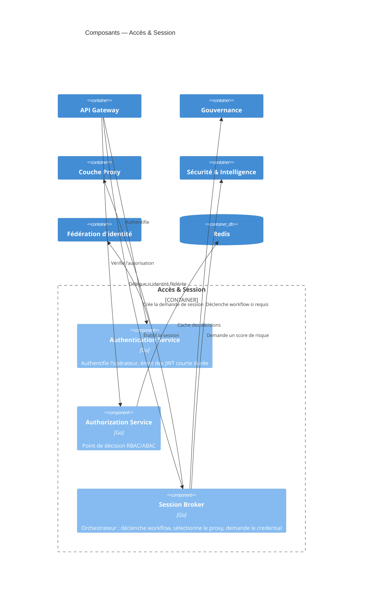
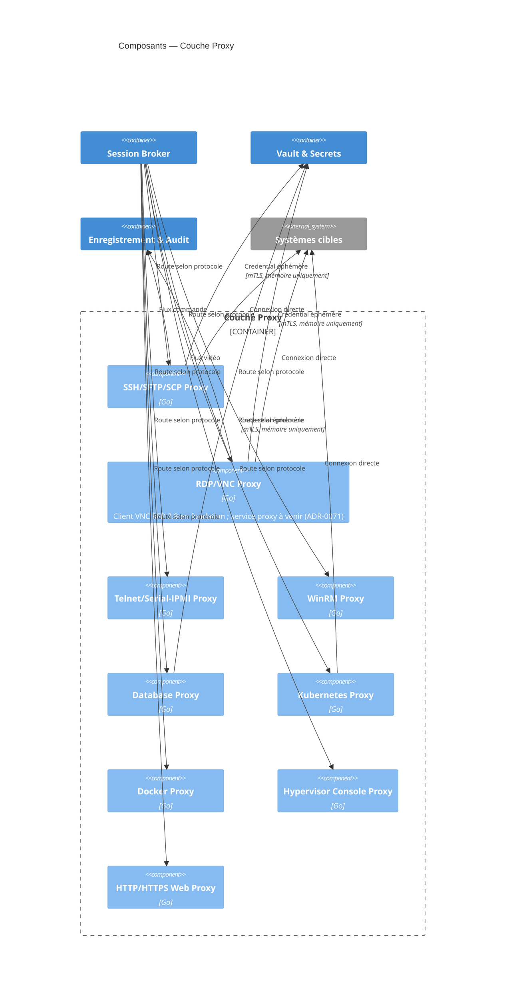
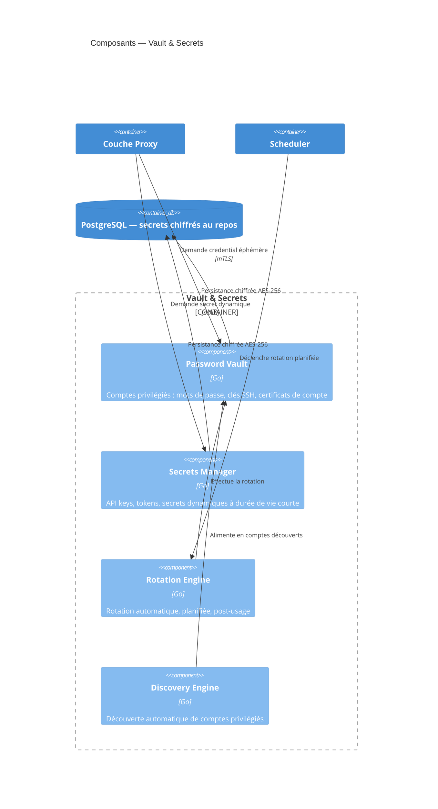
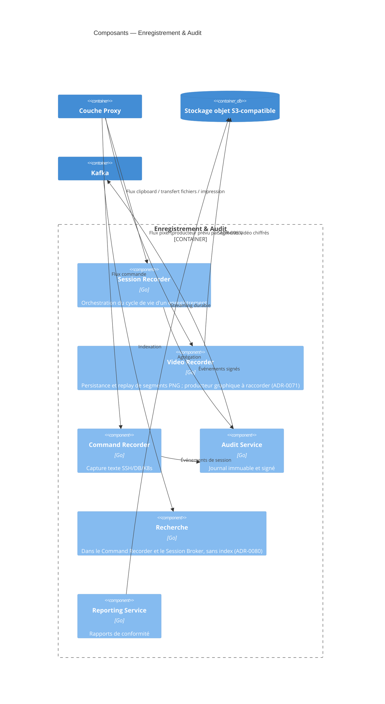
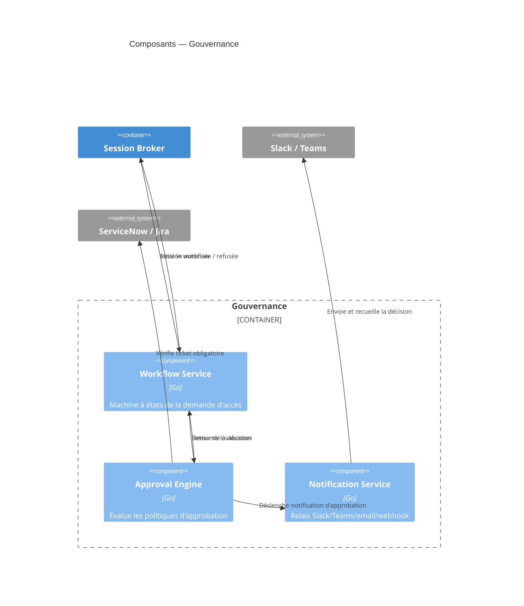

# Composants (C4, niveau 3)

## Conteneur « Accès & Session »

## Conteneur « Couche Proxy »

**Note d'implémentation** : les neuf proxies partagent un pipeline commun (négociation, injection de credential, capture, purge mémoire) implémenté comme bibliothèque interne partagée plutôt que dupliqué — détail qui sera traité dans les ADR et les spécifications d'interfaces inter-services.

## Conteneur « Vault & Secrets »

## Conteneur « Enregistrement & Audit »

## Conteneur « Gouvernance »

## Conteneurs « Sécurité & Intelligence » et « Fédération d'identité » — synthèse

Ces deux conteneurs sont volontairement présentés sous forme de table plutôt qu'en diagramme, leur structure interne étant peu ramifiée à ce stade :

| Conteneur | Composant | Rôle |
|---|---|---|
| Sécurité & Intelligence | MFA Service | TOTP, WebAuthn/FIDO2, YubiKey, Passkeys, carte à puce/PKI |
| Sécurité & Intelligence | Anomaly Detection / Risk Engine | Score de risque par règles, brique ML optionnelle |
| Fédération d'identité | LDAP Connector | Auth/synchro LDAP/OpenLDAP |
| Fédération d'identité | Active Directory Connector | Auth/synchro AD, Kerberos |
| Fédération d'identité | Entra ID Connector | Profil OIDC lié à un tenant (ADR-0079) ; ni SAML ni Graph API à ce jour |
| Fédération d'identité | OpenID Connect Connector | OIDC/OAuth2 générique |
| Fédération d'identité | SAML Connector | SAML 2.0 générique |
| Fédération d'identité | SCIM Provisioning Service | Provisioning/déprovisioning automatique |
