# Conteneurs (C4, niveau 2)

## Niveau 2 — Diagramme de conteneurs

```mermaid
C4Container
    title Conteneurs — OpenBastion

    Person(operator, "Opérateur / Administrateur / Approbateur / Auditeur")

    System_Boundary(ob, "OpenBastion") {
        Container(auiu, "Administration UI", "React / TypeScript / Vite", "Console d'administration : comptes, politiques, secrets, audit, reporting")
        Container(portal, "User Portal", "React / TypeScript / Vite", "Portail self-service : demande d'accès, sessions actives, historique")
        Container(desktop, "Desktop Client", "Tauri", "Client natif pour sessions RDP/SSH avec intégration OS")
        Container(cli, "CLI", "Go", "Automatisation et intégration CI/CD")
        Container(sdk, "SDKs", "Go, Python, Java, JavaScript", "Intégration programmatique tierce")

        Container(gw, "API Gateway", "Go", "Point d'entrée unique HTTP/gRPC, routage, rate-limiting, validation")

        Container(access, "Accès & Session", "Go", "Authentification, autorisation, orchestration de session (Authn, Authz, Session Broker)")
        Container(proxy, "Couche Proxy", "Go", "9 proxies protocolaires — seuls composants détenant un secret en mémoire, transitoirement")
        Container(vault, "Vault & Secrets", "Go", "Password Vault + Secrets Manager, rotation et secrets dynamiques")
        Container(rec, "Enregistrement & Audit", "Go", "Session/Video/Command Recorder, Audit Service, Search Engine, Reporting")
        Container(gov, "Gouvernance", "Go", "Workflow Service, Approval Engine, Notification Service")
        Container(sec, "Sécurité & Intelligence", "Go", "MFA Service, Anomaly Detection / Risk Engine")
        Container(fed, "Fédération d'identité", "Go", "Connecteurs LDAP, AD, Entra ID, OIDC, SAML, SCIM")
        Container(sched, "Scheduler", "Go", "Tâches planifiées : rotations, expirations, rapports")

        ContainerDb(pg, "PostgreSQL", "Base relationnelle", "Comptes, politiques, métadonnées de session, workflows")
        ContainerDb(redis, "Redis", "Cache", "Sessions actives, verrous, rate-limiting")
        ContainerDb(objects, "Stockage objet S3-compatible", "Stockage objet", "Segments vidéo chiffrés")
        Container(nats, "NATS", "Bus événementiel", "Coordination temps réel")
        Container(kafka, "Kafka", "Bus de streaming", "Streaming durable d'audit")
        Container(kc, "Keycloak", "IdP", "Identité de plateforme et fédération")
    }

    System_Ext(idp, "IdP externes")
    System_Ext(chat, "Slack / Teams")
    System_Ext(itsm, "ServiceNow / Jira")
    System_Ext(targets, "Systèmes cibles")

    Rel(operator, auiu, "HTTPS")
    Rel(operator, portal, "HTTPS")
    Rel(operator, desktop, "Sessions RDP/SSH")
    Rel(operator, cli, "CLI")

    Rel(auiu, gw, "REST/gRPC", "mTLS")
    Rel(portal, gw, "REST/gRPC", "mTLS")
    Rel(desktop, gw, "REST/gRPC", "mTLS")
    Rel(cli, gw, "REST/gRPC", "mTLS")
    Rel(sdk, gw, "REST/gRPC", "mTLS")

    Rel(gw, access, "gRPC", "mTLS")
    Rel(access, gov, "gRPC", "mTLS")
    Rel(access, proxy, "gRPC", "mTLS")
    Rel(access, sec, "gRPC", "mTLS")
    Rel(proxy, vault, "gRPC — récupération credential éphémère", "mTLS")
    Rel(proxy, rec, "Flux de session / commande", "mTLS")
    Rel(gw, rec, "Replay vidéo (gRPC)", "mTLS")
    Rel(rec, pg, "Métadonnées vidéo")
    Rel(rec, objects, "Segments vidéo chiffrés (S3-compatible)")
    Rel(gov, chat, "Webhooks")
    Rel(gov, itsm, "API")
    Rel(fed, idp, "LDAP/OIDC/SAML")
    Rel(proxy, targets, "SSH/RDP/VNC/SQL/K8s/IPMI/HTTPS")

    Rel(access, pg, "SQL")
    Rel(vault, pg, "SQL")
    Rel(gov, pg, "SQL")
    Rel(access, redis, "Cache session")
    Rel(access, nats, "Pub/Sub")
    Rel(rec, kafka, "Streaming audit")
    Rel(access, kc, "OIDC")
```

### Table de correspondance conteneurs → technologie

| Conteneur | Nature | Technologie |
|---|---|---|
| Administration UI, User Portal | Application web | React / TypeScript / Vite |
| Desktop Client | Application native | Tauri |
| CLI | Binaire | Go |
| SDKs | Bibliothèques | Go, Python, Java, JavaScript |
| API Gateway | Service | Go, Envoy (data plane) |
| Accès & Session, Proxy Layer, Vault & Secrets, Enregistrement & Audit, Gouvernance, Sécurité & Intelligence, Fédération d'identité, Scheduler | Groupes de microservices | Go |
| PostgreSQL, Redis, stockage objet S3-compatible | Magasins de données (pas d'OpenSearch : ADR-0080) | — |
| NATS, Kafka | Bus de messages | — |
| Keycloak | Identity Provider | — |

Chaque conteneur backend listé ci-dessus regroupe plusieurs microservices détaillés au niveau 3.

## Traçabilité — conteneurs ↔ catalogue de microservices

| Conteneur (Niveau 2) | Microservices correspondants (`docs/architecture/system-overview.md`) |
|---|---|
| Accès & Session | API Gateway*, Authentication Service, Authorization Service, Session Broker |
| Couche Proxy | 9 proxies protocolaires (`docs/architecture/components.md`) |
| Vault & Secrets | Password Vault, Secrets Manager |
| Enregistrement & Audit | Session/Video/Command Recorder, Audit Service, Search Engine, Reporting Service |
| Gouvernance | Workflow Service, Approval Engine, Notification Service |
| Sécurité & Intelligence | MFA Service, Anomaly Detection / Risk Engine |
| Fédération d'identité | LDAP, AD, Entra ID, OIDC, SAML Connectors, SCIM Provisioning Service |
| Scheduler | Scheduler |

*L'API Gateway est représenté comme conteneur autonome au niveau 2 (point d'entrée), regroupé ici pour la traçabilité.
