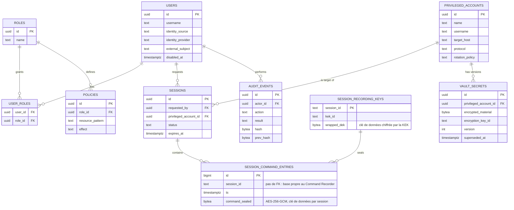

# Modèle de données PostgreSQL

Schéma relationnel du périmètre MVP. Chaque microservice reste propriétaire de ses tables. Les sections gardent leur numéro : un renvoi « §3 » de ce document reste juste.

## 1. Principes de modélisation

| Principe | Traduction |
|---|---|
| Aucun secret en clair | `vault_secrets.encrypted_material` est un blob chiffré (enveloppe AES-256) ; la clé n'est jamais stockée en base, seule une référence à un KMS/HSM externe l'est (`encryption_key_id`). |
| Audit inviolable | `audit_events` est chaîné par hash (`prev_hash` → `hash`), à la manière d'un registre append-only : toute altération rétroactive d'un événement casse la chaîne et devient détectable. |
| Séparation stockage / index | PostgreSQL est la source de vérité des métadonnées. Les segments vidéo chiffrés vivent dans un stockage objet compatible S3 (SeaweedFS en Compose) ; l'index de recherche plein texte (OpenSearch, v0.0.1) est une projection dérivée, reconstructible depuis PostgreSQL — jamais l'inverse. |
| Un schéma par service | Pas de jointure inter-services au niveau base ; toute composition de données entre domaines passe par l'API/gRPC, jamais par une requête SQL cross-schéma. |

## 2. Diagramme entité-relation (périmètre MVP)



## 3. DDL — schéma MVP

```sql
CREATE EXTENSION IF NOT EXISTS pgcrypto;

-- Identité et RBAC (Authentication / Authorization Service) -----------------

CREATE TABLE users (
    id                UUID PRIMARY KEY DEFAULT gen_random_uuid(),
    username          TEXT NOT NULL UNIQUE,
    display_name      TEXT NOT NULL,
    identity_source   TEXT NOT NULL CHECK (identity_source IN ('local','oidc','ldap')),  -- 'ldap' : ADR-0061
    identity_provider TEXT NOT NULL DEFAULT '', -- ADR-0076 : l'identifiant du fournisseur ; '' pour les variables OIDC_*/LDAP_* et les comptes repris
    external_subject  TEXT,                    -- sub OIDC, ou objectGUID/entryUUID de l'annuaire ; NULL si identity_source = 'local'
    password_hash     TEXT,                    -- Argon2id ; NULL si identity_source = 'oidc'
    created_at        TIMESTAMPTZ NOT NULL DEFAULT now(),
    updated_at        TIMESTAMPTZ NOT NULL DEFAULT now(),
    disabled_at       TIMESTAMPTZ,
    UNIQUE (identity_source, identity_provider, external_subject)  -- ADR-0076 : un sub n'est unique que chez son émetteur
);

CREATE TABLE roles (
    id           UUID PRIMARY KEY DEFAULT gen_random_uuid(),
    name         TEXT NOT NULL UNIQUE,
    description  TEXT
);

CREATE TABLE user_roles (
    user_id     UUID NOT NULL REFERENCES users(id) ON DELETE CASCADE,
    role_id     UUID NOT NULL REFERENCES roles(id) ON DELETE CASCADE,
    granted_at  TIMESTAMPTZ NOT NULL DEFAULT now(),
    PRIMARY KEY (user_id, role_id)
);

CREATE TABLE policies (
    id                UUID PRIMARY KEY DEFAULT gen_random_uuid(),
    name              TEXT NOT NULL,
    role_id           UUID NOT NULL REFERENCES roles(id) ON DELETE CASCADE,
    resource_pattern  TEXT NOT NULL,             -- ex. 'vault:account:prod-*'
    effect            TEXT NOT NULL CHECK (effect IN ('allow','deny')),
    created_by        UUID REFERENCES users(id),
    created_at        TIMESTAMPTZ NOT NULL DEFAULT now(),
    UNIQUE (role_id, resource_pattern, effect)
);

-- Coffre-fort (Password Vault) -----------------------------------------------

CREATE TABLE privileged_accounts (
    id               UUID PRIMARY KEY DEFAULT gen_random_uuid(),
    name             TEXT NOT NULL,
    username         TEXT NOT NULL,   -- nom du compte sur la cible ; distinct de `name`, qui identifie l'enregistrement
    target_host      TEXT NOT NULL,
    protocol         TEXT NOT NULL CHECK (protocol IN ('ssh','vnc','rdp')), -- ADR-0071 : clients protocolaires distincts
    approval_required BOOLEAN NOT NULL DEFAULT FALSE,             -- ADR-0067 : une autre personne approuve les sessions ordinaires
    tls_certificate_sha256 TEXT NOT NULL DEFAULT '',               -- ADR-0071 : pin SHA-256 du certificat feuille, vide pour SSH
    target_domain    TEXT NOT NULL DEFAULT '',                     -- ADR-0071 : nom DNS/IP vérifié, vide pour SSH
    rotation_policy  TEXT NOT NULL DEFAULT 'post_use'
                       CHECK (rotation_policy IN ('manual','post_use','scheduled')),
    last_rotated_at  TIMESTAMPTZ,
    created_by       UUID REFERENCES users(id),
    created_at       TIMESTAMPTZ NOT NULL DEFAULT now(),
    disabled_at      TIMESTAMPTZ,
    UNIQUE (target_host, name),
    CHECK ((tls_certificate_sha256 = '' AND target_domain = '') OR
           (tls_certificate_sha256 <> '' AND target_domain <> ''))
);

CREATE TABLE vault_secrets (
    id                     UUID PRIMARY KEY DEFAULT gen_random_uuid(),
    privileged_account_id  UUID NOT NULL REFERENCES privileged_accounts(id) ON DELETE CASCADE,
    encrypted_material     BYTEA NOT NULL,       -- enveloppe AES-256 ; jamais en clair
    encryption_key_id      TEXT NOT NULL,        -- référence à la clé KMS/HSM, pas la clé elle-même
    version                INT NOT NULL,
    created_at             TIMESTAMPTZ NOT NULL DEFAULT now(),
    superseded_at          TIMESTAMPTZ,          -- NULL = version courante
    UNIQUE (privileged_account_id, version)
);
CREATE INDEX idx_vault_secrets_current
    ON vault_secrets (privileged_account_id) WHERE superseded_at IS NULL;

-- Sessions (Session Broker + Command Recorder) -------------------------------

CREATE TABLE sessions (
    id                       UUID PRIMARY KEY DEFAULT gen_random_uuid(),
    requested_by             UUID NOT NULL REFERENCES users(id),
    privileged_account_id    UUID NOT NULL REFERENCES privileged_accounts(id),
    protocol                 TEXT NOT NULL,
    status                   TEXT NOT NULL
                                CHECK (status IN ('pending_approval','active','expired','terminated','denied')),
    justification             TEXT NOT NULL,
    break_glass               BOOLEAN NOT NULL DEFAULT FALSE,  -- ADR-0009 : autorisée à s'exécuter sans recorder
    approval_required         BOOLEAN NOT NULL DEFAULT FALSE,  -- ADR-0067 : demande ordinaire soumise à approbation
    ticket                    TEXT NOT NULL DEFAULT '',       -- ADR-0067 : référence non secrète, vide si aucune
    connection_ticket_hash    TEXT,              -- hash du ticket émis ; jamais le ticket en clair
    created_at                TIMESTAMPTZ NOT NULL DEFAULT now(),
    expires_at                TIMESTAMPTZ NOT NULL,   -- fin de session ; tant que la demande est pending_approval : échéance de la décision (ADR-0011)
    terminated_at              TIMESTAMPTZ,
    duration_minutes          INT NOT NULL DEFAULT 0,          -- ADR-0011 : durée demandée ; l'horloge d'un break-glass part de l'approbation
    decided_by                UUID REFERENCES users(id),       -- ADR-0011 : qui a approuvé ou rejeté ; NULL sans décision (implémentation : TEXT '' sans FK, une base par service)
    decided_at                TIMESTAMPTZ
);
-- ADR-0011 : `decided_by`, `decided_at` et `expires_at` d'une demande décidée ne s'écrivent que par un
-- `UPDATE ... WHERE status = 'pending_approval'` (comparaison-échange) : une seule décision par demande.
CREATE INDEX idx_sessions_requested_by ON sessions (requested_by);
CREATE INDEX idx_sessions_status ON sessions (status) WHERE status IN ('pending_approval','active');
-- ADR-0012 : la liste des demandes en attente (« ce que l'appelant peut décider ») lit les lignes
-- `pending_approval` par échéance croissante, id en départage, bornées à 100. Cet index partiel les sert
-- sans grossir avec l'historique des sessions. Implémentation : `sessions_pending_approval_idx`,
-- créé de façon idempotente (`IF NOT EXISTS`) : une base antérieure le reçoit au prochain démarrage.
CREATE INDEX sessions_pending_approval_idx ON sessions (expires_at, id) WHERE status = 'pending_approval';
-- ADR-0013 : aucun changement de schéma. Le plafond par demandeur compte les lignes `pending_approval` de ce
-- `requested_by` dont `expires_at >= now` (`idx_sessions_requested_by`, `sessions_pending_approval_idx`), et
-- `SaveIfUnderPendingLimit` compte puis enregistre dans UNE transaction, sous
-- `pg_advisory_xact_lock(0x0B7A, hashtext(requested_by))` : deux réplicas du Broker se sérialisent sur le demandeur,
-- jamais sur la table. Le verrou est levé au COMMIT/ROLLBACK ; une demande arrivée à son échéance cesse de compter.

-- Command Recorder — implémenté : services/recording-audit/command-recorder/migrations.
-- Écarts assumés par rapport à la première version de ce DDL :
--   * pas de clé étrangère vers `sessions` (une base par service) — supprimer une session
--     ne détruit donc plus son enregistrement, qui est une preuve ;
--   * `session_id` est du TEXT, comme les identifiants du Session Broker ;
--   * aucune commande n'est stockée en clair : chaque ligne est scellée en AES-256-GCM
--     sous une clé de données (DEK) propre à la session ; la DEK n'existe en base que
--     chiffrée par la KEK (KMS_KEY_HEX aujourd'hui, un KMS/HSM à terme).
CREATE TABLE session_recording_keys (
    session_id   TEXT PRIMARY KEY,
    kek_id       TEXT NOT NULL,        -- quelle KEK a chiffré cette DEK (rotation future)
    wrapped_dek  BYTEA NOT NULL,       -- nonce || DEK chiffrée ; AAD = kek_id + session_id
    created_at   TIMESTAMPTZ NOT NULL DEFAULT now()
);
CREATE TABLE session_command_entries (
    id              BIGSERIAL PRIMARY KEY,
    session_id      TEXT NOT NULL,
    ts              TIMESTAMPTZ NOT NULL,   -- précision microseconde, liée à la ligne (AAD)
    command_sealed  BYTEA NOT NULL          -- nonce || chiffré ; AAD = session_id + ts
);
CREATE INDEX idx_session_command_entries_session ON session_command_entries (session_id, ts, id);
-- Session Broker, 005_search_window.sql (ADR-0080) : sessions_created_idx ON sessions (created_at DESC, id DESC),
-- l'ordre et le curseur de la recherche des sessions (ILIKE … ESCAPE '\' sur ses métadonnées, sans index du texte).
-- 002_search_window.sql (ADR-0080) : la recherche lit sa fenêtre sur le début de chaque enregistrement.
-- Aucun index du texte : les commandes ne sont déchiffrées qu'à la volée, et jetées.
CREATE INDEX idx_session_recording_keys_created ON session_recording_keys (created_at DESC, session_id);

-- Video Recorder (ADR-0070) — implémenté : services/recording-audit/video-recorder/migrations.
-- Les images sont chiffrées avant le stockage S3-compatible ; PostgreSQL ne conserve que
-- l'état, la DEK enveloppée et les pointeurs/checksums des objets.
CREATE TABLE video_recordings (
    session_id    TEXT PRIMARY KEY,
    key_id        TEXT NOT NULL,
    wrapped_dek   BYTEA NOT NULL,
    status        TEXT NOT NULL CHECK (status IN ('incomplete', 'complete')),
    last_sequence BIGINT NOT NULL DEFAULT 0 CHECK (last_sequence >= 0),
    created_at    TIMESTAMPTZ NOT NULL DEFAULT now(),
    completed_at  TIMESTAMPTZ
);
CREATE TABLE video_recording_segments (
    session_id        TEXT NOT NULL REFERENCES video_recordings(session_id),
    first_sequence    BIGINT NOT NULL CHECK (first_sequence > 0),
    last_sequence     BIGINT NOT NULL CHECK (last_sequence >= first_sequence),
    object_key        TEXT NOT NULL UNIQUE,
    ciphertext_sha256 BYTEA NOT NULL CHECK (octet_length(ciphertext_sha256) = 32),
    created_at        TIMESTAMPTZ NOT NULL DEFAULT now(),
    PRIMARY KEY (session_id, first_sequence)
);
CREATE INDEX idx_video_recording_segments_session_last
    ON video_recording_segments (session_id, last_sequence);

-- Audit (Audit Service) ------------------------------------------------------

CREATE TABLE audit_events (
    id             UUID NOT NULL DEFAULT gen_random_uuid(),
    ts             TIMESTAMPTZ NOT NULL DEFAULT now(),
    actor_id       UUID REFERENCES users(id),     -- NULL pour une action système (ex. Scheduler)
    action         TEXT NOT NULL,                  -- ex. 'session.connect', 'vault.rotate'
    resource_type  TEXT NOT NULL,
    resource_id    TEXT NOT NULL,
    details        JSONB NOT NULL DEFAULT '{}'::jsonb, -- ADR-0068 : métadonnées bornées, couvertes par hash v4
    result         TEXT NOT NULL CHECK (result IN ('success','failure')),
    signature      BYTEA NOT NULL,                 -- signature de l'événement par le service émetteur
    prev_hash      BYTEA NOT NULL,                 -- hash de l'événement précédent de la chaîne
    hash           BYTEA NOT NULL,                 -- hash de cet événement (inclut prev_hash)
    hash_version   SMALLINT NOT NULL DEFAULT 1,    -- format du hash (ADR-0026, ADR-0027, ADR-0068) : 1/2 hérités, 3 HMAC, 4 HMAC avec détails
    emitter        TEXT NOT NULL DEFAULT '',       -- service qui a écrit l'événement, d'après son certificat mTLS (ADR-0027)
    chain_key_id   TEXT NOT NULL DEFAULT '',       -- identifiant de la clé de chaîne du HMAC (format 3), jamais la clé
    PRIMARY KEY (id, ts)
) PARTITION BY RANGE (ts);
-- ⚠ DDL cible, pas le schéma réel : depuis ADR-0031, `audit_events` n'est PAS partitionné
-- (mesuré : plus d'unicité globale de l'identifiant, insertion hors partition = audit arrêté,
-- 41 s de conversion par million d'événements, lecture de la chaîne 2,3 fois plus lente), et
-- le schéma réel est celui de services/recording-audit/audit-service/migrations/001_init.sql.

CREATE INDEX idx_audit_events_actor ON audit_events (actor_id, ts DESC);
CREATE INDEX idx_audit_events_action ON audit_events (action, ts DESC);
CREATE INDEX idx_audit_events_resource ON audit_events (resource_type, resource_id, ts DESC);

-- Exemple de partition mensuelle, créée à l'avance par le Scheduler
CREATE TABLE audit_events_2026_08 PARTITION OF audit_events
    FOR VALUES FROM ('2026-08-01') TO ('2026-09-01');

-- Support d'idempotence (API Gateway / Session Broker) -----------------------

CREATE TABLE idempotency_keys (
    key                TEXT PRIMARY KEY,
    endpoint           TEXT NOT NULL,
    response_snapshot  JSONB,
    created_at         TIMESTAMPTZ NOT NULL DEFAULT now()
);
```

### Rotation sur la cible (ADR-0037)

`services/vault/password-vault/migrations/002_rotation.sql` :

```sql
ALTER TABLE privileged_accounts ADD COLUMN IF NOT EXISTS reconciliation_account_id TEXT NOT NULL DEFAULT '';  -- même cible ; vide : pas de rotation
ALTER TABLE vault_secrets ADD COLUMN IF NOT EXISTS pending BOOLEAN NOT NULL DEFAULT FALSE;                    -- posé, pas encore vérifié : jamais injecté
CREATE UNIQUE INDEX IF NOT EXISTS vault_secrets_one_pending_idx ON vault_secrets (privileged_account_id) WHERE pending;
```

La version courante est celle dont `superseded_at` est vide **et qui n'est pas en attente** ; la promotion d'une version en attente remplace l'ancienne dans la même transaction.

### Clé d'hôte épinglée (ADR-0039)

`services/vault/password-vault/migrations/003_host_key.sql` :

```sql
ALTER TABLE privileged_accounts ADD COLUMN IF NOT EXISTS host_key TEXT NOT NULL DEFAULT '';  -- "ssh-ed25519 AAAA…", normalisée ; vide : ni session ni rotation
```

Une donnée publique, pas un secret : elle est rendue par `GET /vault/accounts/{id}` avec son empreinte. Les comptes existants reçoivent `''` à la migration, et restent sans session ni rotation jusqu'à leur épinglage (`PUT /vault/accounts/{id}/host-key`).

### Rotation planifiée (ADR-0040)

`services/vault/password-vault/migrations/004_rotation_schedule.sql` :

```sql
ALTER TABLE privileged_accounts ADD COLUMN IF NOT EXISTS rotation_interval_days INTEGER NOT NULL DEFAULT 0;  -- 1 à 365 pour scheduled, 0 sinon
ALTER TABLE privileged_accounts ADD COLUMN IF NOT EXISTS rotation_attempted_at TIMESTAMPTZ;                 -- dernière prise par le Vault, réussie ou non
UPDATE privileged_accounts SET rotation_interval_days = 30 WHERE rotation_policy = 'scheduled' AND rotation_interval_days = 0;
```

Échéance : `COALESCE(last_rotated_at, created_at) + rotation_interval_days jours`. Un compte est pris par un seul `UPDATE … SET rotation_attempted_at` conditionné (échu, pas pris depuis une heure) : de deux Vaults, un seul le prend.

### Échecs de la rotation planifiée (ADR-0041)

`services/vault/password-vault/migrations/005_rotation_failures.sql` :

```sql
ALTER TABLE privileged_accounts ADD COLUMN IF NOT EXISTS rotation_failures INTEGER NOT NULL DEFAULT 0;  -- d'affilée ; remis à 0 par toute rotation réussie
```

### Rotation après usage : une dette des deux côtés (ADR-0044)

`services/vault/password-vault/migrations/006_rotation_owed.sql` et `services/access/session-broker/migrations/003_after_use_owed.sql` :

```sql
-- Vault : depuis quand le compte doit une rotation ; effacée par toute rotation réussie.
ALTER TABLE privileged_accounts ADD COLUMN IF NOT EXISTS rotation_owed_since TIMESTAMPTZ;
-- Broker : la fin d'une session active doit encore être dite au Vault.
ALTER TABLE sessions ADD COLUMN IF NOT EXISTS after_use_owed BOOLEAN NOT NULL DEFAULT FALSE;
CREATE INDEX IF NOT EXISTS sessions_after_use_owed_idx ON sessions (id) WHERE after_use_owed;
```

### Connexion fédérée OIDC (ADR-0035)

`services/access/authentication/migrations/002_oidc.sql` donne à `users` les colonnes du §3 (`identity_source`, `external_subject` — ici `TEXT NOT NULL DEFAULT ''` plutôt que `NULL`, avec un index unique partiel sur `(identity_source, external_subject)` quand le sujet n'est pas vide) et ajoute les connexions en cours :

```sql
CREATE TABLE IF NOT EXISTS oidc_login_attempts (
    state       TEXT PRIMARY KEY,   -- aléatoire, 32 octets ; pris une fois (DELETE … RETURNING)
    verifier    TEXT NOT NULL,      -- le code_verifier PKCE
    nonce       TEXT NOT NULL,      -- comparé au nonce du jeton d'identité
    expires_at  TIMESTAMPTZ NOT NULL -- 10 minutes après le début
);
```

Un compte OIDC a `password_hash` vide (la connexion locale le refuse) et s'appelle `oidc:<sub>`.

### Second facteur (ADR-0062)

`services/access/authentication/migrations/003_mfa.sql` — ce qui existe à la place de `mfa_factors` (§ ci-dessous, cible) pour TOTP :

```sql
ALTER TABLE users ADD COLUMN IF NOT EXISTS totp_secret_enc BYTEA;                 -- AES-256-GCM sous MFA_SECRET_KEY_HEX, lié à users.id ; NULL : pas enrôlé
ALTER TABLE users ADD COLUMN IF NOT EXISTS totp_last_step BIGINT NOT NULL DEFAULT 0; -- un code ne sert qu'une fois (compare-échange)
CREATE TABLE IF NOT EXISTS mfa_challenges (       -- le second temps d'une connexion : 5 min, 5 essais
    challenge_hash BYTEA PRIMARY KEY,              -- SHA-256 du défi, jamais le défi
    user_id TEXT NOT NULL, roles TEXT[] NOT NULL DEFAULT '{}',
    kind TEXT NOT NULL CHECK (kind IN ('required', 'enrollment_required')),
    login_source TEXT NOT NULL, login_name TEXT NOT NULL,
    pending_secret_enc BYTEA, enrollment_code_hash BYTEA,
    attempts INTEGER NOT NULL DEFAULT 0, expires_at TIMESTAMPTZ NOT NULL);
CREATE TABLE IF NOT EXISTS mfa_enrollment_codes ( -- émis par admin-cli : 24 h, usage unique, par empreinte
    login_source TEXT NOT NULL, login_name TEXT NOT NULL, code_hash BYTEA NOT NULL,
    expires_at TIMESTAMPTZ NOT NULL, created_at TIMESTAMPTZ NOT NULL DEFAULT now(),
    PRIMARY KEY (login_source, login_name));
```

### Clés de sécurité WebAuthn (ADR-0065)

`services/access/authentication/migrations/004_webauthn.sql` :

```sql
ALTER TABLE mfa_challenges ADD COLUMN IF NOT EXISTS webauthn_session BYTEA;  -- la cérémonie en cours d'un défi
CREATE TABLE IF NOT EXISTS mfa_webauthn_credentials (    -- des clés publiques, pas des secrets
    credential_id BYTEA PRIMARY KEY, user_id TEXT NOT NULL,
    credential BYTEA NOT NULL,                            -- clé publique, drapeaux, AAGUID, tels que go-webauthn les garde
    sign_count BIGINT NOT NULL DEFAULT 0, created_at TIMESTAMPTZ NOT NULL DEFAULT now());
CREATE INDEX IF NOT EXISTS mfa_webauthn_credentials_user_idx ON mfa_webauthn_credentials (user_id);
```

`005_webauthn_last_used.sql` (ADR-0066) ajoute `last_used_at TIMESTAMPTZ` : la dernière connexion signée par la clé, pour qu'un administrateur sache laquelle révoquer.

`services/access/authentication/migrations/007_identity_provider_bindings.sql` (ADR-0078) : l'émetteur de chaque fournisseur OIDC, retenu à son premier démarrage. Lue et écrite au démarrage seulement, dans une transaction qui tient les lignes (`SELECT … FOR UPDATE`) : deux réplicas qui démarrent ensemble en retiennent un seul. Une ligne ne change que sur un changement déclaré, écrit à l'audit avant.

```sql
CREATE TABLE IF NOT EXISTS identity_provider_bindings (
    provider  TEXT PRIMARY KEY,                 -- l'id du fichier ; '' pour les variables OIDC_*
    issuer    TEXT NOT NULL,                    -- exactement, comme OIDC_ISSUER (ADR-0035)
    bound_at  TIMESTAMPTZ NOT NULL DEFAULT now());
```

### File des alertes à pousser (ADR-0057)

`services/recording-audit/audit-service/migrations/002_alert_outbox.sql` : les alertes qui attendent d'être poussées (ADR-0045), pour qu'un redémarrage de l'Audit Service ne les perde pas. Une ligne par événement ; 256 au plus (borne tenue par le service) ; la ligne disparaît une fois l'alerte livrée ou abandonnée. Le corps est ce que la chaîne contient déjà, sans secret ; la signature est faite à chaque tentative, sa clé n'est pas en base.

```sql
CREATE TABLE IF NOT EXISTS alert_outbox (
    event_id   TEXT PRIMARY KEY,                      -- l'événement de la chaîne : une alerte n'est gardée qu'une fois
    action     TEXT NOT NULL,
    body       BYTEA NOT NULL,
    attempt    INTEGER NOT NULL,                      -- la tentative à venir, de 1 à 5
    due_at     TIMESTAMPTZ NOT NULL,                  -- son heure
    created_at TIMESTAMPTZ NOT NULL DEFAULT now()
);
CREATE INDEX IF NOT EXISTS idx_alert_outbox_due ON alert_outbox (due_at);
```

### Expiration des sessions (ADR-0034)

`services/access/session-broker/migrations/002_session_expiry.sql` — la première migration numérotée après `001_init.sql` — ajoute à `sessions` :

```sql
ALTER TABLE sessions ADD COLUMN IF NOT EXISTS expired_at TIMESTAMPTZ;                       -- quand le balayage l'a marquée expired
ALTER TABLE sessions ADD COLUMN IF NOT EXISTS expiry_audited BOOLEAN NOT NULL DEFAULT TRUE;  -- FALSE tant que session.expire reste à écrire
CREATE INDEX IF NOT EXISTS sessions_expiry_to_audit_idx ON sessions (expired_at) WHERE status = 'expired' AND NOT expiry_audited;
CREATE INDEX IF NOT EXISTS sessions_expiring_idx ON sessions (expires_at) WHERE status IN ('active', 'pending_approval');
```

Le statut `expired`, prévu au `CHECK` du §3, est maintenant **écrit** en base par le balayage du Broker, et plus seulement calculé à la lecture.

### Version du schéma (ADR-0030)

Chaque service porte son schéma en migrations numérotées (`services/<domaine>/<service>/migrations/NNN_nom.sql`), appliquées au démarrage par `pkg/migrate`, et en garde la trace dans une table créée par `pkg/migrate` lui-même :

```sql
CREATE TABLE IF NOT EXISTS schema_migrations (
    component  TEXT        NOT NULL,   -- authentication, authorization, session-broker, password-vault, audit-service, command-recorder, video-recorder
    version    INTEGER     NOT NULL,   -- NNN du fichier
    name       TEXT        NOT NULL,   -- nom du fichier, ex. 001_init.sql
    checksum   BYTEA       NOT NULL,   -- SHA-256 du texte appliqué : un fichier modifié ensuite est refusé
    applied_at TIMESTAMPTZ NOT NULL DEFAULT now(),
    PRIMARY KEY (component, version)
);
```

La clé inclut le service parce qu'une même base peut en porter plusieurs (c'est le cas en développement et en test). `001_init.sql` est figé tel qu'il était à ADR-0030 : il est idempotent et met à niveau les bases d'avant ; tout changement ultérieur est un nouveau fichier.

## 4. Rationale des choix clés

| Choix | Pourquoi |
|---|---|
| `vault_secrets` versionné plutôt qu'un champ mutable sur `privileged_accounts` | Conserve l'historique de rotation (obligatoire pour l'audit) tout en gardant une requête O(1) de la version courante via l'index partiel `idx_vault_secrets_current`. |
| ~~`audit_events` partitionné par mois~~ | ~~Le volume d'audit croît en continu et sans purge (Full Auditability) ; le partitionnement garde les index performants et simplifie une politique de rétention/archivage par partition entière plutôt que par ligne.~~ **Écarté par ADR-0031** : retirer une partition casse la chaîne comme retirer des lignes, et le partitionnement coûte (mesures dans l'ADR). La rétention passe par un point de contrôle ancré (ADR-0032), sans partitionnement : les mois archivés sont **supprimés** d'`audit_events`, qui ne garde que la rétention configurée ; le point de contrôle, hors de la base, dit d'où la chaîne repart. |
| Chaînage `prev_hash` → `hash` | Rend une falsification rétroactive détectable sans dépendre uniquement des permissions applicatives — défense en profondeur sur l'invariant d'audit. **Depuis ADR-0026**, le hash (format 2) encadre chaque champ par sa longueur, après une étiquette de domaine : déplacer des octets d'un champ au voisin est une modification détectée ; les lignes antérieures (format 1, champs concaténés) se vérifient toujours mais restent sensibles à ce déplacement ; une version ne recule jamais dans la chaîne. ~~**Limite** : la chaîne n'a pas de clé~~ — **depuis ADR-0027**, le format 3 est un HMAC-SHA256 sous une clé tenue hors de la base : sans elle, une fin de chaîne recalculée ne se vérifie pas. Il reste qu'une chaîne **entièrement** réécrite dans un format sans clé (1 ou 2) ne se contredit pas elle-même : c'est l'ancrage hors de la base (ADR-0028) qui la trahit : une ancre (identifiant et hash du dernier événement écrit, sous HMAC) est ajoutée périodiquement à un fichier **hors de la base** — volontairement pas une table : la base ne doit avoir aucun pouvoir sur ce qui la contredit. |
| `connection_ticket_hash` et non le ticket lui-même | Le Session Broker ne doit pouvoir vérifier qu'un ticket a été émis, jamais le rejouer — cohérent avec ADR-0003. |
| Clé étrangère `actor_id` nullable sur `audit_events` | Les actions systèmes (rotation planifiée par le Scheduler, expiration automatique) doivent être auditées même sans acteur humain. |

**Accès aux données** : chaque magasin est écrit en `database/sql` et SQL explicite, derrière un port de domaine. L'opportunité d'un ORM est analysée dans `docs/architecture/data-access-orm-analysis.md` (recommandation : pas d'ORM complet ; sqlc ou sqlx en option ; des migrations versionnées d'abord).

## 5. Extensions prévues (v0.0.1, hors périmètre de ce document)

Ces tables seront détaillées dans une révision ultérieure de ce document, au moment de leur implémentation — elles sont esquissées ici pour anticiper les clés étrangères et éviter une migration douloureuse :

| Table (v0.0.1) | Service propriétaire | Objet |
|---|---|---|
| `workflow_requests`, `approvals` | Workflow Service / Approval Engine | Étapes de validation N+1, référence de ticket externe |
| `notification_log` | Notification Service | Traçabilité des envois Slack/Teams/email |
| `mfa_factors` | MFA Service | Facteurs enrôlés par utilisateur (TOTP, WebAuthn, PKI) |
| `identity_provider_configs` | Connecteurs de fédération | Configuration LDAP/AD/Entra ID/SAML |
| `secrets_manager_dynamic` | Secrets Manager | Secrets applicatifs à durée de vie courte, distincts de `vault_secrets` (ADR-0005) |
