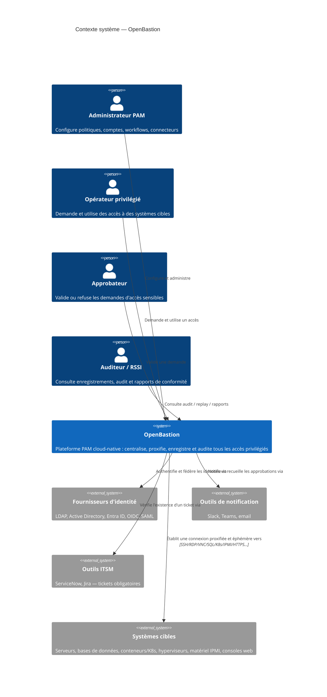

# Contexte du système (C4, niveau 1)

## Notation

| Niveau | Question à laquelle il répond | Granularité |
|---|---|---|
| **1 — Contexte** | Qui utilise OpenBastion et avec quoi interagit-il ? | Le système comme boîte noire |
| **2 — Conteneurs** | De quels grands blocs déployables OpenBastion est-il composé ? | Applications, services, magasins de données |
| **3 — Composants** | Comment un conteneur est-il structuré en interne ? | Microservices / modules au sein d'un conteneur |

Les diagrammes sont exprimés en Mermaid (syntaxe C4) pour rester versionnés en texte aux côtés du code (docs-as-code), conformément à la convention documentaire du projet.

## Niveau 1 — Diagramme de contexte système

**Lecture** : OpenBastion est le seul point de passage entre les humains (opérateurs, approbateurs, administrateurs, auditeurs) et les systèmes cibles. Aucune flèche ne relie directement un acteur humain à un système cible — c'est la traduction visuelle du principe *No Direct Access*.
