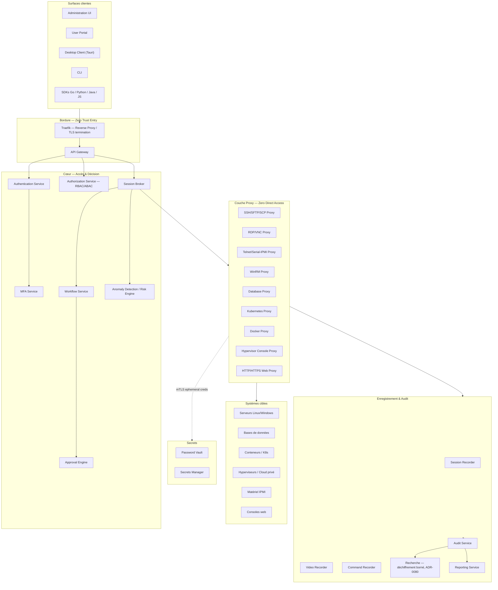
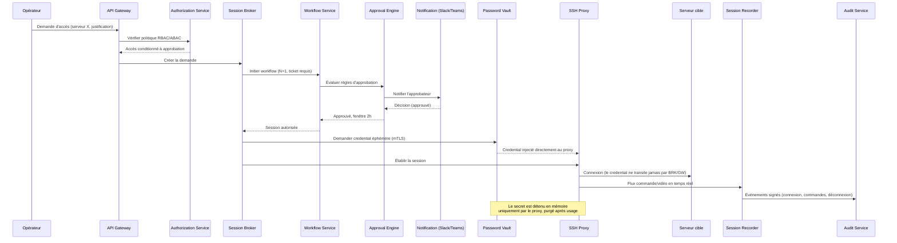

# Vue d'ensemble du système

## Résumé exécutif

OpenBastion est une plateforme open source de **Privileged Access Management (PAM)** cloud-native. Elle centralise, proxifie, enregistre et audite tous les accès à privilèges vers des systèmes cibles hétérogènes (serveurs, bases de données, conteneurs, hyperviseurs, matériel IPMI, consoles web), sans jamais exposer de secret en clair à un opérateur humain.

L'architecture retenue est un ensemble d'environ 35 microservices Go, organisés en 9 domaines fonctionnels, communiquant en interne via gRPC/mTLS et un bus événementiel double (NATS + Kafka), exposant une API REST/gRPC publique, et livrée sous forme de conteneurs déployables aussi bien on-premise (Docker Compose, K3s) qu'en cloud managé (Kubernetes, OpenShift).

## Vue d'ensemble en couches

Neuf domaines fonctionnels structurent le système : **Périmètre & Accès**, **Couche Proxy**, **Coffre-fort & Secrets**, **Enregistrement & Audit**, **Gouvernance (workflow/approbation/notification)**, **Sécurité & Intelligence**, **Fédération d'identité**, **Plateforme & Intégration**, **Surfaces clientes**.

## Catalogue des microservices

### Périmètre et accès

| Service | Responsabilité |
|---|---|
| **API Gateway** | Point d'entrée unique HTTP/gRPC, routage, rate-limiting, validation de schéma, injection de contexte d'identité. |
| **Authentication Service** | Authentifie l'opérateur (mot de passe + MFA, ou fédération externe), émet des jetons JWT courte durée. |
| **Authorization Service** | Point de décision RBAC/ABAC ; évalue chaque requête d'accès contre les politiques (rôle, attribut, contexte, risque). |
| **Session Broker** | Orchestrateur central : reçoit une demande d'accès autorisée, déclenche le workflow si requis, sélectionne le proxy protocolaire, demande un credential éphémère au Vault, câble le client au proxy. |

### Couche proxy — six familles de systèmes cibles

| Famille de cible | Protocoles couverts | Microservice proxy |
|---|---|---|
| Serveurs (Linux/Windows) | SSH, SFTP, SCP | **SSH/SFTP/SCP Proxy** |
| Serveurs (Windows/Linux, bureau distant) | RDP, VNC | **RDP/VNC Proxy** |
| Serveurs (legacy) + accès matériel série | Telnet, console série IPMI (SOL) | **Telnet/Serial-IPMI Proxy** |
| Serveurs Windows (administration) | WinRM | **WinRM Proxy** |
| Bases de données | Protocoles fil (PostgreSQL, MySQL, MSSQL, Oracle, MongoDB…) | **Database Proxy** |
| Conteneurs / orchestration | Kubernetes exec, port-forward, API server | **Kubernetes Proxy** |
| Conteneurs / orchestration | Docker exec/attach | **Docker Proxy** |
| Hyperviseurs / cloud privé | Consoles VMware, Hyper-V, Proxmox, OpenStack | **Hypervisor Console Proxy** |
| Consoles web | HTTP/HTTPS avec injection de credential côté proxy | **HTTP/HTTPS Web Proxy** |

Tous ces proxies partagent un **pipeline commun** (ADR-0006 ; l'invariant qu'il tient : `docs/architecture/principles.md`) : ils sont les seuls composants du système autorisés à détenir un secret en mémoire, de façon transitoire.

### Coffre-fort et gestion des secrets

| Service | Responsabilité |
|---|---|
| **Password Vault** | Stocke/gère les comptes privilégiés (mots de passe, clés SSH, certificats de compte) ; rotation automatique, planifiée ou post-usage ; découverte automatique de comptes. |
| **Secrets Manager** | Secrets applicatifs génériques (API keys, tokens, secrets dynamiques à durée de vie courte) ; émission à la volée pour bases de données et cloud providers. |

### Enregistrement, recherche et audit

| Service | Responsabilité |
|---|---|
| **Session Recorder** | Orchestration du cycle de vie d'un enregistrement (démarrage, métadonnées, chiffrement, indexation) ; agrège les flux clipboard/transfert de fichiers/impression capturés par les proxies. |
| **Video Recorder** | Segments PNG ordonnés, chiffrés avant stockage S3-compatible, métadonnées PostgreSQL et replay audité. Le proxy RDP producteur et le lecteur Admin UI ne sont pas encore implémentés (ADR-0069/0070). |
| **Command Recorder** | Capture texte (SSH/Telnet/DB/K8s exec) → log structuré recherchable commande par commande. |
| **Audit Service** | Journal immuable et signé de toute action système (connexion, déconnexion, commande, upload/download, escalade, rotation, config, workflow, appel API). |
| **Search Engine** | Recherche plein texte des commandes (par le Command Recorder, qui déchiffre à la volée les sessions d'une fenêtre de 31 jours au plus) et des sessions (par le Session Broker, sur leurs métadonnées) : ADR-0080. Aucun index ni OpenSearch : les commandes ne sortent jamais de leur enveloppe. |
| **Reporting Service** | Rapports de conformité, exports périodiques, tableaux de bord agrégés. |

### Gouvernance : workflow, approbation, notification

| Service | Responsabilité |
|---|---|
| **Workflow Service** | Machine à états de la demande d'accès : requête → validation → fenêtre temporelle → octroi → expiration automatique. |
| **Approval Engine** | Évalue les politiques d'approbation (validation N+1, double validation, justification obligatoire, ticket ServiceNow/Jira requis). |
| **Notification Service** | Relaye les demandes/décisions vers Slack, Teams, email, webhooks. Pas de service dédié aujourd'hui : le Broker et l'Audit Service émettent eux-mêmes (ADR-0074). |

### Sécurité et intelligence

| Service | Responsabilité |
|---|---|
| **MFA Service** | TOTP, WebAuthn/FIDO2, clés de sécurité (YubiKey), Passkeys, carte à puce/PKI. |
| **Anomaly Detection / Risk Engine** | Score de risque par session (commande inhabituelle, géolocalisation, horaire, volume de transfert, usage sudo anormal) ; moteur à règles, brique ML optionnelle et détachable. |

### Fédération d'identité

| Service | Responsabilité |
|---|---|
| **LDAP Connector** | Authentification et synchronisation annuaire LDAP/OpenLDAP générique. |
| **Active Directory Connector** | Idem, spécificités AD (groupes, Kerberos). |
| **Entra ID Connector** | Fédération Microsoft Entra ID : un profil OIDC lié à un tenant déclaré (ADR-0079), dans l'Authentication Service. Ni SAML, ni Graph API, ni provisioning à ce jour. |
| **OpenID Connect Connector** | Fédération OIDC/OAuth2 générique (tout IdP conforme). |
| **SAML Connector** | Fédération SAML 2.0 générique. |
| **SCIM Provisioning Service** | Provisionnement/déprovisionnement automatique des identités et groupes. |

Kerberos et RADIUS sont supportés comme protocoles secondaires d'authentification au sein de l'Authentication Service et de l'AD Connector, plutôt que comme microservices dédiés.

### Plateforme et intégration

| Composant | Responsabilité |
|---|---|
| **REST API** | Contrat public exposé par l'API Gateway, documenté OpenAPI (livrable §16.5). |
| **gRPC Internal API** | Contrats Protobuf inter-services, transport mTLS. L'authentification de l'appelant par route est faite **par le service lui-même** à partir du certificat (ADR-0010) ; un mesh Envoy peut s'y ajouter pour le routage et l'observabilité, mais ne la remplace pas. |
| **Message Bus (NATS + Kafka)** | Infrastructure de coordination temps réel et de streaming durable (« Le double bus », ci-dessous). |
| **Scheduler** | Tâches planifiées : rotations, expirations de session, génération de rapports. |

### Surfaces clientes

| Client | Rôle |
|---|---|
| **Administration UI** | Console d'administration (comptes, politiques, workflows, secrets, audit, reporting). |
| **User Portal** | Portail self-service pour les opérateurs (demande d'accès, sessions actives, historique). |
| **Desktop Client (Tauri)** | Client natif léger pour sessions RDP/SSH avec intégration OS (presse-papiers contrôlé, lecteurs). |
| **CLI** | Automatisation, intégration CI/CD, scripts d'exploitation. |
| **SDK Go / Python / Java / JavaScript** | Intégration programmatique dans des outils tiers et pipelines. |

## Flux illustratif : accès SSH avec workflow d'approbation

## Le double bus : NATS + Kafka

| Bus | Usage | Justification |
|---|---|---|
| **NATS** | Coordination temps réel inter-services (établissement de session, notifications d'approbation, signalement de risque) | Faible latence, sémantique pub/sub légère, adaptée aux interactions synchrones courtes. |
| **Kafka** | Streaming durable des événements d'audit et des flux d'enregistrement de session | Rétention longue durée, rejouabilité, garanties d'ordre et de durabilité requises pour la conformité. |

🔖 **Sujet ADR à venir** : ce choix a un coût opérationnel réel (deux systèmes de messagerie à exploiter) mais répond à une séparation fonctionnelle claire — coordination éphémère vs. vérité d'audit durable — jugée preferable à un compromis unique. Documenté depuis en ADR-0001.

## Stack technologique — vue de synthèse

| Couche | Technologies |
|---|---|
| Backend microservices | Go |
| UI Web (Admin UI, User Portal) | React, TypeScript, Vite |
| Client desktop | Tauri |
| Base de données relationnelle | PostgreSQL |
| Cache | Redis |
| Recherche | Déchiffrement à la volée, borné (ADR-0080) ; pas d'OpenSearch |
| Bus temps réel | NATS |
| Streaming durable | Kafka |
| Stockage objet | API S3-compatible (SeaweedFS en Compose ; endpoint externe configurable) |
| Service mesh (data plane) | Envoy |
| Reverse proxy / edge | Traefik |
| Observabilité | Prometheus, Grafana, Loki, Tempo, OpenTelemetry |
| Identité | Keycloak + connecteurs fédérés |
| Déploiement | Docker, Docker Compose, Helm, Kubernetes, K3s, OpenShift |
| CI/CD | GitHub Actions, GitLab CI |

## Exigences non fonctionnelles (aperçu)

Ces points seront détaillés dans les guides `docs/deployment/high-availability.md` et `docs/deployment/disaster-recovery.md` ; à ce stade, ils orientent déjà des choix structurants :
- **Haute disponibilité** : tous les microservices sont conçus stateless-first, état externalisé (PostgreSQL, Redis, stockage objet S3-compatible), permettant réplication horizontale.
- **Scalabilité** : la couche proxy est le composant le plus consommateur en ressources (sessions actives) — dimensionnement indépendant du reste du système.
- **Reprise d'activité** : la séparation Vault / Audit / Session store permet des stratégies de sauvegarde et de restauration différenciées selon la criticité.

## Risques architecturaux identifiés

| Risque | Impact | Traitement prévu |
|---|---|---|
| Complexité opérationnelle du double bus (NATS + Kafka) | Charge d'exploitation accrue | ADR dédié, runbooks d'exploitation |
| Surface d'attaque de la couche proxy (point de détention des secrets) | Critique | Durcissement, scoping Vault strict par proxy, purge mémoire, tests de sécurité dédiés |
| Dépendance à des connecteurs d'identité tiers hétérogènes (AD, Entra ID, SAML, OIDC) | Risque d'incohérence de mapping des identités | Modèle d'identité canonique interne + SCIM comme source de vérité de provisioning |
| Volume de données d'enregistrement de session (vidéo + commande) | Coût de stockage, rétention | Politique de rétention configurable et cycle de vie du stockage objet |
